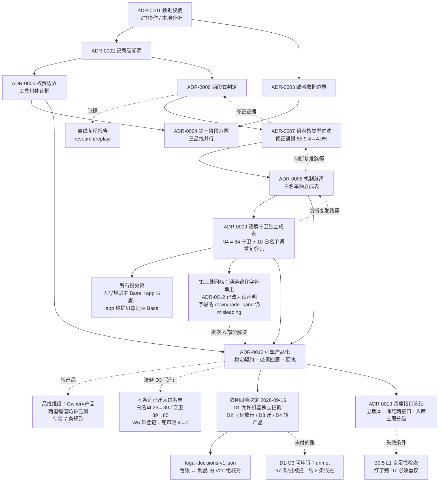

# ADR 索引

> 本目录记录**每一个影响后续工作的决策**。
> 格式与变更流程参照 `research/method/Kb2Agent/docs/architecture/adrs/`。

## 规则

1. **新决策创建新 ADR** —— 不静默改写已接受 ADR 的结论。
2. 替代旧决策时填写 `supersedes`，旧 ADR 改为 `superseded` 但**保留原文**。
3. 任何**提高权限、改变权威存储、改变证据语言、开放外部输入**的 ADR，
   必须由 Owner 重新确认。
4. **ADR 被接受只代表设计决策已定**，不代表已实现、已验收或可上生产。
5. **开发者的异议必须留档**：即使决策与建议相反，建议原文与其依据也保留在 ADR 内，
   供日后复盘判断选择与其代价。不因决策已定而删除异议。
6. 状态取值：`proposed`（待决） / `accepted`（已决） / `superseded`（被取代） / `rejected`（否决）

## 当前决策台账

| ADR | 决策 | 状态 | 日期 |
|---|---|---|---|
| [ADR-0001](./ADR-0001-数据权威与双账本.md) | 飞书为操作账本、本地为分析账本 | **`accepted`** | 2026-09-16 |
| [ADR-0002](./ADR-0002-记录级溯源与版本化.md) | 知识单元必须记录级溯源 + 内容指纹 | `proposed` | 2026-09-16 |
| [ADR-0003](./ADR-0003-敏感样本分级准入.md) | 敏感样本按分级准入，默认不入共享库 | `proposed` | 2026-09-16 |
| [ADR-0004](./ADR-0004-第一阶段范围.md) | 第一阶段三品线并行（**开发者建议收窄，未采纳**） | **`accepted`** | 2026-09-16 |
| [ADR-0005](./ADR-0005-工具只补证据不替人过门.md) | Agent 只补证据，不替人通过判定 | `proposed` | 2026-09-16 |
| [ADR-0006](./ADR-0006-两段式判定而非单张词表.md) | 判定用两段式（宽召回 + 降噪），不用单张词表 | **`accepted`** | 2026-09-16 |
| [ADR-0007](./ADR-0007-判定词表按规则类型过滤.md) | 判定词表必须按规则类型过滤（排除安全词/停用规则） | **`accepted`** | 2026-09-16 |
| [ADR-0008](./ADR-0008-机制分离白名单独立成表.md) | 机制分离：白名单独立成表；第二段法务定规则+开发者实现；RSA 素材不落库 | **`accepted`** | 2026-09-16 |
| [ADR-0009](./ADR-0009-语境守卫独立成表.md) | 语境守卫独立成表（机制分离第 2 处）＋ 所有权分离（app 自有词表 Base） | **`accepted`** | 2026-09-16 |
| [ADR-0010](./ADR-0010-需求知识库权威源与归一化边界.md) | 需求知识库：双账本投影 · 1160 条台账口径（1023 顶层 + 137 子任务）· 三处「不合并」 | **`accepted`** | 2026-09-16 |
| [ADR-0011](./ADR-0011-落地页内容获取的边界与节流.md) | 落地页内容获取：三层自适应节流 · 熔断 · 内容指纹建在提取后正文上 | `proposed` | 2026-09-16 |
| [ADR-0012](./ADR-0012-判定引擎产品化与处置分层.md) | 判定引擎产品化：稳定契约（位置/证据/版本/边界）· 处置**五层**映射（DP0–DP4，原名 L1–L4）· 每次判定留回执 · 结论**出口**与申诉政策 · 法务四项 + Owner 七项决定落地 | **`accepted`** | 2026-09-16 |
| [ADR-0013](./ADR-0013-基座接口冻结与仓库入库分级.md) | 基座：**第一刀 = 立版本 + 冻结两个接口**（判据是「会不会返工」而非「大不大」）· 飞书 Base 唯一权威、本地 JSON 只读投影（单向 + 指纹 + 冲突报错）· 图片/视频先只做**文本化** · 4 类知识库从**措辞表达库**起 · 仓库**三层分级**（L1 入历史 / L2 入盘不入历史 / L3 永不入盘）· 凭据移出项目目录 · `ContentUnit` **双指纹** | **`accepted`** | 2026-09-17 |

## 决策地图

*（0009 由 0008 的遗留 #1 触发；实施中一并测出「app 对自己创建的 Base 有完整写权限」，
于是机制分离顺带做成所有权分离 —— 见 ADR-0009 §七。）*

*（0004 的范围决策依赖 0001/0003/0005；0006 由离线复现报告的证据直接推出；
0007 由确认 0006 第 3 条的过程发现，反向修正 0006 的证据表；
0008 由 0007 的遗留待决 #3 触发，实施中发现同样的病还有第二、三处。）*

## 决策与证据的对应

| ADR | 主要证据来源 |
|---|---|
| ADR-0001 | 飞书 API 无内容指纹/无 diff/无回放能力（实测） |
| ADR-0002 | 21/21 规则「依据来源」全是文件名；2 条记录引用 `EMPTY` |
| ADR-0003 | 8 条可见样本含「婴儿口含硬币」等真实风险素材 |
| ADR-0004 | 三品线数据分布实测；21/21 规则适用产品全是吸奶器型号 |
| ADR-0005 | 130 条 `命中原因` 平均 118 字的人工裁量理由 |
| ADR-0006 | `research/replay/离线复现报告-20260916.md`（留出检验推翻主实验）；逐字核验实测 95.2%（257/270） |
| ADR-0007 | 负例逐条归因：56/57 误报来自安全词白名单；剔除后误报 3.1%（三口径稳健） |
| ADR-0008 | 白名单 26 词中 10 个被**人工抄进** 4 条规则的 `豁免词`（= 有受益人）；14 个孤儿；`豁免词` 内 84/94 是语境守卫 |
| ADR-0011 | 92 个落地页实测：节流策略 1.2s/域 → 30.4%，6s 全局 → 100%；原始 HTML 指纹 3/3 变化 vs 提取后正文 3/3 一致 |
| ADR-0012 | 引擎接口盘点实测 16 项缺口；**放行带在存量 291 条上触发 0 次**（`pass_of()` 全仓无消费者）；匹配原语重构 7275 次差分 **0**；改造前后 P/R/F1 与 CATCH-ALL **逐项一致**；验收 47/47（批次 A）→ 75/75（法务四项）→ **102/102**（Owner 七项） |
| ADR-0012 · D3 | 4 词迁移：白名单 26→30、守卫 89→85、G3 违反 4→0、**W5a 死声明 4→0**；存量语料差分 **0/291**；四词构造正对照全部 `auto_reject`/`manual_review` → `auto_pass` |
| ADR-0012 · D1/D2/D4 | 处置表 `ratified`（Q1 允许机器独立拦截，67 条/批被拦、约 2 条误拦）；T6.1 维持放行（291 条无一条含 T6.1 判险词）；品线转产品（语料 289/291 单一品线，代理语料上 5 条规则跨品线命中） |
| ADR-0012 · D5–D11 | catch_all 拆两路：**DP0 = 59 条（20.3%，$15,747，全是 PLA 无文案）**、空白清单由 159 修正为 **100 条（34.4%）**；ESC-003 维持关闭（实测净新增仅 5 单且是普通多主题广告）；层级 ID `L`→`DP`（两个 L 命名空间语义相反）；`FDA registered` 改降级（存量 0 次命中，前瞻性）；申诉政策落地、**送达管道仍 unmet**；飞书同步 85/30/4 且**修掉「跑第二次整表翻倍」与其验证盲区** |
| ADR-0013 | 只读盘点实测：`git rev-parse` → `not a git repository`（上级目录亦无 `.git`，根目录无 README/构建清单）—— 14 ADR / 161 验收 / 291 条差分全部无版本历史；安全面实测：`PMO/腾讯云-周健-SecretKey.csv` 92B 真实凭据、浏览器 profile 五处共 **228M**（含 `Trust Tokens`）、`research/governance/` 1.1G、`skills/` 682M、`.vendor/` 869M、4 个嵌套第三方 `.git`；证据寻址实测：`raw/html-a520e6ca17ab4d1d.gz` —— 文件名即指纹 |
| ADR-0009 | 读写权限对照实测（主 Base 写全部 403·91403；app 自有 Base 写全部 ✅）；搬迁等价性逐词一致 + `score.py` 输出 2762 字节逐字节相同；G3 违反 4 词 |

## 字段级事实（实测，供后续 ADR 引用）

| 事实 | 值 | 取数方式 |
|---|---|---|
| `命中规则` 字段类型 | `type=1` 多行文本（**非多选**），现用逗号分隔多值 | `lark_find.py fields` |
| `命中规则` ↔ `命中片段` 自洽度 | **132/132 完全一致**（片段前缀可完整推导规则集） | 全量比对 |
| `命中片段` 格式 | `/` 分规则组 · `RULEID:` 前缀 · 组内 `,` 分短语 | 实测样例 |
| `命中片段` 逐字可核率 | 分母 270 真实短语（另有 4 条 `EMPTY` 哨兵属合法不可核）｜**朴素子串 95.2%（257）** ｜ **严格词边界 90.0%（243）**；差 14 处**全是屈折/复合形态**（`schmerzfrei`→`Schmerzfreies`、`hospital`→`Hospitalière`、`krankenhaus`→`Krankenhausqualität`）｜归一化额外救回 **0** | 逐条断言 |
| ★ 核验口径的归属 | **法务定**（屈折/复合算不算证据是语义决定，不是正则写法）—— 见 ADR-0008 §三 | — |
| 白名单词表规模 | 26 词 = **22 active + 4 隔离**（`reduces pain`/`less pain`/`gentle`/`comfort`） | `whitelist-v1.json` |
| 白名单有受益人者 | **10 / 26**（被人工抄进 H06/H07/M01/M02 的 `豁免词`）；**孤儿 14** | 交叉比对 |
| `豁免词` 字段构成 | 白名单类 **10** ｜ 语境守卫类 **84**（**89% 是另一种机制**） | 交叉比对 |
| ★ 语境守卫表规模 | **89 词** = 46 已接线 + 39 待法务定性 + 4 走错通道；现网侧 84 ＋ 骨架独有 5 | `context-guards-v1.json` |
| ★ G3 违反（守卫落在放行带） | **4 词**：`FDA 注册` `silent mode` `静音模式` `suction settings` —— 待 Owner/法务裁定 | `lint_context_guards.py` |
| ★ 写权限边界 | 对**用户拥有的** Base：读 `code 0`／写 `403 · 91403`。对 **app 自建的** Base：全部 ✅ | 8 项读写实测 |
| ★ 规则文件词表持有量 | **0** —— `rules-v1.json` 只剩 `match.keywords` 与 `effect`；放行词/降级词各由独立表组装 | `vocab.py` |
| 有命中记录的素材形态 | **126/130（97%）是 RSA 形态**（含 `\|` 或 `{Keyword:}` 占位符） | 形态识别 |
| 逐字缺失的成因 | **6/6 缺失记录都是 RSA**（97% 记录是 RSA 形态）；**曾把其中一条误判为「跨语种」，已更正** | 逐条复核 |
| 规则库规模 | 21 条规则；6 条从未被引用（H01/H03/H06/H08/U02/安全词） | 交叉比对 |
| 孤儿引用 | 仅 `EMPTY`×2（哨兵值，非规则） | 交叉比对 |
| `命中原因` 与 `命中规则` 的差异 | 30/130 条；其中 M07×28 是**语境守卫引用**而非漏填 | 逐条读原文 |
