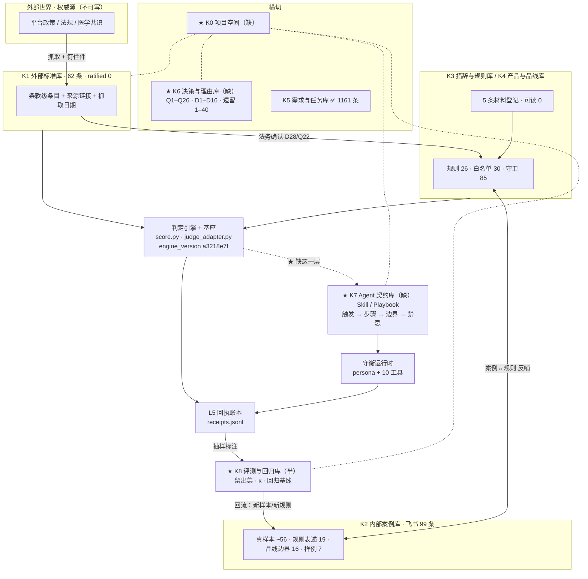

# 守衡 · 创建全景图与知识库体系（讨论稿 v1）

> **性质**：讨论稿。不是 ADR，不是执行令，不改任何代码。
> **基准**：2026-09-17 实测。所有飞书读数由 `open.feishu.cn` 应用身份实时拉取；复现命令见 §附录 A。
> **一句话**：现在的知识库不是"一个库分四类"，是**四个 Base、十六张表、两套所有者、六个正交用途被压在同一批表名下面**——而这正是本项目一直在抓的那类缺陷，只不过这次它长在知识库自己身上。

---

## 一 · 你问的事，实测答案

### 1.1 「统一的飞书多维表格」建成没有

**建成了一半。而且它是"四个 Base"，不是"一张统一表"。**

实测：`4 个 Base / 16 张表 / 1787 条记录`。

| Base | 表 | 条数 | 谁写的 | app 权限 |
|---|---|---:|---|---|
| **吸奶器广告文案·品线内容边界风控**<br>`Lk3Qb8y2QaVyZns6gprcVNE9nA0` | 广告文案明细 | 291 | 业务/投放 | 只读 |
| | 品线内容边界规则库 | 21 | 法务+业务 | 只读 |
| | W1卖点表达边界（品线反馈0910） | 19 | 吸奶器品线 | 只读 |
| | 风险文案改写建议库（分型号分渠道） | 52 | 业务 | 只读 |
| **内容治理-知识库**<br>`GnRZbIuXraCzf0sGr2UcmZ62nfc` | 知识库分类说明 | 5 | 业务 | 只读 |
| | 材料收集 | 28 | 业务（Emma/Misty/银舒涵…） | 只读 |
| | **正面和负面样本** | **99** | 业务 | 只读 |
| **品线内容边界-机器词表**<br>`B1oabL2veaFKbKs2hVAcvyKKnEe` | 语境守卫词 | 85 | app | **读写** |
| | 白名单词 | 30 | app | **读写** |
| | 词表分工说明 | 4 | app | **读写** |
| **需求知识库**<br>`A437bIdQfax7dbsyrAncPpbNnjh` | 需求台账 | 1161 | app（投影） | **读写** |
| | 覆盖报告 | 18 | app | 读写 |
| | 知识库分类 | 4 | app | 读写 |
| | 材料收集 | 15 | app | 读写 |
| | 收集任务 | 5 | app | 读写 |
| | 数据表 | 10 | app | 读写 |

**「统一」这件事**：四个 Base 里**没有任何一格指向另一个 Base**。没有引用字段、没有导航页、没有共享的分类轴。
一个想回答「这条需求有没有对应的正负样本」的人，要在 4 个 Base 之间手工跳三次，而**跳过去的钥匙（产品线名 / 品线族名 / 型号名）三处叫法都不完全一样**。

**另外，公司有 Wiki 知识库空间，但 app 看不见**：解析材料里的 wiki 链接得到 `space_id=7647360568520657850`，但 `GET /wiki/v2/spaces` 返回 0 条、`get_node` 对多数节点返回 `131006 permission denied`。
**所以「公司一共建了几个知识库」这个问题，以当前应用身份答不了** —— 只能答「app 自己建了 2 个 Base，业务侧可见 2 个 Base，Wiki 侧不可枚举」。这条限制本身要写进结论，不能含糊过去。

---

### 1.1b ★ 你特别问到的那一项：**「需要各业务决策的事项」没有统一落点**

这是本次最直接的一个答案：**没有建成，而且它今天散在三处、三套格式、互不引用。**

| 登记处 | 条数 | 载体 | 装的是**谁**的决定 |
|---|---:|---|---|
| `$decision_queue`（`legal-decisions-v1.json`） | **26** | **本地 JSON，不在飞书** | Owner 11 · 法务 6 · 开发 3 · **业务/产品 1** · 其余为 Owner 兼任 |
| `缺口-v1.json` | **16** | **本地 JSON，不在飞书** | **各品线负责人、法务 Sharon、专家 Emma、Roxie/Rikka、投放侧、品牌张丽敏…** |
| `需求知识库.收集任务`（飞书） | **5** | 飞书 Base | 4 类知识库各一条 + 1 条跨类权限；**状态全部「未启动」** |

**两个要命的读数：**

1. **`$decision_queue` 26 条里，`line` 分布是 `engine 22 / kb 3 / repo 1` —— 一条"各品线业务侧"的决定都没有。**
   它装的全部是引擎、法务、Owner 的决定。而**真正需要业务侧拍板的 8 条（D3 权限 / D4 品线口径 / D5 空壳表 / D6 七个品线零证据 / D7 正负样本 / D8 法务确认 / D14 条目确认 / D9 源表口径），全部躺在本地 `缺口-v1.json` 里，不在飞书，也不在决策队列里。**

2. **飞书上唯一"面向业务方"的那张表（`收集任务`）只有 5 行，且状态全是「未启动」。**
   它的内容还是 09-16 推的，此后本地 `知识库-v1.json` 已经重算过两轮（外部标准库 0→62 条），**飞书那 5 行没跟着变**。

> **结论**：今天要回答「一共有多少件事在等业务方回应」，必须打开**两个本地 JSON**（一个 26 条、一个 16 条）、**自己按 `owner` 字段过滤**、**再加上飞书那 5 行**。
> 而这三处的 ID 体系互不引用（`Q#` / `D#` / 无编号）。
> **x.com 那篇文章里「每一次评审，都会更新一部分项目事实……什么时间？哪次会议？为什么调整？」要的正是这个 —— 本项目有这套记录，但它没有一张给业务方看的表。**

---

### 1.2 现在有几个知识库、怎么分类的

**取决于你问哪一层，有两个都不算错的答案：**

**(a) 业务侧定义的分类 = 4 类**（`内容治理-知识库.知识库分类说明`，5 行 = 4 类 + 1 空行）

外部标准库 · 内部正面与负面样本库 · 措辞表达库 · 产品描述库

**(b) 实际在跑、被当作"库"用的东西 = 至少 14 处**

- 飞书 4 个 Base 的 16 张表（上表）
- 本地 `research/governance/skeleton/` 的 12 个制品（规则/白名单/守卫/处置层/品线/决策台账…）
- 本地 `research/kb/` 的 8 个登记与台账
- 本地 `ADR/` 的 14 个决策文件
- 本地 `base/` 的基座契约与自证
- `skills/内容合规审查/SKILL.md` 一页规程
- **而 Wiki 知识库：不可枚举**

**(a) 与 (b) 之间的落差，就是这一轮真正要讨论的东西。**
现在的状态是：**分类是给"素材"分的，而实际在跑的东西远不止素材。**

---

### 1.3 需求调研知识库建成没有

**建成了「是什么」，没建成「为什么」和「还不知道什么」。**

| 目标 | 验收 | 状态 |
|---|---|---|
| **G1 存在性** —— 所有在跑记录可枚举 | 台账 1160 条 = 顶层 1023 + 子任务 137；逐条回读零丢失/零重复/零错位 | ✅ **建成** |
| **G2 关联性** —— 每条能指回来源 + 知道有没有本地证据 | 溯源四元组 100%；证据关联可重算 | ✅ **建成** |
| **G3 可用性** —— 不读代码就能回答 10 条黄金问题 | 查询手册 10/10 可答 | ✅ **建成**（第 7 条答"做不到"，这也算答） |

**但"需求调研"在 x.com 那篇文章里的定义是另外一件事。** 它指的是：
> 客户最关心什么 / 领导为什么要做这个方向 / 研发觉得哪个方案贵 / 公司内部当前优先级 ——
> 「**你知道，不等于 AI 知道**」。

按这个定义，本项目建成的是**任务台账**（有哪些需求、谁在做、卡在哪），**没建成的是认知台账**（这些需求背后的人怎么想、为什么这么定）。

而这块其实**已经有料，只是没成库**：`legal-decisions-v1.json` 的 `$decision_queue` 有 **26 条决策（22 已答 / 4 待决）**，每条的 `option.impact` 和 `default_if_unanswered` 都写得很细 —— 这已经是一份高质量"为什么"的记录了，**但它不在需求知识库里，也不在任何知识库分类里**。

---

### 1.4 PMO 知识库 / Agent 核心知识库建成没有

**都没有。而且这是同一件事的两面。**

**PMO 知识库 = 没有。** `PMO/` 现在装的是**运维文档**：1 份架构说明、6 份修复记录（发送者身份/回复截断/时间基准/查名/看不见的东西）、1 份打通测试报告、1 份阶段性复盘。
这些是"这个 bot 怎么运维"，不是"这个项目现在是什么、已经知道什么、还不知道什么"。

**Agent 核心知识库 = 没有。** 守衡此刻能读到的全部"知识"是：

| 它有什么 | 位置 | 形态 |
|---|---|---|
| 人格与行为约束 | `tools/agent/persona.mjs` | 一段手写系统提示词 |
| 10 个工具 | `tools/agent/tools.mjs` | 只读（其中 `judge_copy` 会写回执，是定义的一部分） |
| 会话记忆 | `PMO/shouheng-state/` | 按会话隔离的对话历史 |
| 判定引擎 | `judge_copy` → `base/judge_adapter.py` → `score.py` | **唯一真正的领域能力** |

它**没有 Skill 层、没有检索层、没有知识注入**。它能"判一条文案"，但不知道怎么把"判一条文案"组织成一次完整的审查工作；也不知道 4 类知识库、62 条外部标准、99 条样本、26 个决策的存在。

**这正是 Kb2Agent 链条里 L3（Skill / 可执行契约）那一层的缺失**（见 §五）。

---

## 二 · 本次实测新发现的五件事

### 发现 1 ★★ 「内部正面与负面样本库」不是空白 —— 它有 99 条，而本地台账说它是空白

| 读数来源 | 读数 |
|---|---|
| 本地 `research/kb/知识库-v1.json`（生成于 09-17） | **「无法判定：证据落盘件自相矛盾（抬头声明 8 条，盘上 5 条）」** · 状态「空白」 |
| 本地证据 `_evidence/正负样本.raw.txt` | `total=8，样例 7` |
| **飞书实况（09-17 20:2x 拉取）** | **`total=99`，样例仍是 7** |

**样例数没变（7），真实记录从 1 涨到 92。**
也就是说：**在 09-16 那次快照之后，业务方往这张表里灌了 91 条真实记录**，其中 91 条带「来源链接」、91 条带「渠道/市场」、92 条带「审核人」。

这不是「台账算错了」，是**台账是快照，而业务方还在长**。但它暴露一个结构性问题：

> `知识库-v1.json` 的写法是「**定义是抄的，现状是算的**」。
> 但「算」的输入是**本地快照**，不是**飞书实时**。
> 于是「现算」这句话在**输入本身过期**时，会产出一个**看起来同样可信**的假结论。
>
> **更糟的是它的形状**：一个被写成「空白」的知识库，恰恰是最不容易被复查的那一个——
> 没人会去核实"空白"是不是真的空白。

### 发现 2 ★★ 那张 99 条的表其实装着六类东西，其中 35 条根本不是样本

把 99 条按备注形态分类，实测：

| 类 | 条数 | 实际是什么 |
|---|---:|---|
| ③ 消息池抽取（备注=`价值评分: N；涉及消息数: M`） | 31 | 从群聊/消息按价值分抽的**线索** |
| ④ 素材审核意见（备注=`Draft V1 审核意见` / `Script V2 审核` …） | 25 | 真实素材的**审核记录** |
| ② **规则标准表述**（备注=`规则H01 - 医疗功效声明（高危红线）` …） | **19** | **H01–H09 / M01–M07 / U01,U03,U04 的规则定义文本** |
| ⑥ **W1 品线表达边界**（备注=`W1-01 绿色-可用：温热体验表述` …） | **16** | **W1 六个卖点 × 绿/黄/红 三色表达清单** |
| ① 模板样例 | 7 | 表格自带示范 |
| ⑤ 备注空 | 1 | |
| | **99** | |

**这张表同时是三样东西：样本库 + 规则的自然语言定义 + 品线表达边界表。**
它不叫"分类混乱"，它叫**一张表压了三个正交问题** —— 和 `材料收集` 表把「是不是知识材料」与「属于哪一类」压成一列（ADR-0013 §16.1 已拆）是**同一个病**。

而 ⑥ 那 16 条是 `heldout_test.py` 的**留出集 1 的来源**（`风险文案改写建议库` / `W1卖点表达边界`）。也就是说：**评测用的留出集，一半躺在了一张名叫「样本」的表里，而登记表没把它算进任何一类。**

### 发现 3 ★★★ 同一批规则有「四份文字表述」，互不对账

飞书那 19 条规则表述里，`规则H01` 的正文写着：

> 医疗功效声明：治疗/治愈/诊断/疏通堵奶/治疗或预防乳腺炎。禁止宣称 unclog ducts、treat mastitis、cure engorgement、热敷治疗堵奶等。
> **边界允许：缓解涨奶（ease/relieve engorgement）、降低堵奶风险（reduce the risk of clogged）、支持奶阵（let-down）。**

而实测把四处的表述并排放在一起，它们是**四份不同粒度、四份互不引用**的东西：

| # | 住哪儿 | 字段 | 一个 H03 长什么样 | 读者 |
|---|---|---|---|---|
| **①** | `skeleton/rules-v1.json` | `match.keywords` + `disposition` + `severity` + `downgrade_band` | **9 个关键词**，可执行 | **引擎** |
| **②** | 主 Base `品线内容边界规则库`（21 条） | `边界内容` | 「**未经备案的临床/科学背书**」——一句话 | 人 |
| **③** | 业务侧 `正面和负面样本`（表里的 19 条） | `具体原因/分析` | **一整段**，含「边界允许：…」「放松叙事+限定语可走审慎关注」 | 人 |
| **④** | 主 Base `风险文案改写建议库`（52 条） | `规则依据与边界` | 「**H02 红：**裸 more milk/增产/催产素/长期奶量/裸奶阵排空承诺禁止；**放松叙事+限定语（may/natural/可能）可降黄（M07）**」 | 人 |

**③ 和 ④ 里写着引擎读不到、而判定最需要的东西**：
「**什么可以说**」（`边界允许：ease/relieve engorgement`）和「**什么条件下可以降级**」（`放松叙事+限定语 可降黄 (M07)`）。
这两类语义，决定了 `Warmth & Massage to Relax` 是被拦下还是被放行 —— 而这正是最难、最贵、最容易出错的部分。

**它们不是矛盾，是四份各自演化、谁也没跟谁对过账的文本。**
其中 ③ 住在一张名叫「**正面和负面样本**」的表里 —— **一个想找规则边界的人，不会想到去那里找。**

> 这不只是"文档不同步"。它意味着：**规则的权威文本不在规则表里。**
> 任何"改一条规则"的动作，今天最多只能改到 ① 和 ②，而 ③ ④ 会**静默地停在旧语义上**，
> 并且看起来完全正常 —— 因为它们是散文，没有版本、没有检查、没有指纹。

### 发现 4 ★ 飞书投影落后于本地 —— 方向反了

`需求知识库.知识库分类`（app 投影，4 行）里写着：

> 外部标准库 = 「**0 条结构化**」
> 内部正面与负面样本库 = 「**8 条，其中 7 条备注写「样例」→ 实质为 0 条真实样本**」

而本地 `知识库-v1.json`（09-17 重算）写着：

> 外部标准库 = 「**62 条已入册**」
> 内部正面与负面样本库 = 「无法判定：落盘件自相矛盾」

**飞书上是 09-16 的旧值，本地是 09-17 的新值。**
按 ADR-0013 §三，方向应当是「飞书权威 → 本地只读投影（单向）」。
实际是**本地算完了没推回去**，于是同一个问题在两个地方有两个答案，**且没有人被通知**。

---

### 发现 5 ★★ 「错题本」的 schema 是对的，但**没有人在填**

`errorbook.csv` 有 25 列，设计是合理的（含 `人工复判结论 / 复判人 / 复判时间 / 处置码 / 处置人 / 处置日期`）。
实测填充率：**这六列全部 `0 / 177`**。源表侧的 `检查人` 同样是 **`0 / 291`**。

**后果**：引擎的精度数字（`0.970 / 0.962 / 0.966`）**只能来自一次冻结的 V13 基线，不能随时间积累**。
也就是说 —— **K8 的瓶颈不是"设计一个评测库"，是"让复判真的被填进去"**。
这与 Q33 的方案选择直接相关：先做 κ 只是治标，**没有回填机制，任何评测集都会在第 N 天变成一张冻结快照**。

同一形态的另一例：`base/sync_rules.py --verify` 已交付、自证全绿，但**不在任何自动路径上**（`verify_base.py` 的 A 面只跑 `--selftest`）。
—— 本项目反复出现的「声明了没实现」，这一次的形态是「**实现了但没接线**」。

---

## 三 · 为什么业务侧的「4 类」不够：三个结构性问题

要先说清楚：**业务侧的 4 类本身没有错**。它回答的是「我们要攒哪些素材」——这个问题它答得很好，而且有 owner、有字段建议、有待收集问题，质量高于多数企业的同类文档。

它不够，是因为**它只覆盖了整条链的一层**。

### 问题 1：它的分类轴混了两个问题

| 类名 | 分的其实是 |
|---|---|
| **外部**标准库 | 按**来源**分（外部权威） |
| **内部**正面与负面样本库 | 按**来源**分（内部经验） |
| **措辞表达**库 | 按**内容主题**分 |
| **产品描述**库 | 按**内容主题**分 |

「来源」与「主题」是两个正交问题。压在一个字段里之后，就会出现**没有家**的东西：
`品线内容边界-机器词表`（85+30 条）按主题是"措辞表达"，按来源是"机器生成"，**它不属于任何一类，于是它不在 4 类里，也不在登记表里**。

> 这与 ADR-0013 §16.1 拆掉的那个「待分类」是同一个病，只是换了个位置。

### 问题 2：它漏掉了「机器读的那一层」

判定引擎实际读的是：`rules-v1.json`（26 条规则）+ `whitelist-v1.json`（30 词）+ `context-guards-v1.json`（85 词）+ `disposition-layers-v1.json` + `product-lines-v1.json`。

这 5 份制品**没有一份出现在 4 类里**。它们被登记在 `ADR-0013` 和 `verify_base.py` 里，用的是另一套语言（L1/L2 入库分级、derived/primary）。

**结果**：一个业务方问"我们的措辞表达库现在有什么"，得到的答案是"吸奶器 21 条规则"——而**真实在跑的是 26 条规则 + 30 词白名单 + 85 词守卫，且守卫有 39 条没接线**。数字对不上，不是谁错了，是**两套账本各自记了一半**。

### 问题 3：它漏掉了「凭什么」和「怎么用」

4 类回答"我们懂什么"。但一个能跑的 Agent 还需要另外三样：

| 缺的东西 | 本项目已有的原料 | 现状 |
|---|---|---|
| **凭什么这么判**（决策与理由） | ADR 14 份 + `$decision_queue` 26 条 + `缺口-v1.json` 16 条 + ADR 遗留 ≈83 行 | **有料，三套 ID 体系（D#/Q#/遗留#）互不引用，未成库** |
| **Agent 拿它做什么**（Skill 契约） | `skills/内容合规审查/SKILL.md` 一页 | **只有一页，且只覆盖文本一条路径** |
| **怎么知道它判对了**（评测与回归） | `offline_replay.py`（P/R/F1）+ `heldout_test.py`（留出检验）+ 291 条已人工判过的语料 | **有零件，无制品；κ 一致性从未实测** |

---

## 四 · 提议的知识库体系：两根轴 + 九个库

### 4.1 两根轴（每一格都必须同时答两个问题）

**轴 A · 这条知识为谁生产？**
- `M` 给**判定引擎**读的 —— 结构化、可执行、有版本
- `A` 给 **Agent 运行时**读的 —— 契约形态（何时触发、怎么做、边界在哪）
- `H` 给**人**读的 —— 用于决策、追溯、学习
- `X` 人和机器都读，但**读法不同**

**轴 B · 谁有权改它？**
- `E` **外部**权威（法规/平台政策/行业标准）—— 我们只能引用与确认，不能改
- `I` **内部**权威（业务/法务的判断）
- `D` **算出来的**（投影，可重算，改了会被检查抓住）

### 4.2 九个库（K0–K8）

| # | 知识库 | A 轴 | B 轴 | 装什么 | 谁写 | 已存在？ |
|---|---|---|---|---|---|---|
| **K1** | **外部标准库** | M+H | E | 法规/平台政策/行业标准/医学共识的**条款级条目**（来源链接+抓取日期+确认状态） | 研究者起草，**法务确认** | ✅ 62 条（ratified **0**） |
| **K2** | **内部案例库** | M+H | I | 正例/反例/审核争议/返工，**每条带原文或截图** | 业务+品线 | ⚠️ 飞书 99 条（真样本 ~56），本地台账说"空白" |
| **K3** | **措辞与规则库** | **M** | I | 规则本体、白名单、语境守卫、品线表达边界 | 法务+业务定规则 / app 维护机器词表 | ✅ 26 规则 / 30 白名单 / 85 守卫（**39 未接线**） |
| **K4** | **产品与品线库** | M+H | I | 品线/型号/卖点/边界/认证/FAQ/常见误解 | 各品线 + 专家 | ❌ 5 条材料登记，**可程序读取 0 条**（131006） |
| **K5** | **需求与任务库** | H | D | 需求台账、覆盖报告、缺口登记 | app 投影 | ✅ 1161 条 |
| **K6** | **决策与理由库** | H+A | I | 每个决定的**问题、选项、代价、裁定、理由、沉默等于什么** | Owner + 法务 | ❌ 原料齐（26+16+83），**未成库** |
| **K7** | **Agent 契约库** | **A** | D | Skill/Playbook：触发条件→执行步骤→边界→禁忌；工具契约 | 开发者（法务确认边界） | ❌ **只有 1 页，只覆盖文本路径** |
| **K8** | **评测与回归库** | M+H | I+D | 留出集、金标语料、κ 一致性、回归基线、每次评测的回执 | 测试 owner + 独立标注人 | ⚠️ **有零件无制品**：`offline_replay.py`（P/R/F1）+ `heldout_test.py`（留出检验）；**κ 从未实测**；金标数据源已存在——主 Base `广告文案明细` 291 条带 `风险等级`（绿 99/红 74/黄 21/灰 6）+ `命中规则` + `命中片段` + `检查人` |
| **K0** | **项目空间（PMO 知识库）** | H+A | D | **横切**：现状/已知/未知 + 协作规则 + 导航到 K1–K8 | Owner + 开发者 | ❌ 无 |

### 4.2b 交叉验证：K0–K8 与企业 Agent 调研得出的「八层分层候选」对得上吗

调研报告（`kb2agent-research/企业Agent知识库体系调研报告.md` §6.1）从 6 家企业知识助手里归纳出八层。把两套并排：

| 调研归纳的八层 | 多数/少数派 | 本方案对应 | 备注 |
|---|---|---|---|
| **L0 源与权威** | 多数 | **K1 + 「谁是权威」声明** | ★ 调研指出的**最贵失败模式**（Air Canada）就死在这层；本项目的发现 3 是同一形态 |
| **L1 接入**（同步型 vs 联邦型） | 多数 | K1/K2/K3 的抓取与投影 | 本项目已有 ADR-0011 的三层节流 |
| **L2 索引**（词法+语义+元数据） | 多数 | — | **守衡今天没有检索层**，靠规则表直查；不构成阻塞 |
| **L3 权限/一致性等级** | 多数 | **缺失，需补声明** | Microsoft 24h / Atlassian last-mile / Glean 三档；**守衡必须表态** |
| **L4 规则与阈值** | **合规类必有**，知识助手普遍不显式建模 | **K3**（本项目最强的一层） | 阈值需自带「校准日期 + 模型版本」 |
| **L5 先例与申诉** | **行业最大空白** | **K2 + K6 + 回执账本** | ★★ **守衡已有，这是最硬的差异化** |
| **L6 程序与工具（Skill）** | 多数 | **K7**（缺） | 调研的「可执行 + 可审计」= 本项目的处置层与回执 |
| **L7 记忆与状态** | 多数 | 守衡 `memory.mjs`（按会话隔离） | 已有；与知识库正交 |
| **L8 评测与回归** | **横切** | **K8 + 七套 `verify_*.py`** | 基座自证已强，**能力评测缺** |

**两套分类互为独立推导，结论重合度很高**（L4↔K3、L6↔K7、L8↔K8、L5↔K2+K6）。
**唯一的实质差异是 L0**：调研把它单列为首层并指出它是**失败率最高的一层**，而本方案的 K1 只覆盖了 L0 的"外部"那一半 ——
**"内部谁是权威"这一半（发现 3 的四份规则文本）在两套分类里都没有位置。这是本方案要补的一块，建议在 K3 里显式加一列 `authority`。**

---

### 4.3 与现有 4 类的关系：不是替换，是分层

```
业务侧 4 类 ─────────►  K1 外部标准库
                        K2 内部案例库      ← 4 类覆盖的是这一层（"素材"）
                        K3 措辞与规则库
                        K4 产品与品线库

本项目自建 ──────────►  K5 需求与任务库    ← 已建成
                        K8 评测与回归库（半）

从来没建 ────────────►  K6 决策与理由库    ← 缺
                        K7 Agent 契约库    ← 缺（这就是"Agent 核心知识库"）
                        K0 项目空间        ← 缺（这就是"PMO 知识库"）
```

**一句话概括新增的三个**：

> 现有 4 类回答「**我们懂什么业务**」，K5 回答「**我们在做什么**」。
> 缺的三个回答：「**我们凭什么这么判**」（K6）、「**Agent 拿它做什么**」（K7）、「**怎么知道它判对了**」（K8）。
> K0 是那个把九个库串起来、并且**明确写出"还不知道什么"**的地方。

### 4.4 K0 项目空间（PMO 知识库）具体装什么

按 x.com 那篇文章（《2026 产品经理 AI 实践手册》，`run_maotui`）的「项目初始化」逻辑 + 本项目的实际，六件：

| # | 装什么（对应文章原话） | 本项目现状 |
|---|---|---|
| 1 | **这个产品现在是什么** | 散在 ADR-0013 §一 / 复盘 / README，**没有一份活的** |
| 2 | **已经知道什么** | ADR 14 份 + `$decision_queue` 22 条已答 ✅ **很强** |
| 3 | **还不知道什么** | `缺口-v1.json` 16 条 + `$decision_queue` 4 条 open + ADR 遗留 ≈83 行 ⚠️ **三套 ID 互不引用** |
| 4 | **「什么时间？哪次会议？为什么调整？」** | 在 ADR 里有，但**没有按需求/项目索引**，只能按 ADR 编号找 |
| 5 | **协作规则**：什么能当事实 / 文件放哪 / 改了要同步什么 | 「什么能当事实」在 ADR-0013 §三 有；**后两条完全没有** |
| 6 | **节奏**：谁在什么时候被问什么、多久重算一次 | 无 |

**第 3 条是当前最痛的一处**：三套未决登记（`D1–D16` / `Q1–Q26` / `遗留 1–40+`）**互不引用**。
一个 Owner 想知道"现在一共欠我多少个决定"，要打开三个文件、三种格式、自己数。

#### 一个没预料到的呼应：文章的「两类读者」= 本项目的「双账本」

文章里有一句很重要的话，值得单独标出来：

> **「PRD 开始有两类读者……同一份结构化内容，我现在会生成一份适合人阅读的 PRD，也可以保留一份信息更完整的 Markdown，给研发和测试的 Agent 继续使用。」**

本项目**独立地发明了同一件事，但只发明在数据层**：ADR-0001 的「飞书操作账本 / 本地分析账本」，ADR-0013 的「飞书唯一权威 → 本地只读投影」。

**它没有被推广到文档层。** 今天的产物全部是"一类读者"：
- `SKILL.md` 是给人读的，Agent 读它要自己解析
- 台账是给人和脚本读的同一份
- ADR 是给人读的，**守衡读不到**
- `$decision_queue` 的结构（owner / options / impact / default_if_unanswered）**本来就是机器可读的**，但没有任何东西在读它

**K7 和 K6 的本质，就是把"只给人写"的文档补上"给 Agent 写"的那一份。** 这与本项目的双账本原则是同一条原则，只是换了一层。


---

## 五 · 横向对标：9 个真实 Agent 产品的共识与空白

> 依据：`research/star-lists-audit-report.md`（已在本仓，10 个仓库 → **9 个不同项目**，逐仓库抓 tarball 做源码级分析）。

### 5.1 它们共同收敛成一个三层架构 —— 而守衡只有其中两层半

| 层 | 职责 | 守衡现状 |
|---|---|---|
| **① 确定性规则层** | 词表/正则/阈值/结构化规则注册表，可枚举、可版本化、可单测 | ✅ **有，且质量高于对标**：26 规则 + 30 白名单 + 85 守卫 + `engine_version` 冻结 + 171 项契约检查 |
| **② 语义模型层** | VLM/LLM 做上下文理解、跨模态比对、**边界判断** | ❌ **没有**。判定 = 词表匹配 + 正则，无语义层。图片/视频只做文本化后进同一管道 |
| **③ 决策仲裁层** | 汇总多源信号 → 置信度聚合 → 三态结论 + 可解释理由 | ⚠️ **有一半**：ADR-0012 的 DP0–DP4 分层 + `boundary_statement` + 回执，**但没有 ② 可汇总** |

> **报告原文的关键洞察**：「清单里**没有任何一个项目用纯 LLM 做审核并宣称可用**。凡是认真做的，都是『确定性规则先跑一遍，把发现喂给 LLM，再由决策层仲裁』。」
>
> **守衡的处境恰好相反**：它的 ① 是三份对标里最扎实的，但它**停在了 ①**。而报告同时指出 ① 单独使用的必然代价 —— **「只靠词表 → 大量误报」**，这与本项目实测的 **catch-all 54.6%**（一半以上文案没有任何规则覆盖）是同一个现象的两面。

### 5.2 两个行业空白，正好是本项目已经在做的事

| 报告列出的空白 | 守衡对应物 | 差距 |
|---|---|---|
| **无美国市场合规规则库** —— 「所有项目的规则库都是中国《广告法》+ 国内平台规范语境。FTC substantiation、endorsement guides、health claims、Made in USA 等**完全缺失**」 | **K1 外部标准库**：62 条条款级条目，覆盖 Amazon/Meta/TikTok/Google 政策 + FDA/FTC | **`ratified = 0`** —— 有货，但一条都没经法务确认 |
| **无「发布前一次性把关」的 Gate 形态** —— 「现有项目都是逐条异步审核（一条素材一个结论）。**没有项目把多条素材 + 多个维度聚合成一个 release gate / 放行决策**」 | **ADR-0012 的 DP0–DP4 + K7 契约库** | K7 是空的；DP 分层已建但只被 `judge.py` 单条调用 |

**这两条合起来是守衡唯一站得住的差异化定位**：
> **不是"再做一个审核 Agent"，而是做一个「有法务确认过的美国规则库 + 有明确放行分层 + 有回执可申诉」的发布前 Gate。**
> 9 个对标项目里没有一个在做这个 —— 不是它们没想到，是**它们没有法务侧的证据链**（62 条待确认条目、26 条决策、D28 的确认流程）。

### 5.3 可直接抄进 K 库的六件（按报告原文）

| 抄什么 | 抄给谁 | 报告出处 |
|---|---|---|
| **`RiskFinding{code, severity, title, message, suggestion, locator}` 七字段规则单元** —— 「几乎可以直接照搬」 | **K3**（规则单元 schema） | `Sinyard/contract_review/risks.py` |
| **「有 A 但缺 B」的判定形态** —— 「有违约责任表述但无金额量化」→「有 claim 但无 substantiation 证据」**完全同构** | **K3 / K7**（FTC substantiation 检查） | Sinyard `_check_breach` |
| **「命中 ≠ 违规」五条原则**（敏感词命中≠违规 / 规则相关度≠违规概率 / 案例只辅助 / 无法验证≠虚假 / 风险≠违规） | **K7**（Agent 契约的"禁忌"段） | `ad-compliance-agent` orchestrator prompt |
| **golden dataset 4 桶 + adversarial 桶 + `regression_check.py` 门禁** | **K8** | `ad-review-agent` |
| **评测指标目标值表 + `manual_review` 按 reject 计入混淆矩阵 + 双向误差分析章节** | **K8** | `ad-compliance-agent` `metrics.py` |
| **`rulesSnapshot` 冻结 + `ruleId` 命名（`platform.imageType.type`）** | **K3 / K1** | `crossborder-image-agent` |

### 5.4 报告里最锋利的一条，直接打在 K4 上

报告 §3.3 第 17 条与 §3.4 指出：**没有任何项目做品牌 tone/voice/视觉调性一致性量化**；而本项目飞书那 99 条样本里，**`品牌一致性` 是占比最高的原因分类（33/98）**。

也就是说：**业务方最常提的问题（品牌一致性），在整个行业里没有现成做法。**
这条要进 K4/K7 的设计前提 —— 它不能靠抄，只能自建，而且**必须先有判据**。

---

### 5.5 三条各家差异最大的轴 —— 守衡都必须显式表态

> 依据：`kb2agent-research/企业Agent知识库体系调研报告.md`（6 家企业知识助手 + 方法论 + 合规审核 + 失败复盘，36 个可核验来源）。

#### （1）权限：不是后置过滤器，是**索引的一等维度** —— 而守衡今天没有等级

三家的做法差异极大，这本身就是最重要的对照轴：

| 产品 | 权限一致性等级 | 一手原文 |
|---|---|---|
| Microsoft 365 Copilot | **最终一致（最弱）** | 「Permissions updates occur during a full crawl, **not an incremental crawl**」·「might take up to **24 hours** to reflect」 |
| Atlassian Rovo | **交付前最终校验** | 「Teamwork Graph runs **last-mile checks**」 |
| Glean | **可配置三档** | `Indexed` / `Live` / `Hybrid` |

**守衡必须显式声明自己是哪一档** —— 而且守衡的情况比这三家都更简单也更危险：它读的是**四份互为副本的规则文本**（发现 3），
而 Harvey 的论述正打在这里：

> 「Agents access data, not the lawyer. If the agent accesses a document behind an ethical wall,
> **the breach has already occurred — even if the lawyer never sees the result.**」

Harvey 给的四条要求（**fail closed** / matter 作硬边界 / 不自建权限系统 / 审计到能事后证明没读过）可直接当作守衡的自检表。
另一条对守衡极关键：Harvey 发现**只在提示词里"要求给出来源"会诱导模型编造来源**，导致答案分反而更差 —— **来源必须结构上可验证**。

#### （2）★ 申诉与先例：**全行业最大的空白点，而守衡已经有**

调研报告的八层分层候选里，`L5 先例与申诉`被明确标为**行业最大空白**：
「合规类必有（L4 规则与阈值），但 L5 先例与申诉**普遍不显式建模**」。

**而本项目有这一层**：ADR-0012 的申诉政策（D10 定了入口 / 责任人 / 2 个工作日时限 / 撤销须附理由）+ `receipts.jsonl` 回执账本 + `$decision_queue` 的 22 条裁定记录。

> **这是守衡的第二个差异化，而且比第一个更硬**：
> 9 个对标项目 + 6 家企业知识助手，**没有一个把"申诉"做成一等公民**。
> 结合 §5.2 的「发布前 Gate」，守衡的定位可以收成一句：
> **「一个有法务证据链、有明确放行分层、且**判错了能申诉**的发布前 Gate。」**

#### （3）评测：行业默认状态是"做不起来" —— 所以这一层最容易形成复利

- **6 个案例里只有 Glean 公开到指标级**（context relevance/recall、answer relevance/completeness、groundedness）。
- 其余（Microsoft / Notion / Sana / Dust / Atlassian / Salesforce）**全部"未找到公开评测方法"**；Atlassian 只有「44% more accurate」这类无方法学数字。
- **最该记住的一个数**：Glean 公开的**人类标注者彼此一致率只有 79%**，AI Evaluator 与人类 74%。

> 「人类标注者自己都只有 79% 一致」这一条，直接改变了 Q33 的问法：
> **κ 不是"验证引擎准不准"，是"先搞清楚人工基准本身有多可信"。**
> 本项目那 291 条语料带 `风险等级` 人工标注（绿 99/红 74/黄 21/灰 6），但 `检查人` 填充率 **0/291** ——
> **连标注人是谁都不知道**，谈 κ 之前先要解决这个。

另一条会漂移的资产：Perspective API 官方 FAQ 原文 ——「need to update that threshold **when the models update**… we are **not able to notify users each time an update is released**」。
**阈值必须自带「校准日期 + 对应模型版本」**，否则它会在某次模型更新后静默失效。

#### （4）失败模式里最贵的一类：**权威源认定缺失**

调研报告给出的最贵失败模式不是"检索不到"，而是"**检索到了不该被信任的那一份**"：

> Air Canada 案（Moffatt v. Air Canada, 2024 BCCRT 149）：**存在一个错误的、对客户可见的知识源，与一个正确的、客户查不到的知识源，
> 而没有任何机制规定以哪个为准** —— 对外可见的那一份自动成为事实上的权威源。

用分层语言说，这是 **L0 权威源认定缺失**。
**它和本项目的发现 3（同一批规则四份文字表述、互不对账）是同一个失效形态** ——
只不过守衡的四份**都对内可见**，所以问题还没爆，但它已经在"改一条规则只能改到其中两份"这一步上开始积累了。

#### （5）Kb2Agent 的反面教材：它把所有风险转移到了**人的签字**上

对 Kb2Agent 的深读给出了一个可量化的结论，与本项目处境**高度同构**：

| Kb2Agent 的读数 | 守衡的对应读数 |
|---|---|
| 26 章 × 4 角色 = **104 个责任人槽位**，12 个已映射的**全部 `assignee: null`** | `$decision_queue` 26 条 + `缺口-v1.json` 16 条 + ADR 遗留 ≈83 行 = **≈125 项等人** |
| 三份验收契约的 4 个阻断里，**3 个是「人没签」** | 待决 4 条 + 未启动 5 条 + 待提出/待收集/待确认 ≈11 条 |
| 9 条阈值**全为 `illustrative`**（示意值） | Q22/D28：「62 条外部标准库条目 `ratified = 0`」 |
| `maxAgeDays: 30` + `onExpiry: 'block-task'` → **第 31 天自动停工** | 台账为手工快照，**不刷新就静默过期**（发现 1 已实际发生） |

> Kb2Agent 的自我总结是：「它把自己约束到几乎不可能出错……但正因如此，
> **把所有失败风险从『系统会不会出错』转移到了『组织能不能持续签字』——而签字速度注定慢于业务变化速度。**」
>
> **守衡要避开的正是这个陷阱。** 区别在于：Kb2Agent 让 104 个槽位等着签字；守衡今天只有 ≈125 项等人，
> **且它已经证明了自己能在没人签字的情况下继续推进**（本文件全部产出都在等人签字的状态下完成）。
> 这意味着守衡的正确策略不是"等签完再做"，而是 —— **把"没签字"本身做成一个可见的、可查询的状态**（这正是 K6/K0 要解决的事）。

#### （6）补一条：Kb2Agent 的「编译链」名不副实，别照抄它的叙事

深读结论：`reference/runtime/compiler.mjs:102-204` 的 `compilePackage()` 读入一个**手写模板**，
只把 `base.sources` 换成提取结果，再手工构造 3 条 EvidenceFragment。
**即 L0→L1 是机器做的，L1→L4 是人预先写好的。**
而且 20 条 golden 的期望值是硬编码字符串、判定用同一套规则 → **20/20 是必然结果，不构成泛化验证**。

> 其最短路径报告的原话：**「最短路径真正的瓶颈是第 1 步（有人能说出『答错哪道题会造成真实业务损失』）和第 6 步（有人能手写 20 个合格知识对象），
> 都是领域专家的时间，不是工程师的时间。」**
>
> **这条对 K7 的直接含义**：Skill 层的价值不在"能自动生成"，在**"把领域专家脑子里的判据写下来"**。
> 守衡已经有 26 条决策 + 19 条规则表述 + 16 条品线边界的原料 —— **K7 要做的是把它们编译成 Agent 能执行的形态，不是重新发明。**

> ⚠️ **引用陷阱**：Kb2Agent 仓里同时存在**四套互不相同的「L」编号**（LoD 蒸馏 L0–L4 / 对象链 L0–L6 / 术语表 L1–L6 / 证据等级 L0–L4，其中术语表的 `DecisionModel=L3, Skill=L5` 与对象链的 `L2/L3/L4` **直接冲突**）。
> 本文件 §六 用的是**对象链 L0–L6**，转述时请声明口径。

---

## 六 · 从知识库到 Agent 的完整链（Kb2Agent 映射）

Kb2Agent 的核心不是它的对象模型，是它**每个对象都必须回答「凭什么这么说」和「不能说什么」**。
把它的 L0–L6 链映射到守衡，缺口一目了然：

| Kb2Agent 层 | 守衡对应物 | 现状 | 证据 |
|---|---|---|---|
| **L0** SourceArtifact | 平台政策原文 / 落地页 / 广告文案 / 素材截图 | ⚠️ 部分有 | 2900+ 抓取件在 `_evidence/`，但**该目录被 gitignore** |
| **L1** EvidenceFragment / Claim | 62 条外部标准库条款级条目 | ✅ 有 | `外部标准库-v1.json`，但 `ratified=0` |
| **L2** Concept / DecisionModel / **Case** / Playbook | 规则 26 + 样本 99 + 品线边界 19 | ⚠️ 有料，**没有关系层** | 案例与规则之间只有 19 条手工写的备注 |
| **L3** **Skill** | —— | ❌ **完全没有** | `skills/内容合规审查/SKILL.md` 只覆盖文本一条路径 |
| **L4** TaskPackage | —— | ❌ 无 | 没有"一次审查任务"的对象 |
| **L5** ActionPackage / RunTrace | 判定回执 `receipts.jsonl` | ⚠️ 有回执，无 ActionPackage | ADR-0005 约束 5 保证"判定发生过" |
| **L6** KnowledgeReceipt / ReleaseSnapshot | `engine-manifest.json` + `verify_base.py` | ✅ **有，且刚修好** | `engine_version=a3218e7f3245f745` |
| **横切** 独立验收 | `verify_*.py` 七套（引擎契约 171 项 / 基座六面 / KB 四组 / …） | ✅ **本项目最强的一环** | 无 |

**读法**：这个项目在 **L6（版本与自证）和横切（验收）上远超 Kb2Agent 的完成度**，在 **L3（Skill）上是零**。
**它缺的不是严谨，是把已有的严谨交付出去的那一层。**

---

## 七 · 守衡创建全景图



**图上四个 ★ 就是四件缺的事**：K7 契约层、K8 评测层、K6 决策层、K0 项目空间。

---

## 八 · 执行计划（B4–B10 · 已按 Q27–Q34 的裁定重排）

> 原判据不变：**每一切由「会不会返工」判定，不由「大不大」判定**（ADR-0013）。
> 下表已把八条裁定烘焙进验收条件 —— 粗体是**因为某条裁定才新增**的验收项。

| 阶段 | 做什么 | 产物 | 验收（**粗体 = 裁定带来的新验收**） | 依赖 |
|---|---|---|---|---|
| **B4**<br/>契约层 | **9 库定义表 + K7 成库**（Q27=A / Q28=A）：先出 9 库定义与登记表重建，再按载体切三条 Skill —— 文本 / 图片 / 落地页 | `skills/内容合规审查/{文本,图片,落地页}.md` + `skill-manifest.json` | `verify_skill.py` 三条路径的命令**逐条真跑**；反向对照：删任一 Skill，manifest 必须红 | ADR-0013 遗留 35 |
| **B5**<br/>案例层 | **K2 拆表**（Q30=A）：99 条拆成三张表（真样本 / 规则表述 / 品线边界），**先拆不补** | 飞书 3 张新表 + 本地新登记 | **① 「空白」与「已拆表但未补料」必须能被区分**（否则拆完当晚就复发发现 1）；② 规则表述表与 `rules-v1.json` **逐条对账** | 业务侧配合 |
| **B5'**<br/>同步修 | **K1–K4 登记表换输入 & 推回投影**（Q31=A） | 登记表输入改为飞书实时 + 表头拉取时间戳；重算结果推回飞书 | **飞书投影与本地重算值逐字一致**；反向对照：手改飞书任一格，对账必须红 | 与 B5 同时落地 |
| **B6**<br/>评测层 | **K8 起手**（Q33=A）：**先修回填机制**，同时出 κ | 回填规程 + `评测集-v1.json` + κ 报告 | **① 错题本六列至少一列不再为 0**（回填机制真的通了）；② 两个独立标注人 ≥ 50 条出 κ；③ **κ < 0.6 时，任何对外产物不得出现「判定可靠」字样** | B5 的真样本 |
| **B7**<br/>决策层 | **K6 + K0 成库**（Q29=C / Q32=A）：三套 ID 合并；项目空间两侧落地 | `$decision_queue` 单一编号空间 + `PMO/项目空间.md` + 飞书「守衡·项目空间」Base + **指纹对账脚本** | 「现在一共欠 Owner 多少个决定」**一条命令可答**；**先写对账脚本再写内容**；飞书侧手改 → 对账脚本必须红 | 无 |
| **B8**<br/>接入 | 守衡接 Skill：从"能判"到"能按规程审查" | 更新 persona + 工具集 | 端到端：给一条文案，守衡产出**含边界声明的完整审查**，而不只是判定结果 | B4 |
| **B9**<br/>语义层 | **只补 catch_all 一处**（Q34=A） | `catch_all` 条目的语义判定通道 + **独立证据等级** + **可与规则命中分离的回执字段** | ① 语义结果**不得进入 `hits` 数组**，不得改变 `machine_may_finalize`；② 回执里规则命中与模型建议**可分开统计**；③ 反向对照：关掉语义通道，DP 分层分布必须回到今天的样子 | B4（需先有契约层） |
| **B10**<br/>补 K3 | **K3 加 `authority` 列**（§4.2b 得出的缺口） | 四处规则文本的权威源声明 | 四份规则表述（引擎 / 规则库 / 样本表 / 改写建议库）**任一处被改，另三处必须被点名** | B5 |

**并行关系**：B4 · B7 零外部依赖，**可以立刻开工**。B5/B5' 必须成对。B6 依赖 B5。B8 依赖 B4。B9 依赖 B4。B10 依赖 B5。

**为什么 B4 仍然排第一**：它做完之后，「造 Agent」这件事就从**改代码**变成**写文档** —— 而这是 Q28 选 A 的全部意义。

---

## 九 · 待你决定的事（八项已全部裁定 · 权威记录在台账）

> **$authority（D12 / Q21）**：本节原先是这八个问题的**唯一落点**；现在不是了。
> 问题、选项、每个选项的代价、以及「沉默等于什么」**已全部移入唯一台账**
> `research/governance/skeleton/legal-decisions-v1.json` 的 `$decision_queue` ——
> **Q27–Q34 现为 `answered`，各自 `record` 指回决定 `D29`–`D36`**。
> 按 D12，本节**只保留指针与裁定摘要，不再保留选项副本**：副本的代价不是占地方，
> 是**它会漂，而漂掉的那一份读起来同样像一个结论**（这条纪律的由来见 V30d 的注释）。
> 复核：`python3 tools/verify_engine_contract.py --only V30`

> **已裁定（2026-09-17，Owner）**：**Q27 = A**（4 类之上补 K6/K7/K8 + K0，共 9 个库）· **Q28 = A**（K7 按载体切三条：文本 / 图片 / 落地页）· **Q29 = C**（K0 两边都要：飞书给人看、本地给机器读，用指纹对账）。
> **已裁定（续）**：**Q30 = A**（99 条拆成三张表，**先拆不补**；「必须有原文」作真样本准入条件）· **Q31 = A**（登记表输入改为**飞书实时** + 表头印拉取时间戳 + 重算结果推回飞书投影）。
> **已裁定（续二）**：**Q32 = A**（三套未决 ID 合并进 `$decision_queue` 单一编号空间，`D#`/`遗留#` 作别名保留）· **Q33 = A**（先修回填机制 + 同时出 κ，**κ < 0.6 不外说「判定可靠」**）· **Q34 = A**（**只补一处**：对 `coverage=catch_all` 的条目加一次 LLM 语义判定，输出**仍只是建议**，落 DP3，**不夺机器终结权**）。
> **Q34 选 A 引入的三条硬约束**（选项 A 已声明，此处是 §八 B9 的验收来源）：
> ① **必须新增证据等级**：LLM 语义判定既不是 `L2-fixture` 也不是 `L3-production`，`ContentUnit` 契约里要有一个能表达"这条是模型说的"的字段，且**它不能与规则命中混在同一个 `hits` 数组里**；
> ② **回执必须能区分**：ADR-0005 约束 5 说「没有回执的判定不算发生过」—— 现在一次判定里会同时有确定性规则的回执与模型建议，**两者必须能在回执里分开统计**，否则"引擎可复现"这句话会被模型的不确定性污染；
> ③ **不夺终结权**：语义结果不得进 `hits`、不得改 `machine_may_finalize`，DP3 的终结权归属保持不变。

> **Q30 + Q31 合起来的即时后果**：B5 的验收多了一条硬条件 —— **拆完之后，真样本表会变空（56 → 少数几条带原文的）**，这正是 Q30 选项 A 声明的代价。因此 **B5 必须与 Q31 同时落地**，否则拆完表当晚就会发生一次和"发现 1"同型的误报：一张空的真样本表，会被下一次重算读成"空白"。**"空白"和"已拆表但还没补料"必须能被区分** —— 这是 B5 的第一条验收。

> **Q29 选 C 的直接后果**：飞书侧要多出一个「项目空间」载体，而它必须与本地那份**指纹对账** ——
> 这意味着 K0 的落地**同时**是「新增第五个 Base 的风险」和「第一次真正验证双账本对账机制的机会」。落地时要先写对账脚本再写内容，否则会变成又一份会漂的副本。

### 八条裁定 · 指针

| 题 | 题目 | 裁定 | 决定 | 台账里看什么 |
|---|---|---|---|---|
| Q27 | 知识库体系采用哪一套分类 | **A** —— 4 类之上补 K6/K7/K8 + K0，共 **9 个库** | `D29` | 三个选项各自的代价 · `accepted_risk`：「4 类」不再是全集 |
| Q28 | K7（Agent 核心）第一批 Skill 怎么切 | **A** —— 按**载体**切三条：文本 / 图片 / 落地页 | `D30` | `effect` 末句：造 Agent 从**改代码**变成**写文档** |
| Q29 | K0 项目空间的载体选哪个 | **C** —— 两边都要，**指纹对账** | `D31` | `$artifact`：**先写对账脚本，再写内容**（顺序约束） |
| Q30 | 飞书那 99 条表怎么处置 | **A** —— 拆三张表，**先拆不补** | `D32` | `quantified_consequence`：真样本 56 → 只剩少数几条带原文 |
| Q31 | 登记表与飞书实况的落差怎么修 | **A** —— 输入改**飞书实时** + 打印拉取时间戳 + 推回投影 | `D33` | `accepted_risk`：离线会失败，且**必须红得能读懂** |
| Q32 | 三套未决 ID（D#/Q#/遗留#）要不要合并 | **A** —— 合并进单一编号空间，`D#`/`遗留#` 作别名 | `D34` | `$artifact`：**迁移尚未开始**，本仓仍有三套编号 |
| Q33 | K8 评测库要不要现在做 | **A** —— 最小可用 + 出 κ，**κ < 0.6 不外说「判定可靠」** | `D35` | `accepted_risk` 的两条硬约束（κ 门槛 / 六列非零） |
| Q34 | 要不要补「语义模型层」 | **A** —— **只补 `catch_all` 一处**，输出仍是建议 | `D36` | `accepted_risk` 的三条硬约束（证据等级 / 回执可分 / 不夺终结权） |

**每个选项的完整文本（含被放弃的那两个的代价）在台账该题的 `options[]` 里；「沉默等于哪个选项」在 `default_if_unanswered` 里。** 本节不再复制它们。

> **入库时新增一条未决项 `Q35`（不属于上面这八条）**：把 Q27–Q34 写进台账的过程中按编号扫了一遍全仓，
> 实测出 `research/kb/缺口-v1.json` **自带第四套 `D#`（D1–D16，数据缺口）与第五套 `Q#`**，
> 与台账的 `D1`–`D36` / `Q1`–`Q35` **同名不同物** —— Q32（→`D34`）裁定的合并范围只写了三套，**漏了这一处**，
> 而它正落在下一轮迁移的必经之路上（迁移脚本若按 `\bD(\d+)\b` 全仓扫，会把缺口表 16 条一起改掉）。
> 详见台账 `$decision_queue · Q35`。★ 撞车在本次改动之前就存在 —— **入库这个动作把它变成了可见的**。

---

## 十 · 这份文件的边界（它不知道的事）

1. **公司的 Wiki 知识库有几个，本文件答不了。** app 身份 `131006 permission denied`。要答需要人工去飞书后台看，或给 app 加 wiki 读权限。
2. **那 91 条新样本是谁、什么时候、用什么工具灌进去的，没有记录。** 备注形态（`价值评分: N；涉及消息数: M`）**看起来像**某个 AI 工具从群聊批量抽取的，但这是**推断，不是事实**。
3. **§六 的全景图里，K1–K4 之间的箭头是设计意图，不是已实现的引用。** 今天飞书上这四类之间**零引用**。
4. **B4–B8 的工作量没有估时。** 本文件只给顺序与验收，不给工期 —— 估时需要先回答 Q27/Q28。
5. **§五 的 Kb2Agent 映射是推演，不是仓库事实。** 原仓库里没有"守衡"这个东西。

---

## 附录 A · 复现命令

```bash
# 飞书四个 Base / 十六张表 / 条数（只需凭据，只读）
# 2026-09-18 更正：原先这里写的是 `python3 /tmp/all_bases.py`（「本次会话生成的探针脚本」）。
# /tmp 不持久 —— 那份探针早就没了，这条命令**复现不出任何东西**。
# 现在由索引器覆盖同一件事，而且是可重跑、带对账的：
python3 tools/feishu_index.py --no-extent   # 全量扫 + 重写索引；本租户 25 条，含全部 Base/表/条数
python3 tools/verify_feishu_index.py        # 独立验收，29 项

# 99 条的六类分解
# 2026-09-18 更正：原为 `python3 /tmp/samp3.py`，同因失效。
# 同一份分解现在落在这里（正负样本表就在「内容治理-知识库」里）：
python3 -c "import json;d=json.load(open('research/feishu/资源索引-v1.json'));e=[x for x in d['resources'] if x['title']=='内容治理-知识库'][0];[print(t['name'],t['records']) for t in e['extent']['tables']]"

# 本地 4 类登记表
python3 tools/kb_classes.py --check
python3 tools/verify_kb.py

# 引擎事实上线了多少条规则 / 多少词
python3 -c "import json;d=json.load(open('research/governance/skeleton/rules-v1.json'));print(len(d['rules']))"
python3 research/governance/skeleton/engine_manifest.py --check

# 三套未决登记的数量
python3 tools/kb_gaps.py --check
python3 tools/verify_engine_contract.py --only V30
```

