# 知识工程调研报告：AI 参与产品全流程方法论 × Kb2Agent 知识到 Agent 编译链

> 调研日期：2026-09-17
> 调研者：DSH 子代理（知识工程研究员）
> 报告约定见 §0。

---

## §0 取证边界与阅读约定

### 0.1 「读到的事实」与「我的推断」的标注约定

本报告严格区分两类陈述：

| 标记 | 含义 |
|---|---|
| **【事实】** | 我在本次调研中直接读到的原文内容。X 类来源给出 URL + 小节名；仓库类来源给出 `文件路径:行号`。行号是真实读到的行号，不是估算。 |
| **【推断】** | 我基于事实做的归纳、类比、设计建议或因果判断。未经原文支持。 |
| **【未取得】** | 我尝试取回但失败的语料，附失败原因。 |

凡我未读到的内容，我一律写「未取得」或「该文档未回答」，不做任何补全。

### 0.2 任务 A 的取证结果（含失败记录）

**先修正用户提供的三条 URL 的实际语义**（这一点很重要，否则会引错）：

| # | 用户给的 URL | 用户对它的描述 | 实际是什么 | 结果 |
|---|---|---|---|---|
| 1 | `https://x.com/run_maotui/status/2100157320944881776` | 「X 文章…《AI 参与产品需求定义到上线的完整过程》」 | 【事实】该推文内嵌的长文 = **`x.com/i/article/2100113442724306944`，标题《深度长文｜2026产品经理AI实践手册》**（X syndication API 权威映射） | ✅ **正文全文已取到**（plain_text 4,940 字）。含「开始之前」+ 1–9 阶段 + 10 三个心法 + 写在最后 + 附录 |
| 2 | `https://x.com/run_maotui/status/2100156767137415210` | 「同作者的配套 Prompt」 | 【事实】该推文内嵌的文章 = **`x.com/i/article/2100149046908436480`，标题《产品项目初始化Prompt：让Agent参与产品全流程》** | ✅ **正文全文 + 全部 10 个代码块已取到**（逐字，两种独立方式交叉校验） |
| 3 | `https://x.com/i/article/2100149046908436480` | 「长文」 | 【事实】**这个 ID 是上面第 2 条（Prompt 文章）的 article ID，不是长文的**。用户给它的描述「长文」与事实不符；而它的渲染页匿名直取返回 `404`（"We're unable to show this content"），**但同一内容可通过承载它的推文页（第 2 条）完整取到** | ⚠️ **ID 真实存在、归属被标错、且该 URL 本身不可匿名直取** |

【事实】**更正我在本报告早期版本中的一处判断**：我曾推断「第三个链接是误抄」。更准确的说法是：`2100149046908436480` 是一个**真实存在的 article ID**，它对应的是「产品项目初始化 Prompt」这篇文章（即第 2 条），而不是《2026产品经理AI实践手册》。用户若想要长文的 article URL，正确的 ID 是 **`2100113442724306944`**。旁证（X syndication API 元数据）：`tweet 2100156767137415210 → article.rest_id = 2100149046908436480, title = "产品项目初始化Prompt：让Agent参与产品全流程"`；`tweet 2100157320944881776 → article.rest_id = 2100113442724306944, title = "深度长文｜2026产品经理AI实践手册"`。另据子代理核实，主贴里的短链 `https://t.co/Zgr6SMauc2` 解析后指向 `x.com/i/article/2100149046908436480`，**而手册正文附录里写的仍是这个已死的旧 ID** —— 即作者自己编辑过链接但附录没同步。

**关于「目录职责表」：不是抓取丢失，是原文根本没有这张表（重要负面结论）**

原文写「可以先复制这份目录职责表，再根据自己的产品调整：」，紧随其后的却是「命名约定：」。子代理用**三条互相独立的证据**证明表格不在源文中：

1. **X 自己的内容模型（最强）**：主贴页面内嵌的 `contentKey` 结构化流（X 对这篇文章的权威 block 清单）共 53 个 block，其中第 14–17 个依次是：`vu2gm9`/unstyled/「这是最重要的规则文件，定义每个目录放什么、不放什么。可以先复制这份目录职责表，再根据自己的产品调整：」→ `xf386a`/unstyled/「命名约定：」→ `bxsthb`/unordered-list-item/「Markdown 文件：英文小写 kebab-case…」。**「…再根据自己的产品调整：」之后直接就是「命名约定：」，中间没有任何 block。**
2. **页面 HTML 里真表格标记为 0**：全文搜 `<table`、`role="table"`、`x-article-table`、`<tr`、`<td`、`<th `、`table-cell` 全部零命中。该文里的 4 个表格（README「常用入口」、AGENTS.md「规则入口」、source-register、requirement-pool）**都是以 markdown 文本形式出现在代码块内**，不是渲染出的表格。
3. **两个语言变体结果一致**：`?lang=zh-Hans` 与 `?lang=en` 两次抓取在同一位置都直接跳到「命名约定：」。

**【事实】结论：作者写了「可以先复制这份目录职责表」，但表格本身没有出现在文章里（漏贴或未渲染）。它不在 X 上。** 因此「每个目录放什么/不放什么」这一列的逐行内容**无法给出**——尤其「不放什么」这一列在全文任何位置都没有出现过。

**唯一可作为表格等价信息的原文**，是第一节目录树里每个目录后的中文职责注释（见 §A.2，原文明确只有「放什么」这一列）。

**已尝试并失败的取回手段（共 33 种，由子代理逐条记录）**，择要如下：

| 类别 | 具体手段与失败原因 |
|---|---|
| 抓取引擎 | firecrawl 云端全程 **429**（keyless 限额，`retry_after ≈ 86300s`）；read_page 自动降级 local 引擎（可用，但该处本无内容） |
| 代理 | `r.jina.ai` **403 AbuseAlleviationError**（x.com 被匿名封禁至 2026-09-17 13:18 UTC，理由为前次滥用/DDoS 嫌疑） |
| Nitter 系（12+ 实例） | `xcancel.com` **451 停服**（法律程序）；`nitter.poast.org` / `nitter.privacydev.net` / `nitter.1d4.us` / `nitter.pussthecat.org` / `nitter.esmailelbob.xyz` / `nitter.moomoo.me` / `nitter.fdn.fr` / `nitter.snopyta.org` / `nitter.woodland.cafe` / `bird.trom.tf` 等 **HTTP 000**（域名已死）；`nitter.tiekoetter.com` 返回 **Anubis 反爬挑战页**；`nitter.kavin.rocks` **502**；`nitter.space` / `twiiit.com` / `nitter.eu` 403 或空壳 |
| 抓取站 | `twstalker.com`、`sotwe.com`、`lightbrd.com` **403 Cloudflare "Just a moment..."**；`twitterthreadreader.com` 连接失败 |
| 展开服务 | `threadreaderapp.com` **302 → /authenticate**，需登录；Google 缓存服务已下线（返回空页） |
| 存档 | Internet Archive **整站 "Temporarily Offline"** + `429`；CDX 查询无快照 |
| X 官方端点 | `cdn.syndication.twimg.com/article-result` 空响应；`tweet-result` 可取 tweet 文本与 article 元数据（title/rest_id/preview_text），**但无正文** |
| 搜索引擎 | `web_search`（modsearch）**全部失败**：唯一配置的 web 引擎 firecrawl 429，已知引擎列表里 tavily / exa / grok-cli / antigravity-cli **均未配置**；`exa_search` **未配置 Exa API Key**；另试 Mojeek / DuckDuckGo HTML / Bing 均 0 结果 |
| 代码搜索 | GitHub `search/code` **401 需登录**；网页版 "Sign in to search code"；`search/repositories` 对相关关键词 **total_count: 0**；grep.app 被 Vercel 安全网关拦截；searchcode.com API **404 已下线** |
| 浏览器桥 | **未连接**（`no browser extension connected`），无法借用登录态 |
| Punk-Skill（原文配图出处） | 已用 GitHub API 拉取**完整文件树 193 个条目**逐项核对：全库仅 2 个 skill（`skills/punk-avatar`、`skills/punk-cover`）+ 50 余个 `styles/*/STYLE.md` + `screenshots/`；对 `README.md`(16308B) / `AGENTS.md`(3006B) / `skills/punk-cover/SKILL.md`(18518B) 的 raw 内容 grep `00-rules` / `requirement-pool` / `source-register` / `目录职责` / `naming-and-structure` **零命中**。**它确实只是配图风格 skill 库，与产品脚手架无关** |

**二手材料：零。** 所有中文技术社区（掘金 / CSDN / 知乎 / 少数派 / 即刻 / 微信公众号）检索均因搜索引擎全线不可用而无法执行，因此本报告不含任何第三方转载或引用。

**子代理已保存的取回产物**（可直接复核）：
- `x-recovery/main-post-code-blocks.md` —— 主贴 10 个代码块逐字原文 + 全部散文
- `x-recovery/manual-2026-PM-AI-plaintext.txt` —— 长文 4,940 字逐字 plain_text

### 0.3 任务 B 的取证结果

【事实】本地克隆存在且完整可用：`/Users/lute/Project/audit_multi_content/research/method/Kb2Agent`。
- `git log --oneline -5` → 单条提交 `57f8e3e Merge pull request #3 from zjgulai/codex/mkd-public-projection`；`git rev-parse --is-shallow-repository` → `true`（浅克隆）。
- GitHub API 元数据：`full_name=zjgulai/Kb2Agent`，`description="从知识到agent"`，`created_at=2026-07-25`，`pushed_at=2026-08-18`，`size=7510`，`stargazers_count=2`，`forks_count=0`，**`license=null`**，`default_branch=main`。
- 【事实】**仓库没有 README**：GitHub API `/readme` 返回 `null`，本地根目录 `ls *.md` 只有审计类文档（`content-audit.md` / `design-qa.md` / `g2-*.md` / `knowledge-system-audit.md` / `qa-receipt.md`）。
- 【事实】**仓库没有 LICENSE 文件**：`ls LICENSE*` → `No such file or directory`。
- 规模：`scripts/` 30 个脚本、`tests/` 11 个 `*.test.mjs`、`docs/` 108 个 md（其中 `docs/architecture/` 66 个）、`docs/knowledge/` 26 章共 18,707 行。

---

# A 节：拆解 @run_maotui《AI 参与产品需求定义到上线的完整过程》

## A.1 原文事实：阶段划分

### A.1.1 原文自述的十阶段

【事实】原文明确写出流程链（URL: `https://x.com/run_maotui/status/2100157320944881776`，正文第 3 段）：

> 项目初始化 → 市场分析 → 需求调研 → 需求分析 → 原型 → PRD → 需求评审 → 研发 → 测试上线 → 运营反馈

【事实】同一 URL 的配套 Prompt 贴（`https://x.com/run_maotui/status/2100156767137415210`）把末段措辞扩展为「市场分析、需求调研，到需求分析、原型、PRD、评审、研发、测试、验收和版本复盘」——即把「测试上线」显式拆为「测试、验收」并补上「版本复盘」。

### A.1.2 逐阶段的输入 / 输出 / 人的职责

下表每行都是我按原文各小节内容整理的，**内容为原文事实**，阶段序号沿用原文编号：

| # | 阶段 | 输入（原文） | 输出（原文） | 人的职责（原文） |
|---|---|---|---|---|
| 0 | **项目初始化**（原文「开始之前：先给 Agent 一个产品项目」） | 已有材料：产品介绍、历史 PRD、当前系统截图、设计规范；以及一套协作规则 | 一个「可以长期工作的项目空间」；三件事被梳理清楚：**这个产品现在是什么 / 已经知道什么 / 还不知道什么** | 把材料整理进去；给出协作规则（「什么内容可以当事实 / 文件应该放在哪里 / 修改需求后哪些内容需要同步更新」）。原文：「为了避免每次从头搭项目，我后来把这套流程整理成了一份初始化 Prompt」 |
| 1 | **市场分析** | 一个待查证的问题 | 一套「看起来很完整」的答案 → **必须回到原始来源判断** | 「用多个 AI 扩大信息面，用多个来源交叉验证，**最后由人来判断哪些事实可以用**」。原文举了自己的实操：「把同一个问题分别交给 GPT、Gemini、Grok、DeepSeek 和豆包，得到的数字经常对不上」；可信线索列举为「公司官方数据、财报、行业研究报告、App 日活和月活追踪网站、权威媒体」 |
| 2 | **需求调研** | 公开信息（AI 能找）+ **公司内不可见信息**：客户最关心什么 / 领导为什么做这个方向 / 研发觉得哪个方案成本最高 / 公司内部当前优先级 | 持续整理进项目的「隐性认知 → 可用上下文」 | 「**AI 可以处理已经被表达出来的信息。产品经理仍然要负责找到那些还没有被写下来的信息。**」原文点明这些信息「可能来自一次客户访谈、一场内部会议，甚至只是你和研发在工位上的一次聊天」 |
| 3 | **需求分析** | 一个需求（原文案例：改端口号） | 需求包（原文举例：「需要和 AI 对齐的需求包有 20 个共 100 多个需求点」） | 两件事：① **做减法**——「哪些是核心需求？哪些能力可以放到后续版本？哪些设计的复杂度和收益根本不匹配？」；② **自己能讲清楚**——「最终留下来的每一个关键设计，我都要能讲清楚为什么」。原文警示：「否则研发问一句『为什么这里要这么设计？』产品经理还要回去问 AI，那其实已经变成了一个**传话筒**」 |
| 4 | **原型设计** | **设计约束**：已有页面、组件库、UI 规范；若无规范则给参考（「找几个设计成熟的同类产品页面，或者使用设计类 Skill」） | HTML 原型 | 交代设计约束。原文对比：「没提供设计约束之前 … 提供设计约束之后」，并指出「AI 生成的页面可能单独看挺好看，放回现有产品却完全不像同一个系统」 |
| 5 | **PRD** | 公司 PRD 模板 + 过去写得比较好的 PRD（「包括文档结构、字段要求和验收标准」） | **两份**：① 适合人阅读的 PRD；② 「信息更完整的 Markdown，给研发和测试的 Agent 继续使用」 | 保证符合公司规范；回答新问题「需求交给另一个 AI 以后，信息会不会丢？」原文判断：「过去，PRD 主要解决人与人之间的交接。以后，它还要承担人与 AI、AI 与 AI 之间的信息交接」 |
| 6 | **需求评审** | 评审会结论（领导决定某功能先不做 / 研发提出新限制 / 测试发现规则有问题） | **更新后的项目事实**，且必须带「什么时间？哪次会议？为什么调整？」 | 「每一次重要决策，都要重新写回项目上下文。否则，AI 只能记住结果，找不到当时的理由。」原文给的验证方式：过几个月后直接问「这个功能当时为什么删掉了？」 |
| 7 | **研发** | 研发过程中的变更（原文案例：PRD 写方案 A → 研发发现实现不了 → 改成方案 B） | 同步回项目的新产品事实 | 把研发变更同步回来。原文警示：「如果只改了代码，没有把这个变化同步回项目，那么下一次再让 AI 分析这个功能，它很可能还会基于方案 A 继续往下推」；「**如果掌握的项目现实已经过期了，能力再强也没用**」 |
| 8 | **测试上线** | 需求 | AI 按需求逐项检查实现结果，参与实际验收（借助 Computer Use、浏览器操作） | 「**但验收不能完全交给 AI。**功能到底好不好用、体验是否合理、有没有达到业务目标，最后仍然需要产品经理判断」 |
| 9 | **运营反馈** | 用户反馈、线上问题、客户新需求、延期功能 | 下个版本的输入。原文给了可直接复用的指令：「整理一下当前所有用户反馈、线上问题、延期功能和需求，列出下个版本值得考虑的功能，**并标注每一项的来源和背景**」 | 定最终优先级：「AI 可以整理和推荐，最终优先级仍然由产品经理决定」。原文称此步为闭环：「上线后的反馈，重新成为下一轮需求的输入」 |

### A.1.3 三大心法（原文逐字）

【事实】原文第 10 节「跑完整个流程后，我总结了三个心法」（URL 同 A.1.1）：

1. **第一，充分：给足上下文。** 「AI 能不能把事情做好，很大程度取决于它知道多少。从项目初始化、需求调研，到评审和研发，其实一直在做同一件事：持续把真实的项目上下文补给 AI。结果不对时，先别急着怪模型。它很可能缺少一些你已经知道的背景。」
2. **第二，约束：主动做减法。** 「AI 很容易把事情做得很『完整』：需求分析时补异常、补状态、补规则；原型设计时补页面和交互；写 PRD 时也越写越细。产品经理要在有限资源里挑出最值得做的事。哪些真的需要，哪些可以以后再做，哪些复杂度根本不值得，都需要有人拍板。」
3. **第三，慢下来：先想清楚，再让 AI 加速。** 「以前做一个原型、写一份 PRD、整理一份分析报告，都需要不少时间，人会在过程中边做边想。现在几分钟就能出一版，产出快了，思考却未必跟得上。常常还没想清楚，就已经做了一堆东西。**AI 越快，人越要先想清楚。不要因为生成成本趋近于零，就把思考成本也降到零。**」

【事实】原文结尾给出的能力判断：「AI 时代，产品经理的核心竞争力是：**能给 AI 足够真实的上下文，做出正确的取舍，并对最后的结果负责。**」并列出 AI 替代不了的四种事：「客户想要什么；领导为什么要做这件事；研发的技术边界在哪里；十个看起来都合理的需求，到底先做哪三个。」

## A.2 原文事实：产品项目初始化 Prompt 的完整结构

【事实】以下全部逐字来自 `https://x.com/run_maotui/status/2100156767137415210`（本次已完整取回）。原文开头自述：「它更像是一个『项目脚手架』，而不是一次性的 Prompt。」

### 一、创建目录结构（10 个目录，原文逐字）

```text
00-rules/            # 规则和模板
01-inputs/           # 原始输入（讨论、文档、截图、外部材料）
02-product/          # 稳定产品事实（术语、背景、平台基线）
03-planning/         # 跨需求规划（问题空间、模块地图、决策记录）
04-requirement-pool/ # 需求池（候选需求登记和状态跟踪）
05-requirements/     # 单需求工作包（每个需求一个子目录）
06-versions/         # 版本管理（目标、范围、里程碑）
07-reviews/          # 评审、验收、复盘
90-assets/           # 共享资产（演示、原型截图等）
99-archive/          # 已关闭或过期的材料
```

原文说明：「编号前缀的作用：文件管理器里按名称排序时，就是工作流的自然顺序。」

### 二、创建 .gitignore（原文逐字）

```text
.DS_Store
~$*.docx
~$*.xlsx
~$*.pptx
```

### 三、创建规则文件（原文称「核心」），共 4 个

**1. `00-rules/naming-and-structure.md` — 目录职责和命名约定**
原文：「这是最重要的规则文件，定义每个目录放什么、不放什么。可以先复制这份目录职责表，再根据自己的产品调整：」→ **【未取得】该表本身（见 §0.2）**。
命名约定（原文逐字）：
- Markdown 文件：英文小写 kebab-case（`problem-space.md`、`decision-log.md`）
- 日期材料：`YYYY-MM-DD-<主题>`
- 需求目录：`req-<四位编号>-<英文短名称>`（如 `req-0001-route-management`）
- 版本目录：`v<主版本>.<次版本>`

**2. `00-rules/source-of-truth.md` — 唯一事实源**
原文：「核心原则：**每类信息只有一个维护位置，其他地方只引用不复制。**」

**3. `00-rules/status-and-gates.md` — 需求状态和阶段门槛**
完整状态机（10 态，原文逐字）：

```text
candidate → collecting → analyzing → defined → reviewing → approved → developing → validating → released → closed
```

关键规则（原文逐字）：
- 状态只在需求池维护，不在其他地方复制
- `approved` 后发生实质变化时，记录变更并回到 `reviewing`
- `released` 必须有真实上线验证证据
原文补充：「如果刚起步，可以先只用 `candidate → analyzing → defined → approved → released → closed` 六个状态，已经够用。」

**4. `00-rules/product-workflow.md` — 产品工作流**
总体流程（原文逐字）：

```text
原始输入 → 产品认知与规划 → 需求池 → 单需求定义 → 原型与 PRD → 版本承诺 → 开发验收 → 上线验证 → 复盘
```

关键纪律（原文逐字）：
- 原始输入先登记再使用，不直接当正式需求
- 阶段形成清晰结论后，**必须先跟负责人确认再落盘，不要自己去改文件**
- 一个需求应能独立定义、评审、开发和验收

### 四、创建入口文件

**1. 根目录 `README.md`**（原文给出完整骨架）：标题 `# [产品名称] 产品工作空间`，含「当前阶段」两行（「已建立产品工作流和目录规则」/「尚未启动正式版本」）与一张「常用入口」两列表（要做的事 → 入口），9 行入口指向 `AGENTS.md`、`00-rules/`、`01-inputs/`、`02-product/`、`03-planning/`、`04-requirement-pool/`、`05-requirements/`、`06-versions/`、`07-reviews/`、`90-assets/`。

**2. 根目录 `AGENTS.md`**（原文给出完整正文）：标题 `# [产品名称] 项目协作规则`，含
- 「规则入口」表（4 行，把四个 rules 文件映射到唯一维护位置），并规定「新增或调整规则时，先修改对应的唯一维护文件」；
- 「通用执行要求」4 条，其中关键一条：**「产品判断必须引用来源，使用 `已观察`、`推断`、`待确认`、`未覆盖` 标记结论等级。」**；另一条：「Markdown 是持续维护的内容事实源；Word、PDF 是由已确认内容产生的交付产物。」
- 「硬性边界」4 条：① 新增/修改/删除文件前必须先说明问题判断和影响范围并取得确认；② AI 生成内容必须保留来源引用、待确认事项和未覆盖范围；③ **未经确认，AI 不得自行把草稿标记为已批准，不得推进正式状态**；④ 密钥、Token、密码不进代码、不进文档、不进 Git 历史。

**3. 各子目录 `README.md`**：原文给出两份样例（`01-inputs/README.md`、`04-requirement-pool/README.md`），并说「其他目录同理，一两句话说明职责即可」。

**4. `01-inputs/source-register.md` — 输入来源登记表**（原文给出表头与登记规则）：
表头 8 列：`来源 ID | 日期 | 材料 | 类型 | 提供方 | 项目内位置 | 适用范围 | 当前处理状态`
登记规则 3 条：原始材料不静默改写；同一材料出现新版本时新增记录并保留旧版本；**正式需求必须引用来源 ID**。

**5. `04-requirement-pool/requirement-pool.md` — 需求池表**（原文给出表头与字段规则）：
表头 10 列：`需求 ID | 需求名称 | 来源 | 所属模块 | 状态 | 优先级 | 负责人 | 目标版本 | 前置依赖 | 工作包`
字段规则 4 条：来源填 `SRC-XXXX` 回溯原始输入；状态用 `status-and-gates.md` 的定义；优先级用 `P0/P1/P2/P3` **必须说明判断依据**；目标版本表示当前计划，**版本承诺以 `06-versions/<version>/scope.md` 为准**。

【事实】原文未说明 Prompt 是否存在「五、」及以后的小节。已取回文本止于「5. 04-requirement-pool/requirement-pool.md — 需求池表」，且子代理对 X 的 `contentKey` block 流做了完整枚举——**文章到此结束，无收尾段**。因此可以确认：**这就是 Prompt 的完整版**（不再是「疑似」）。

### A.2.1【事实】一个关键发现：规则层实际内容比它的标题薄得多

这是本次调研对 A 节最重要的发现。子代理逐字核对后确认，四个「最关键的规则文件」里，有三个**原文只有一两句话**：

| 文件 | 原文实际给了什么 | 原文**没有**给什么 |
|---|---|---|
| `00-rules/naming-and-structure.md`（原文称「最重要的规则文件」） | 4 条命名约定（kebab-case / `YYYY-MM-DD-<主题>` / `req-<四位编号>-<英文短名称>` / `v<主版本>.<次版本>`）。**「目录职责表」引用但未贴** | 每个目录「放什么 / **不放什么**」的逐行定义（「不放什么」这一列在全文任何位置都未出现） |
| `00-rules/source-of-truth.md`（唯一事实源） | **一句话**：「核心原则：每类信息只有一个维护位置，其他地方只引用不复制。」 | 任何具体规则：哪些信息算「一类」、冲突时谁优先、如何检测重复维护 |
| `00-rules/status-and-gates.md`（需求状态和**阶段门槛**） | 10 态流转串 + 3 条关键规则 + 「六个状态简化版」建议 | **尽管小节标题写了「阶段门槛」，原文没有任何 gates 的具体定义**——没有「什么条件下允许从 analyzing 进入 defined」、没有「谁能改状态」、没有「状态推进需要什么证据」 |
| `00-rules/product-workflow.md`（产品工作流） | 1 条流程串 + 3 条关键纪律 | 每个阶段的具体准入/准出条件、产出物清单 |

另外【事实】：
- 10 个子目录中，**只有 2 个**（`01-inputs/`、`04-requirement-pool/`）的 README 被原文给出；其余 7 个目录的 README「原文只说『其他目录同理，一两句话说明职责即可』」而未提供。
- `00-rules/README.md` **仅在 README 的链接表里被引用，正文未给出**。
- 长文正文含 11 处配图/截图，其中「没提供设计约束之前 / 之后」对比图、「需和 AI 对齐的需求包 20 个共 100 多个需求点」的表格截图**均以图片形式存在**，plain_text 中只留下 2 个 `__XPOSTER_*_IMAGE_*__` 占位符。**这些图的内容本次未取得**（无浏览器扩展，无法读图）。

**【推断】这个发现改变了我们对 A 的评估方式**：这套脚手架的「规则层」在原文里是**声明式**的，不是**规定式**的。它规定了「要有唯一事实源」，但没规定「唯一事实源怎么算」；它规定了「要有阶段门槛」，但没给门槛。这不一定是缺陷——原作者明说「不用全抄我的，这几个是最关键的」（即把细节留给了使用者自行补齐）——**但它意味着：直接照抄这份 Prompt，得到的是一个有目录结构的空壳，而不是一套可运行的规则系统。** 这也正是 §A.3.2 那些补充结构存在的理由。

---

## A.3 三条心法在工程上如何落地：一套可运行的知识库 + Agent 需要什么结构

本节分两半：**A.3.1 是原文已给出的结构（事实）**；**A.3.2 是我认为要变成「可运行的 Agent」必须补的结构（推断）**。

### A.3.1 原文脚手架已经做对的三件事【事实】

| 心法 | 原文对应的工程机制 | 出处 |
|---|---|---|
| 充分：给足上下文 | ① 一个长期存在的**项目空间**（不是每次对话重新解释）；② `01-inputs/` 把原始材料落盘；③ `02-product/` 存稳定产品事实；④ `03-planning/decision-log.md` 存决策背景 | Prompt 贴「一、创建目录结构」「3. `00-rules/naming-and-structure.md`」 |
| 约束：主动做减法 | ① 需求池是**唯一状态维护位置**（防止状态在多处漂移）；② `approved` 后实质变化必须回到 `reviewing`（防止偷偷改需求）；③ `released` 必须有真实上线验证证据（防止口头完成） | Prompt 贴「3. `00-rules/status-and-gates.md`」 |
| 慢下来：先想清楚再加速 | ① **「阶段形成清晰结论后，必须先跟负责人确认再落盘，不要自己去改文件」**——这是把「人的确认」做成写盘前置门禁；② 「未经确认，AI 不得自行把草稿标记为已批准，不得推进正式状态」；③ 「新增、修改、删除文件前，必须先说明问题判断和影响范围，取得确认」 | Prompt 贴「4. `00-rules/product-workflow.md`」「2. 根目录 `AGENTS.md`」 |

【推断】这套脚手架的设计内核，用一句话概括：**它把「AI 不能自己改状态」写成了文件系统级的硬约束**。三条心法里最容易被忽略的第三条，恰恰是唯一被写成了两条 `AGENTS.md` 硬性边界的那条——因为「先想清楚」在工程上无法度量，作者把它转译成了可执行的替代物：**任何状态推进和文件写入都必须先经过一次人类确认**。

### A.3.2 补齐结构：从「脚手架」到「可运行的知识库 + Agent」【推断】

下面是我认为必须补的结构。每一项都标注它与原文哪条心法/阶段对应，以及**为什么原文的形态不够**。

#### (1) 把 Markdown 表格升级为「双写」：人读 Markdown + 机器读注册表

原文的需求池和登记表都是 Markdown 表格。Markdown 表格对人类友好，但 Agent 消费它有三个硬问题：无法稳定解析（列数漂移、单元格内出现 `|`）、无法做引用完整性校验、无法表达枚举约束。

**补的结构**：保留 Markdown 作为人读视图，同时增加机器注册表：

```text
00-rules/
  registry-schema/
    source.schema.json       # 约束 source-register
    requirement.schema.json  # 约束 requirement-pool
    decision.schema.json     # 约束 03-planning/decision-log
    evidence.schema.json     # 约束每个需求的关键设计依据
knowledge/
  sources.yml         # 机器注册表（source-register 的权威副本）
  requirements.yml    # 机器注册表（requirement-pool 的权威副本）
  decisions.yml       # 决策记录（含背景字段）
  evidence.yml        # 证据/依据
```

**唯一事实源冲突的解法**【推断】：原文说「每类信息只有一个维护位置」。一旦 Markdown 与 YAML 双写，就会出现两个位置。建议把 `source-of-truth.md` 的原则细化为：**Markdown 是人的阅读投影，YAML 是唯一权威源，Markdown 由 YAML 生成**（CI 校验二者一致，不一致即失败）。这与 Kb2Agent 的 ADR-002 是同一思路（Git-native 权威源 + 可重建运行投影，`docs/architecture/adrs/002-git-native-sqlite.md:12`）——**两份材料在这一点上可以互相印证**。

#### (2) 字段级设计：在原文 8+10 列的基础上补哪些字段

**`source-register` 原文 8 列** → 建议扩到 13 字段【推断】：

| 字段 | 原文有？ | 为什么必填 |
|---|---|---|
| `sourceId`（`SRC-XXXX`） | ✅ | 需求回溯的锚点；原文规定「正式需求必须引用来源 ID」 |
| `date`（日期） | ✅ | 判断材料新旧 |
| `material`（材料） | ✅ | 人读标识 |
| `type`（类型） | ✅ | 决定解析路径（对话/文档/截图/外部） |
| `provider`（提供方） | ✅ | 溯源与授权判断 |
| `location`（项目内位置） | ✅ | 定位 |
| `scope`（适用范围） | ✅ | 防止越界引用 |
| `status`（当前处理状态） | ✅ | 未处理/已登记/已分析/已过期 |
| `asOf` | ❌ | **材料自身所描述事实的截止时点**。与 `date` 不同：一份 2026-01 的截图，`date=2026-01`，但 `asOf` 可能是 2025-12。缺此字段，Agent 无法判断内容是否过期 |
| `validUntil` | ❌ | **失效条件**。原文反复强调「有的已经过期，有的是未来规划，还有一些只是讨论过但没有落地的方案」——这一判断必须机器可读，否则每次都要人重新判 |
| `contentHash` | ❌ | 防止材料被静默改写。原文只规定「原始材料不静默改写」，但无校验手段 |
| `authority` | ❌ | 一手/二手/转述。直接对应心法一「用多个来源交叉验证」——交叉验证必须先知道每个来源的权威级 |
| `supersedes` | ❌ | 原文规定「同一材料出现新版本时新增记录，保留旧版本」，但没说新旧怎么关联。没有显式指向，旧版本就永远留在池子里污染检索 |

**`requirement-pool` 原文 10 列** → 建议扩到 15 字段【推断】：

| 字段 | 原文有？ | 为什么必填 |
|---|---|---|
| `reqId` / `name` / `source` / `module` / `status` / `priority` / `owner` / `targetVersion` / `dependencies` / `workPackage` | ✅（10 列） | 原文已定 |
| `priorityRationale` | 半有（原文只说「必须说明判断依据」，未给字段） | **把「依据」变成字段**，否则「必须说明」会退化为一句话，无法校验、无法回溯 |
| `decisionRefs` | ❌ | 指向 `decisions.yml`。评审删掉某功能时，理由必须挂在需求上，否则过几个月无法回答「当时为什么删掉了」——这正是原文第 6 阶段的核心诉求 |
| `evidenceRefs` | ❌ | 指向 `evidence.yml`。对应心法二「哪些真的需要」，需要证据支撑而非主观判断 |
| `stageEnteredAt` | ❌ | 每个状态进入时间。原文只说「状态只在需求池维护」，没有时间维度，`approved` 停留 8 个月的需求无法被识别为异常 |
| `rejectedOptions` | ❌ | **被否决的方案**。原文第 3 阶段案例（改端口号被 AI 越做越复杂）里，被砍掉的输入校验/部分成功/异常状态恰恰是最有价值的知识——它们解释了「为什么不做」。不记录，下一轮 AI 会重新提出同样的方案 |

**`decisions.yml`（对应 `03-planning/decision-log.md`）必备字段**【推断】——直接来自原文第 6 阶段的三个问句：

| 字段 | 原文依据 |
|---|---|
| `decisionId` | — |
| `decidedAt`（什么时间） | 原文：「什么时间？」 |
| `meeting`（哪次会议） | 原文：「哪次会议？」 |
| `rationale`（为什么调整） | 原文：「为什么调整？」 |
| `targetRefs`（影响哪些需求/模块） | 原文：「每次评审，都会更新一部分项目事实」 |
| `supersedes` | 评审后方案会变化，旧决策必须保留但标记失效 |

#### (3) 更新机制：三个回写触发器

原文给出了三个必须回写项目的时点，但它们只是「纪律」，没有机制【事实：纪律存在；推断：机制需补】：

| 触发时点 | 原文表述 | 建议机制【推断】 |
|---|---|---|
| 评审后 | 「每次评审，都会更新一部分项目事实」 | 评审产出物模板强制包含 `decisions.yml` 条目；CI 校验「本次评审涉及的需求，其 `status` 或 `decisionRefs` 必须发生变化」，否则评审记录视为无效 |
| 研发变更后 | 「研发过程中发现实现不了，最后改成了方案 B」 | 需求工作包目录下强制存在 `impl-delta.md`；CI 校验「若 PRD 版本号变化，则必须存在对应 `decisions.yml` 条目」 |
| 上线后 | 「用户反馈、线上问题、客户新需求和延期功能，都会不断产生新的信息」 | 反馈进入 `01-inputs/` 并登记 `SRC-`；原文给的指令模板（「列出下个版本值得考虑的功能，并标注每一项的来源和背景」）固化为一个可复用的 Agent 任务 |

**加一条原文没有但必须有的机制**——**时效巡检**【推断】：按 `validUntil` 每日扫描，到期条目标记 `stale` 并把引用它的需求打上「依据过期」标；未填 `validUntil` 的默认 90 天后进入人工复审队列。理由：原文第 0 阶段承认存量材料「有的已经过期」，但整份脚手架没有任何机制让过期被发现——只能靠人想起来。

#### (4) Agent 装配清单（原文缺，必须补）【推断】

原文的 `AGENTS.md` 是**规则索引**，不是**任务装配清单**。一个 Coding Agent 进入项目后，仍需自己推断「做需求分析时该读哪些文件」。建议新增：

```text
00-rules/task-context-map.md
```

按阶段声明必读/可读/禁读文件。示例（对应原文第 3 阶段需求分析）：

```yaml
req-analysis:
  must_read:
    - 04-requirement-pool/requirement-pool.md     # 前置依赖与状态
    - 02-product/glossary.md                      # 术语基线
    - 03-planning/decision-log.md                 # 历史取舍理由
    - 05-requirements/req-XXXX/prd.md             # 需求本身
  may_read:
    - 01-inputs/**（仅已登记且未过期的 SRC-）
  must_not_read:
    - 99-archive/**            # 防止基于已废弃材料推理
    - 01-inputs/**（stale 标记的）
  must_output:
    - 减法清单（保留/延后/砍掉 + 理由）
    - 引用来源 ID 列表
```

**为什么这是关键缺失**【推断】：心法一说「持续把真实的项目上下文补给 AI」，但「补给什么」在原文里完全依赖人的自觉。一旦项目有几百个文件，Agent 默认的检索行为会把过期材料、已废弃方案一起捞进来——原文第 7 阶段警告的「如果掌握的项目现实已经过期了，能力再强也没用」就会系统性发生。

#### (5) 双读者 PRD 的工程化（原文第 5 阶段）【推断】

原文提出 PRD 要拆成「给人看」和「给 Agent 看」两份，但没给结构。建议：

- `05-requirements/req-XXXX/prd.md` —— 人读版，沿用公司模板；
- `05-requirements/req-XXXX/context-pack.md` —— Agent 读版，只放**结构化事实**，不含修辞；
- 二者通过 `prd.md` 的 front-matter 声明 `contextPack: ./context-pack.md` 与 `contextPackHash: sha256:...` 绑定。

**理由**【推断】：原文最担心的是「需求交给另一个 AI 以后，信息会不会丢」。只要两份文档可以各自被人手改，就一定会漂移。必须用哈希绑定 + CI 校验，才能把「不丢信息」变成可检查条件。

---

## A.4 这套方法的隐含前提与局限：什么情况下会失效

以下每条都是【推断】，但我尽量锚定原文的具体表述。

### A.4.1 隐含前提（原文没说但方法依赖它们）

| # | 隐含前提 | 失效时的表现 | 原文线索 |
|---|---|---|---|
| P1 | **存在一个「负责人」可以随时确认** | 「阶段形成清晰结论后必须先跟负责人确认再落盘」这条纪律会变成瓶颈——所有落盘都要等人，Agent 的吞吐优势被人类响应时间吃掉 | Prompt 贴故意把这条写成硬纪律，说明作者知道它要紧，但没讨论负责人不可用时怎么办 |
| P2 | **产品经理本人是唯一写盘者** | 多人同时改同一需求池会产生冲突；原文的 `source-of-truth.md`（唯一维护位置）在单写者假设下才成立 | 「不要自己去改文件」（「你」= 单一负责人） |
| P3 | **产品有长期稳定的存量材料可整理** | 0→1 全新产品没有「历史 PRD、当前系统截图、设计规范」可喂；原文的初始化步骤会退化为空 | 「运行过一段时间的产品，资料通常不会很干净」——**作者自己承认前提是「运行过一段时间的产品」** |
| P4 | **组织允许把内部信息写进项目仓库** | 「客户最关心什么 / 领导为什么做这个方向 / 研发觉得哪个方案成本最高」是敏感信息。写进 Git 仓库、喂给第三方 Agent，在多数企业需要额外授权 | 原文把这四类信息列为必须补的上下文，未讨论合规 |
| P5 | **AI 的产出足够可用，人的成本主要在判断而非返工** | 若 AI 原型/PRD 需大改，做减法省下的时间被返工吃掉 | 原文没给任何量化收益，只有「几分钟就能出一版」 |
| P6 | **需求可以被独立定义、评审、开发和验收** | 原文把它写成纪律。但强耦合需求（平台重构、跨系统改造）无法满足此假设，整套目录结构（一个需求一个子目录）会失效 | Prompt 贴「一个需求应能独立定义、评审、开发和验收」 |

### A.4.2 方法论层面的局限

1. **市场分析环节只给了纪律，没给方法。** 原文的心法一是「用多个 AI 扩大信息面，用多个来源交叉验证，最后由人来判断」。这是一条**流程纪律**，不是可执行方法：没有定义「几个来源算够」、没有定义来源权威级排序、没有定义冲突时如何裁决（若两个权威来源给出不同数字，谁赢？），也没有留下「这次用哪几个来源、结论是什么」的可复用记录。原文举的实操（问 5 个模型、数字对不上）恰恰说明这条路线的成本会随问题数线性增长。【推断】

2. **「主动做减法」没有任何判据。** 原文给的是问句（「哪些是核心需求？哪些可以放到后续版本？」），不是判据。删掉的东西如果不记录理由（见 A.3.2 的 `rejectedOptions`），同一场减法三个月后要重做一遍。【推断】

3. **「先想清楚再加速」不可度量，只能靠人自律。** 原文把它写成心法，但脚手架里唯一对应的机制是「写盘前要确认」。这只拦住了**落盘**，拦不住**思考**——一个人完全可以在想清楚之前让 AI 生成 20 版原型而不落盘。【推断】

4. **验收环节明确交回给人，但没给验收标准。** 原文说「功能到底好不好用、体验是否合理、有没有达到业务目标，最后仍然需要产品经理判断」——这是正确的边界划分，但也意味着**这套方法不解决「做出来的东西对不对」**，只解决「流程有没有走完」。若业务目标本身模糊，整套方法的产出仍然是高质量的错东西。【推断】

5. **没有任何成本/收益数据。** 原文全篇无一个数字说明这套方法省了多少时间、增加了多少维护工时。唯一接近量化的是「需求包有 20 个共 100 多个需求点」——那是规模，不是收益。【事实：原文确实没有；推断：这使得 ROI 无法评估】

6. **单点依赖：整套方法长在一个人的工作习惯上。** 目录编号规则、状态机、落盘确认纪律，全部是个人实践的固化。原文自己说「不用全抄我的，这几个是最关键的」——但哪些是「关键」、改动后哪些联动会断，没有依赖说明。换一个人接手，规则会漂移。【推断】

7. **「规则层」是声明式的，缺一条从声明到执行的路径。**（详见 §A.2.1）四个规则文件里，`source-of-truth.md` 只有一句话、`status-and-gates.md` 标题写了「阶段门槛」却没有门槛定义、`naming-and-structure.md` 的「目录职责表」根本没贴。**【推断】后果是**：以这份 Prompt 初始化的项目，规则是否被遵守完全取决于 Agent 的自觉与人的记忆——没有 lint、没有 CI、没有「状态推进缺证据就报错」的机制。在单人对单项目、周期短的场景下这不是问题；一旦项目超过几个月或多个人参与，「唯一事实源」和「阶段门槛」会静默失效，而且**失效时不会有任何提示**。

8. **没有「规则本身如何演进」的机制。** `AGENTS.md` 规定「新增或调整规则时，先修改对应的唯一维护文件」——这规定了**改哪里**，没规定**谁批、何时生效、改了什么影响谁**。对比 §B 节 Kb2Agent 的做法：它有 `reference/ontology/terms.json`（术语注册表）、`schemas/*.json`（结构契约）、以及 ADR 变更流程「新决策创建新 ADR，不静默改写已接受 ADR 的结论」（`docs/architecture/adrs/README.md:18`）。【推断】A 的规则层缺的正是 ADR 这一层：没有规则变更记录，规则会在无人察觉中漂移。

### A.4.3 与任务 B 的交叉观察

【推断】把 A 与 B 并置，两者恰好处在同一条谱系的两端：

| 维度 | A（@run_maotui 产品脚手架） | B（Kb2Agent） |
|---|---|---|
| 服务对象 | **一个人 + 一个产品** | **一个知识库 + 多个消费者** |
| 权威源形态 | Markdown 文件 + 目录约定 | JSON/YAML + JSON Schema（`docs/architecture/adrs/002-git-native-sqlite.md:12`） |
| 门禁执行者 | **人**（负责人确认） | **脚本**（`npm run reference:contracts` 等，`docs/architecture/m1-a-schema-catalog.md:49-51`） |
| 未落盘的代价 | 需要重新解释一遍上下文 | 对象无法通过 Schema，链路直接断 |
| 自动化的边界 | 不设自动化，全部人工确认 | 机器可验证但**禁止自动晋级**（`reference/runtime/compiler.mjs:206-213`） |

**A 的极限是规模**：文件一多、人一多，「靠约定 + 靠人确认」就会失效。
**B 的极限是增速**：门禁越严，从语料到 Agent 的路径越长（见 §B.3 与 §B.4）。
【推断】真正可落地的形态可能是：**A 的前端（低摩擦摄入 + 人类确认）+ B 的后端（Schema 化 + 机器门禁）**，中间的转换点就是 A.3.2 里建议的「Markdown 人读投影 + YAML 机器权威源」双写层。

---

# B 节：拆解 Kb2Agent 的「知识库 → Agent」完整编译链

## B.0 先厘清一件事：Kb2Agent 里有**两条**并行的链，而且被刻意禁止合并

【事实】这个仓库最重要、也最容易误读的结构事实是：它同时维护两套互不相通的流水线，并用 ADR 明文禁止二者互相抬升成熟度。

| | **GUIDE 链**（文档/知识生产线） | **REFERENCE 链**（对象/Agent 编译线） |
|---|---|---|
| 定位 | 26 章方法论知识站 | 可机器校验的对象链 + 确定性 Agent |
| 权威产物 | `docs/knowledge/*.md` + `knowledge-system/*.yml` | `reference/schemas/*.json` + `reference/fixtures/*` + `reference/runtime/*.mjs` |
| 成熟度模型 | `principle / solution / runnable / acceptance` | `draft / replayable / live-candidate / accepted` |
| 阶段编号 | **Stage 0 + Stage 1–6**（`docs/knowledge/04-architecture.md:32,44,149,151`） | **L0–L6 对象链**（`docs/architecture/m1-a-schema-catalog.md:15-23`） |
| 当前状态 | 26 页中 2 principle / 22 solution / 2 runnable / **0 acceptance**（`content-audit.md:43-46`） | `replayable`，grade `L2-fixture-or-dry-run`（`knowledge-system/product-lines.json:25-26`） |

【事实】ADR-001 的决策原文：「Guide 使用 `principle/solution/runnable/acceptance`；Reference 使用 `draft/replayable/live-candidate/accepted`。**两套账本只能通过显式引用关联，不允许互相继承等级。**」（`docs/architecture/adrs/001-dual-product-ledgers.md:17`）
后果条款三条：「Reference fixture 通过**不改变** 26 个 Guide 页面的成熟度」（同文件 `:22`）；「Guide Claim 通过也**不允许**把 runtime 标为 replayable」（`:23`）。

【事实】`knowledge-system/product-lines.json:5` 的 scopeNote 再次重申：「Guide 与 Reference 的成熟度独立计算；**任一产品线的通过不得抬升另一产品线**。」

【事实】两链之间唯一的连接件是一个**只定义映射、不执行迁移**的适配器：
`reference/adapters/guide-registry-map.json:4-5` → `"status": "candidate-only"`, `"mode": "map-without-migration"`；`:34` → `"bulkMigrationAllowed": false`；`:35` → `"automaticAcceptanceAllowed": false`。

**【推断】这解释了一个反直觉现象**：仓库里 26 章方法论写得极尽详细（18,707 行），但真正能跑的 Agent 只有 1 个任务、138 个对象、7 条关系（`docs/public/reference/m1b/canonical-dry-run.json:11-12`）。**这不是没做完，是设计上就拒绝让「文档写完了」变成「系统能跑了」。**

### B.0.1 一个必须先警告的陷阱：仓库里同时存在**四套互不相同的「L」编号**

【事实】这是本仓库最大的引用陷阱，任何转述都必须声明用的是哪一套：

| 编号体系 | 定义位置 | 内容 | 冲突证据 |
|---|---|---|---|
| **① LoD 蒸馏阶梯 L0–L4** | `docs/knowledge/01-framework.md:192-198` | L0 平铺 / L1 实体增强 / L2 层级导航 / L3 知识图谱 / L4 可执行契约 | — |
| **② Reference 对象链 L0–L6** | `docs/architecture/m1-a-schema-catalog.md:15-23` | L0 来源 / L1 证据 / **L2 知识对象** / **L3 Skill** / **L4 TaskPackage** / L5 ActionPackage+RunTrace / L6 Receipt+Snapshot | 与 ③ 直接冲突 |
| **③ 术语表层级** | `reference/ontology/terms.json:7-9` | `TERM-DECISION-MODEL` → **layer "L3"**；`TERM-SKILL` → **layer "L5"**；`TERM-TASK-PACKAGE` → **layer "L6"** | 同一批对象在 ② 里是 L2/L3/L4，在 ③ 里是 L3/L5/L6 —— **同一仓库内两个官方注册表给出不同层号** |
| **④ 证据等级** | `reference/schemas/common.schema.json:22-24`（`evidenceGrade` 枚举定义处；`reference/schemas/evidence.schema.json:21` 等处通过 `$ref` 引用它）。Guide 侧另有一份同名枚举定义在 `knowledge-system/schemas/claim.schema.json:163-172`，取值完全相同 | `L0-unverified` / `L1-public-or-runtime` / **`LO-S-synthetic`** / `L2-fixture-or-dry-run` / `L3-production-read-only` / `L4-authorized-live` | **注意 `LO-S-synthetic` 用的是字母 O 而不是数字 0**，与同枚举内其他值（`L0-unverified`）的字符集不一致 |

【事实】此外还有第五、第六套「L」散落在章节正文里（子代理精读交叉核对结果）：四层金字塔 `L1→L4`（`docs/knowledge/04-architecture.md:169`，但实现只到 L3）、记忆层 `L0 Conversation→L1 Atom→L2 Scenario→L3 Persona`（`docs/knowledge/06-agent-call.md:329-332`）。

**【推断】工程后果**：`docs/knowledge/09-skill-distillation-deep-dive.md:490` 写「Agent 不得自我批准 **L3-L5** 对象」，但 Schema 里的权限枚举只有 `E0–E4`（`reference/schemas/common.schema.json:28-30`）与 `publicELevel E0–E2`（`:31-33`）——**「L3-L5」在这句话里既不是对象层号也不是权限级，出现了第三种含义**。这套命名混乱会直接削弱它「机器可校验」的核心主张：人可以靠上下文猜，Schema 不能。

---

## B.1 一张完整的「资料 → 知识 → Agent」编译链流程图

下面这张图把**两条链合并呈现**，但用颜色/泳道区分，并标出每一层的**输入、输出、门禁、谁能过门**。
图中所有元素均来自我读到的文件（标注见后文 §B.1.1 逐条溯源表）。

```mermaid
flowchart TD
    subgraph GATE0["【人类前置门禁】Stage 0 · 需求建模（不计入执行阶段）"]
        direction TB
        Q["输入：业务问题<br/>输出：黄金问题集 20–50 题<br/>GQ = id / question / type /<br/>required_evidence（source, evidence_level 1-5, staleness_limit_days）/<br/>acceptance_criteria（must_include, must_not_include, confidence_floor）/<br/>failure_consequence / owner"]
        QGATE{"G1 上线门控<br/>pass_rate ≥ 0.80 且 failed_critical = 0 → 允许上线<br/>≥ 0.70 → 有条件上线，须标注已知盲区<br/>&lt; 0.70 或有关键题失败 → 禁止上线，返回 Stage 0"}
        Q --> QGATE
    end

    QGATE -->|"谁能过门：Owner / 业务负责人<br/>【原文唯一具名示例 owner = 选品负责人】"| IN

    subgraph L0S["【L0 · 资料层】"]
        IN["输入：多格式原始语料<br/>6 格式 = pdf / pptx / docx / xlsx / markdown / json<br/>5MB 上限；4 个负例语料"]
        L0["输出：SourceArtifact + SourceRevision + StructuralElement<br/>必填：title/format/language/contentHash/license<br/>sourceArtifactId/asOf/contentHash<br/>sourceRevisionId/elementType/locator/contentHash/text"]
        E0{"门禁 E0-extract（机器）<br/>manifest sha256 一致<br/>expected.minElements / locatorIncludes 命中<br/>失败码：HASH_MISMATCH / STRUCTURE_MISMATCH / TEXT_MISSING / INPUT_TOO_LARGE / FORMAT_UNSUPPORTED"}
        IN --> L0 --> E0
    end

    E0 -->|"谁能过门：extract.mjs（无 LLM 的确定性解析器）"| L1S

    subgraph L1S["【L1 · 证据层】"]
        L1["输出：EvidenceFragment + Claim<br/>EvidenceFragment 必填：summary / locator(sourceRevisionId, structuralElementId, locator, contentHash) / grade<br/>Claim 必填：statement / supportRefs / contradictionRefs / applicability / claimStatus"]
        E1{"门禁 E1-contracts（机器）<br/>locator 可解析<br/>supports / contradicts 可追溯<br/>relation 端点白名单<br/>悬空引用 / fromType→toType 非法 / supersedes 有向环 → 拒绝"}
        L1 --> E1
    end

    E1 -->|"谁能过门：scripts/check-reference-contracts.mjs<br/>（node scripts/check-reference-contracts.mjs）"| L2S

    subgraph L2S["【L2 · 知识层】"]
        L2["输出：Concept / Metric / DecisionModel / Case / Playbook<br/>（+ MentalModel / Heuristic）<br/>DecisionModel 必填：inputs / branches / outputs / unknownPolicy /<br/>stopConditions / reviewState<br/>Case 必填：context / facts / decisions / outcome /<br/>evidenceRefs / limitations / dataClass"]
        E2{"门禁 E2-knowledge（机器）<br/>类型化 / 版本化 / 关系端点合法<br/>Case 不得绕过 KnowledgeCandidate 或<br/>PromotionDecision 直接产生 Skill"}
        L2 --> E2
    end

    E2 -->|"谁能过门：check-reference-contracts.mjs<br/>+ 跨对象不变量"| L3S

    subgraph L3S["【L3 · Skill 层】"]
        L3["输出：Skill<br/>必填：name / inputContract / outputContract / tools[] / steps /<br/>eLevel / stopConditions / rollback / tests(≥2) / promotionDecisionRef<br/>tools[] 必填：toolId / mode(read|calculate|draft) / sideEffect"]
        E3{"门禁 E3-promotion（机器 + 人类）<br/>必须存在 PromotionDecision<br/>首案权限上限 E2<br/>负例 NEG-CASE-SKILL-PROMOTION 与 NEG-E3-SKILL fail-closed<br/>Agent 不得自我批准"}
        L3 --> E3
    end

    E3 -->|"谁能过门：机器校验 PromotionDecision 存在性；<br/>人类决定 decision 值（reviewerRoleRefs）"| L4S

    subgraph L4S["【L4 · 任务包层】"]
        L4["输出：TaskPackage<br/>必填：name / taskContract / requiredClosure<br/>（objectIds + allowedRelations + maxDepth 1-4 + maxObjects 1-100）/<br/>skillRef / outputSchemaRef（锁死为 action-package.schema.json）/<br/>evaluationRefs / eLevel / publicInput<br/>publicInput.freeText / fileUpload / urlInput 恒为 false"]
        E4{"门禁 E4-task（机器）<br/>Skill + 对象闭包 + EvaluationContract 均可解析<br/>输入合同：只允许白名单 case/task/枚举/有界数值"}
        L4 --> E4
    end

    E4 -->|"谁能过门：check-reference-contracts.mjs<br/>输入合同由公网 API 严格拒绝未知字段"| L5S

    subgraph L5S["【L5 · 运行层】"]
        L5["输出：ActionPackage + RunTrace<br/>ActionPackage 必填：summary / facts[] / inferences[] / unknowns[] /<br/>options[] / recommendation / calculations[] / risks[] /<br/>stopConditions[] / approvalRequirements[] / evidenceRefs / status<br/>RunTrace 必填：mode / events[] / status / externalCalls / sideEffects"]
        E5{"门禁 E5-guardrail（机器，失败关闭）<br/>7 类阻断：case 不在快照 / 窗口不可比 / 必填输入缺失 /<br/>证据过期 / 证据矛盾 / 请求外部动作 / 请求非白名单工具<br/>白名单 8 个工具全部 sideEffect = false"}
        L5 --> E5
    end

    E5 -->|"谁能过门：agent.mjs 的 blockersFor()<br/>判定结果 ∈ completed 或 blocked"| L6S

    subgraph L6S["【L6 · 回执层】"]
        L6["输出：KnowledgeReceipt + ReleaseSnapshot<br/>Receipt 必填：mode / evidenceGrade / snapshot / taskPackage / skill /<br/>model / prompt / tools / traceRef / evaluationRefs / artifactHashes /<br/>externalCalls / sideEffects / issuedAt<br/>Snapshot 必填：objectIds / relationIds / canonicalization /<br/>manifestHash / immutable"]
        E6{"门禁 E6-evaluation（机器）<br/>20 条 golden：8 正例 / 8 负例 / 4 对抗<br/>阈值 golden_pass_rate == 1<br/>external_side_effects == 0，external_calls == 0<br/>评估引用 / trace / manifest hash 三者一致"}
        L6 --> E6
    end

    E6 -->|"谁能过门：evaluation-report.json<br/>（20/20 通过）"| HUMAN

    subgraph HUMAN["【人类终审门禁】"]
        direction TB
        H1["四角色独立验收<br/>ROLE-PRODUCT-CONTENT / ROLE-AMAZON-ADS-DOMAIN /<br/>ROLE-ENGINEERING-TEST / ROLE-SECURITY-RELEASE<br/>恰好 4 个角色，4 个不同具名自然人"]
        H2{"门禁 E7-deploy<br/>reviewAcceptancesRequired = 4<br/>distinctAssigneesRequired = 4<br/>productionDeployAllowed = false（硬编码）"}
        H1 --> H2
    end

    H2 -->|"谁能过门：pray / ll / zy / ly（roles.json 中 4/4 accepted）"| CANON

    CANON{"门禁 E8-canonical（机器，硬阻断）<br/>validatePromotion(apply=true) 直接抛<br/>CANONICAL_APPLY_DISABLED<br/>canonicalWrites 恒为 0"}
    CANON -->|"结论：知识永远停在 candidate，<br/>写入正规知识库需要新的授权"| STOP(["停止"])

    subgraph LICENSE["【全局阻断门禁】"]
        LG["ADR-005 proposed-blocking<br/>blocker = LICENSE_DECISION_PENDING<br/>Schema / fixture / 未来 Runner 只允许本地开发与审查，<br/>禁止 package / container 公开发布"]
    end
    LICENSE -.->|"未关闭：仓库至今无 LICENSE 文件"| STOP

    classDef gate fill:#fef2f2,stroke:#dc2626,stroke-width:1.5px,color:#7f1d1d;
    classDef machine fill:#eff6ff,stroke:#2563eb,stroke-width:1px,color:#1e3a8a;
    classDef human fill:#f0fdf4,stroke:#16a34a,stroke-width:1.5px,color:#14532d;
    class E0,E1,E2,E3,E4,E5,E6,CANON,LG gate;
    class Q,L0,L1,L2,L3,L4,L5,L6 machine;
    class QGATE,H1,H2 human;
```



### B.1.1 流程图中每个元素的溯源表

| 图中元素 | 出处（文件:行号） |
|---|---|
| 黄金问题集 20–50 题、四种类型、`GOLDEN_QUESTION` 字段 | `docs/knowledge/04-architecture.md:52-83` |
| G1 上线门控三档判定 | `docs/knowledge/04-architecture.md:136-141`；`blocked = len(failed_critical) > 0` 见 `:126` |
| L0–L6 对象链定义 | `docs/architecture/m1-a-schema-catalog.md:15-23` |
| L0 各对象必填字段 | `reference/schemas/source.schema.json`（`sourceArtifact`/`sourceRevision`/`structuralElement` 三段 allOf-required） |
| 6 格式与 5MB 上限 | `reference/runtime/extract.mjs:15`（`MAX_INPUT_BYTES = 5 * 1024 * 1024`）、`:221-227`（format 分派） |
| 提取失败码 | `reference/runtime/extract.mjs:31,39,80,82,89,104,111,140,146,158,180,200,203,210,215,227,230,234` |
| manifest 校验字段 | `reference/corpus/amazon-ads-v1/manifest.json:10-33`（path/title/format/corpusClass/language/expected{minElements,locatorIncludes}/asOf/bytes/sha256/authorship/license/redistribution/publicDisplay/privacy） |
| L1 必填字段 | `reference/schemas/evidence.schema.json`（`evidenceFragment` / `claim` 两段 allOf-required） |
| 关系白名单与阻断项 | `docs/architecture/m1-a-schema-catalog.md:29-35`；白名单本体 `reference/ontology/relations.json:5-16` |
| L2 必填字段 | `reference/schemas/knowledge-object.schema.json`（7 个 def 的 allOf-required） |
| L3 Skill 必填字段与 tool 三字段 | `reference/schemas/skill.schema.json:9`（root required）、`tool` def required `["toolId","mode","sideEffect"]` |
| tools mode 枚举 read/calculate/draft | `reference/schemas/skill.schema.json:32-33`（子代理精读核对） |
| E3 promotion 门禁：PromotionDecision 存在、首案最高 E2 | `docs/architecture/m1-a-schema-catalog.md:20` |
| Case 绕过阻断 | `docs/architecture/m1-a-schema-catalog.md:34` |
| 「Agent 不得自我批准」 | `docs/knowledge/09-skill-distillation-deep-dive.md:490`（子代理精读） |
| L4 TaskPackage 必填字段、`maxDepth 1-4`/`maxObjects 1-100`、`outputSchemaRef` 锁死 | `reference/schemas/task-package.schema.json`（子代理精读定位到 `:9,13,20,21,26`） |
| `publicInput` 三字段恒 false | `reference/schemas/task-package.schema.json:33-35`（子代理精读） |
| 公网输入合同（白名单、无文件/自由文本/URL） | `docs/architecture/adrs/004-public-input-contract.md:12` |
| L5 必填字段 | `reference/schemas/action-package.schema.json`（root + `assertion`/`unknown`/`option`/`calculation` 四 def） |
| RunTrace 必填字段 | `reference/schemas/run-trace.schema.json`（root + `event` def） |
| 7 类阻断条件 | `reference/runtime/agent.mjs:31-41` |
| 8 个白名单工具、全部 `sideEffect: false` | `reference/runtime/agent.mjs:6-15`（`TOOL_REGISTRY`）；同表复现于 `reference/runtime/compiler.mjs:149-158` |
| L6 Receipt/Snapshot 必填字段 | `reference/schemas/knowledge-receipt.schema.json:6`（root required）、`reference/schemas/release-snapshot.schema.json:5` |
| golden 20 条：8 正 / 8 负 / 4 对抗 | `reference/runtime/compiler.mjs:59-95`（模板列表逐条可见 `POSITIVE-01..08` / `NEGATIVE-01..08` / `ADVERSARIAL-01..04`） |
| 评估阈值三行 | `reference/runtime/compiler.mjs:172-177` |
| 20/20 通过结果 | `docs/public/reference/m1b/evaluation-report.json:4-8` |
| 四角色、恰好 4 个、4 个不同具名 | `knowledge-system/roles.json:6-34`；`knowledge-system/schemas/roles.schema.json:13-14`（`minItems: 4, maxItems: 4`） |
| `reviewAcceptancesRequired=4` / `distinctAssigneesRequired=4` / `productionDeployAllowed=false` | `knowledge-system/schemas/m1-c-review-acceptance.schema.json:97-100` |
| E8 canonical 硬阻断 | `reference/runtime/compiler.mjs:206-213`（`throw new Error('Canonical apply is disabled in M1-B')`，`code: 'CANONICAL_APPLY_DISABLED'`） |
| ADR-005 许可证门禁 | `docs/architecture/adrs/005-license-gate.md:7-13`（`状态：proposed-blocking`，`blocker：LICENSE_DECISION_PENDING`）；无 LICENSE 文件为我实测 |
| 权限级 E0–E4、公网上限 E2 | `reference/ontology/permissions.json:4-14` |
| 新鲜度门禁 30 天 / block-task | `reference/runtime/compiler.mjs:164-167`（`FRESHNESS-AMZ-ADS-30D`，`maxAgeDays: 30`，`onExpiry: 'block-task'`） |

### B.1.2 把「门禁」按执行者重新归类（这是理解这套方法的关键）

【推断】把上图 9 道门禁按**谁能执行**重新分组，会看到一个很清晰的结构：

| 门禁类型 | 数量 | 执行者 | 代表 | 失败后果 |
|---|---|---|---|---|
| **机器门禁（确定性脚本）** | E0、E1、E2、E4、E5、E6、E8 | `scripts/check-*.mjs`、`reference/runtime/*.mjs`、`node --test` | `npm run reference:contracts`；`blockersFor()` | 抛错 / `blocked` 状态 / 断言失败 |
| **机器+人类混合门禁** | E3（promotion）、E7（deploy） | 机器校验「有没有人签」，人决定「签不签」 | `PromotionDecision`、四角色验收包 | 对象停在 `candidate` |
| **纯人类门禁** | Stage 0 的 G1（谁能定义「关键问题」）、ADR 决策 | Owner / 四角色 | `product-decisions.json` 的 28 条决策 | 流程不启动 / 授权不下发 |
| **全局阻断** | ADR-005 许可证 | Owner | `proposed-blocking` | 禁止任何公开发布 |

【事实】`npm run docs:qa` 一条命令串了 **21 个**顺序门禁（`package.json` scripts.docs:qa：`reference:build → agent:qa → docs:metrics → docs:identity → docs:concepts → docs:claims → docs:evidence → docs:acceptance → docs:audit → docs:semantic-links → docs:links → docs:snippets → test:content → docs:build → docs:headings → docs:preview-isolation → docs:performance → docs:lighthouse → test:site:hydration → test:site`）。另有 `reference:qa = reference:build && reference:test && reference:contracts`、`agent:qa = agent:build && agent:test`。

【推断】这套设计的本质不是「瀑布式每层一道闸」，而是**漏斗式治理**：入口分诊（Stage 0 + `InputTier` 的 SKIP/CACHE/PROCESS/ESCALATE）、出口验收（G1 上线门控 + 20 条 golden + 四角色）、全程异常告警（结构漂移 STOP_PIPELINE、高风险字段冲突 human_escalate、告警三级 CRITICAL/WARNING/INFO）。子代理精读也已独立得出同一判断。

【事实】贯穿全部异常路径的一句话原则（`docs/knowledge/10-e2e-pipeline.md:1015`）：
> 「**宁可停下来，不要静默通过**」

---

## B.2 每一层需要的对象与字段（对象名 + 必填字段 + 为什么必填）

### B.2.1 通用底座：所有对象共享的 6 个必填字段

【事实】`reference/schemas/common.schema.json` 的 `baseObject` required（`:67`，子代理精读核对）：

```
id, objectType, revision, status, createdAt, sourceRefs
```

【事实】同一文件另有两个约束：
- `identifier` 正则 `^[A-Z][A-Z0-9]*(?:-[A-Z0-9]+)+$`（`:6-8`）—— 强制「类型前缀-编号」的命名，使对象类型可从 ID 直接读出；
- `sourceLocator` required `["sourceRevisionId","structuralElementId","locator","contentHash"]`（`common.schema.json` 的 freshness/risk/sourceLocator 三 def）。

**为什么这 6 个字段必填**【推断】：
- `id` + `objectType` → 让「引用完整性校验」成为可能（否则悬空引用无法检测）；
- `revision` → 让对象可被 supersede 而不被删除；
- `status`（取值含 `candidate`）→ **这是整套方法最关键的一个字段**：它让「已经校验通过」与「已被接受」成为两件事。没有它，「对象通过 Schema」会被误读为「对象可用」；
- `createdAt` → 新鲜度门禁的输入；
- `sourceRefs` → 血缘。`docs/knowledge/01-framework.md:361-380` 给了必须记录纠错锚点的理由：L4 Skill 出错时要能沿血缘回滚到 L0 原始案例。

### B.2.2 分层对象与字段总表

下表 **所有「必填字段」均为 Schema 原文**，来源为该层对应的 schema 文件；「为什么必填」列是我的解读【推断】。

#### L0 资料层 — `reference/schemas/source.schema.json`

| 对象 | 必填字段 | 为什么必填【推断】 |
|---|---|---|
| **SourceArtifact** | `title`, `format`, `language`, `contentHash`, `license` | `contentHash` 是「材料不静默改写」的唯一强制手段；`license` 是再分发门禁的输入（ADR-005 的许可证阻断需要它）；`format` + `language` 决定解析路由与检索语言 |
| **SourceRevision** | `sourceArtifactId`, `asOf`, `contentHash` | `asOf` 让「内容时点」与「登记时点」分离——这是 freshness 门禁唯一可用的事实来源；同一 artifact 多 revision 才能表达「材料更新了但旧版要留」 |
| **StructuralElement** | `sourceRevisionId`, `elementType`, `locator`, `contentHash`, `text` | `locator` 是**一切引用的最终锚点**：没有可解析的 locator，「可追溯」就只是口号。`contentHash` 让引用能检出「定位还在、内容变了」 |

【事实】`StructuralElement` 的 locator 实现在 `reference/runtime/extract.mjs` 里是**格式相关**的：PDF `page=N;block=body`（`:83`）；PPTX `slide=N;shape=M`（`:98`）；DOCX `heading=X;paragraph=N` 与 `table=N;row=M`（`:125-126,136`）；XLSX `sheet=X;range=A1:D9`（`:177`）；Markdown `heading=X;block=N`（`:191`）；JSON `jsonpath=$.key`（`:204`）。

#### L1 证据层 — `reference/schemas/evidence.schema.json`

| 对象 | 必填字段 | 为什么必填【推断】 |
|---|---|---|
| **EvidenceFragment** | `summary`, `locator`(=`sourceRevisionId`+`structuralElementId`+`locator`+`contentHash`), `grade` | `grade` 是该仓库的**证据等级**（6 值枚举，见 §B.0.1 ④）。没有 grade，「合成数据得出的结论」与「生产只读观测得出的结论」在结构上无法区分 |
| **Claim** | `statement`, `supportRefs`, `contradictionRefs`, `applicability`, `claimStatus` | **`contradictionRefs` 是必填的（可以是空数组）**——这个设计强制作者显式回答「有没有反证」，而不是默认「没有」；`applicability` 强制写适用边界；`claimStatus` 让「未决」成为一等状态而非缺失 |

【推断】把 `contradictionRefs` 设为必填，是这套 Schema 里**信息量最大的一个设计决策**。同时它也解释了为什么 `reference/fixtures/negative/` 里要有 `conflicting-guidance.synthetic.md`（`manifest.json:178-192`，`expectedError: "CONTRADICTION_BLOCKED"`）——矛盾是被当作一等输入来测试的，不是异常。

#### L2 知识层 — `reference/schemas/knowledge-object.schema.json`

| 对象 | 必填字段 | 为什么必填【推断】 |
|---|---|---|
| **Concept** | `canonicalTerm`, `aliases`, `definition`, `examples` | `aliases` 是检索召回的关键（同一概念多种叫法）；`examples` 防止概念只停留在抽象定义 |
| **Metric** | `name`, `formula`, `inputs`, `unit`, `window` , `failureModes` | **`window` 必填**——因为 ACOS 这类指标在「7d vs 7d」与「不同窗口」下结论完全不同（首案的核心阻断条件之一就是「comparison windows are missing or not comparable」，`reference/runtime/agent.mjs:34`）；`failureModes` 强制写「这个指标什么时候会误导人」 |
| **MentalModel** | `trigger`, `inputs`, `reasoning`, `limits`, `counterexample` | `counterexample` 必填 —— 心智模型必须附反例，否则会被当成普适规律 |
| **DecisionModel** | `inputs`, `branches`, `outputs`, `unknownPolicy`, `stopConditions`, `reviewState` | **`unknownPolicy`（证据不足时怎么办）与 `stopConditions`（何时必须停）必填**，这两个字段把「失败关闭」从原则变成了结构。`reviewState` 让决策模型本身可处于未复核状态 |
| **Heuristic** | `trigger`, `recommendation`, `confidence`, `exceptions` | `confidence` 必填 —— 启发式必须自带置信度，避免被当成规则使用；`exceptions` 是边界 |
| **Case** | `title`, `context`, `facts`, `decisions`, `outcome`, `evidenceRefs`, `limitations`, `dataClass` | **`dataClass` 必填**（合成/真实）—— 首案的 `CASE-AMZ-ACOS-SYNTHETIC` 正是靠它把「合成案例」挡在业务结论之外；`limitations` 必填，防止案例被过度泛化 |
| **Playbook** | `title`, `prerequisites`, `steps`, `checks`, `rollback`, `approval` | **`rollback` 与 `approval` 必填** —— 任何可执行流程必须写明怎么退、谁来批 |

#### L3 Skill 层 — `reference/schemas/skill.schema.json`

【事实】root required（`reference/schemas/skill.schema.json:9`）：
```
name, inputContract, outputContract, tools, steps,
eLevel, stopConditions, rollback, tests, promotionDecisionRef
```
【事实】约束细节（我已逐行复核 `reference/schemas/skill.schema.json`）：`inputContract`/`outputContract` 必须是 `{schemaRef}` 且 `additionalProperties: false`（`:13-14`）；`tools` minItems 1（`:15`）；`steps` minItems 1、每项 minLength 4（`:16`）；`eLevel` 引用 `publicELevel`（`:17`，即只允许 E0–E2）；`stopConditions` minItems 1、每项 minLength 5（`:18`）；`rollback` minItems 1、每项 minLength 5（`:19`）；**`tests` minItems 2 且 uniqueItems**（`:20`）；`tool` def required `["toolId","mode","sideEffect"]`（`:29`）；`mode` 枚举仅 `["read","calculate","draft"]`（`:32`）；**`sideEffect` 被 `const` 锁死为 `false`**（`:33`）。

| 为什么必填【推断】 | 对应字段 |
|---|---|
| 有输入/输出合同，Skill 才能被另一个 Agent 组合调用，而不是只能人读 | `inputContract` / `outputContract` |
| 每个工具必须显式声明副作用，**且当前枚举里没有任何写入模式** —— 能力对象在类型层面就被设计成无副作用 | `tools[].mode` / `tools[].sideEffect` |
| 权限上限是 Skill 的属性而非调用者的属性 —— 低权限 Skill 不可能被高权限调用放大 | `eLevel` |
| **`promotionDecisionRef` 是这套方法的核心创新**：一个 Skill 在没有「晋级决定」对象指向它之前，结构上就不可信 | `promotionDecisionRef` |
| 至少 2 个测试才允许存在 —— 单测试的 Skill 被视为未验证 | `tests`（minItems 2） |

#### L4 任务包层 — `reference/schemas/task-package.schema.json`

【事实】root required（`reference/schemas/task-package.schema.json:9`）：`name, taskContract, requiredClosure, skillRef, outputSchemaRef, evaluationRefs, eLevel, publicInput`
【事实】`requiredClosure` 必填四项（`:16`）：`objectIds`、`allowedRelations`、`maxDepth`（整数 1–4，`:20`）、`maxObjects`（整数 1–100，`:21`）。`taskContract` minLength 12（`:13`）。`outputSchemaRef` 被 `const` 锁死为 `"https://mkd.local/schemas/action-package.schema.json"`（`:26`）。`publicInput` required 四项（`:31`），其中 `freeText` / `fileUpload` / `urlInput` 全部 `const false`（`:33-35`），仅 `allowedParameters` 可填。（以上均由我逐行复核）

| 为什么必填【推断】 | 对应字段 |
|---|---|
| **`maxDepth` 与 `maxObjects` 是「闭包有界」的强制手段** —— 没有这两个数字，Agent 可以从一个任务出发把整个知识库拉进上下文，成本与延迟都不可控 | `requiredClosure.maxDepth` / `maxObjects` |
| `outputSchemaRef` 被锁死为唯一值，说明当前只允许一种输出形态（决策行动包）。这不是通用性缺失，而是**刻意的窄化**：先让一条输出路径完全可校验 | `outputSchemaRef` |
| 三个输入口恒 false，把「公网只读演示」变成类型层强制，而不是运行期检查 | `publicInput.*` |

#### L5 运行层 — `reference/schemas/action-package.schema.json` + `run-trace.schema.json`

【事实】ActionPackage root required：
```
actionPackageId, taskPackageId, runId, summary, facts, inferences, unknowns,
options, recommendation, calculations, risks, stopConditions,
approvalRequirements, evidenceRefs, status
```
【事实】四个子对象的 required：`assertion` = `["text","evidenceRefs"]`；`unknown` = `["question","impact","nextEvidence"]`；`option` = `["optionId","label","action","tradeoff","externalWrite"]`；`calculation` = `["metricRef","formula","inputs","unit","window","resultState"]`。
【事实】RunTrace root required：`traceId, runId, mode, events, status, externalCalls, sideEffects`；`event` required：`eventId, stage, kind, startedAt, durationMs, status, inputRefs, outputRefs`。

| 为什么必填【推断】 | 对应字段 |
|---|---|
| **`facts` 与 `inferences` 是两个不同的必填数组** —— 这套 Schema 把「事实/推断分离」写进了数据结构。任何转述这套方法的人都无法把两者混在一段话里输出 | `facts[]` / `inferences[]` |
| `unknowns[]` 必填且每项必须有 `nextEvidence` —— **禁止「假装知道」**，未知必须附带「下一步该拿什么证据」 | `unknowns` |
| `calculation.resultState` 允许取值 `blocked`（`agent.mjs:82` 实际输出 `'blocked'`）—— 数字位可以是一个「拒绝给出数字」的状态，而不是缺失 | `calculations[].resultState` |
| `option.externalWrite` 必填 —— 每个备选方案必须声明是否会写外部系统 | `options[].externalWrite` |
| `stopConditions` 与 `approvalRequirements` 必填 —— 行动包必须自带停止条件与审批要求 | `stopConditions` / `approvalRequirements` |
| Trace 的每个事件必须写明输入引用与输出引用 —— 这是「可复放」的定义：给定同样输入能重放出同样事件序列 | `event.inputRefs` / `outputRefs` |

#### L6 回执层 — `reference/schemas/knowledge-receipt.schema.json` + `release-snapshot.schema.json`

【事实】KnowledgeReceipt root required（`:6`）：
```
receiptId, runId, mode, evidenceGrade, snapshot, taskPackage, skill,
model, prompt, tools, traceRef, evaluationRefs, artifactHashes,
externalCalls, sideEffects, issuedAt
```
其中 `versionedRef` required = `["id","version"]`。实测回执内容见 `docs/public/reference/m1b/runs/RUN-AMZ-M1B-001/receipt.json`：`model = {id: "deterministic-rule-engine", version: "m1-b"}`（`:18-21`）、`prompt = {id: "no-provider-structured-replay", version: "1"}`（`:22-25`）、`tools` 列出全部 8 个工具及版本（`:26-59`）、`artifactHashes` 三个哈希（`:64-68`）、`externalCalls: 0` / `sideEffects: 0`（`:69-70`）。

【事实】ReleaseSnapshot root required：`snapshotId, version, objectIds, relationIds, canonicalization, manifestHash, createdAt, immutable`。实测：`objectIds` 138 项、`relationIds` 7 项、`manifestHash = sha256:cfa7d24c...`（`docs/public/reference/m1b/canonical-dry-run.json:10-12`）。

| 为什么必填【推断】 | 对应字段 |
|---|---|
| `prompt` 与 `model` 必须进回执 —— 这两项是 LLM 系统里最容易漂移、也最少被记录的变量。首案用 `deterministic-rule-engine` + `no-provider-structured-replay` 把两者都固定住，是为了让「复放」有意义 | `model` / `prompt` |
| `artifactHashes` 让「回执里的结论」与「磁盘上的产物」可绑定校验 | `artifactHashes` |
| `immutable: true` 是快照的语义契约：快照一旦生成不可改，只能新建 | `ReleaseSnapshot.immutable` |
| `canonicalization` 字段使哈希算法本身可被声明与替换 | `canonicalization` |

#### 辅助层 — `reference/schemas/governance.schema.json` + `evaluation.schema.json` + `relation.schema.json`

【事实】8 个治理对象的必填字段：

| 对象 | 必填字段 | 为什么必填【推断】 |
|---|---|---|
| **Policy** | `title`, `rules`, `enforcement` | 策略必须声明**怎么执行**（`enforcement`），否则只是文档 |
| **FreshnessRule** | `targetTypes`, `maxAgeDays`, `onExpiry` | `onExpiry` 必填 —— 过期必须绑定一个动作。首案取 `block-task`（`compiler.mjs:166`） |
| **PermissionRule** | `targetRefs`, `maxELevel`, `allowedToolModes`, `externalWrite` | 权限规则必须指向具体对象，而不是全局开关 |
| **Ownership** | `targetRef`, `roleRefs`, `acceptanceState` | 责任必须挂在对象上且带状态 |
| **PromotionDecision** | `candidateRef`, `targetType`, `decision`, `reviewerRoleRefs`, `reasons` | **`reviewerRoleRefs` 与 `reasons` 必填** —— 晋级必须有评审人且有理由 |
| **Acceptance** | `targetRef`, `roleRefs`, `thresholdRefs`, `state`, `productionReady` | **`productionReady` 是最关键字段**：`acceptance.yml` 三份契约全部为 `productionReady: false`（`:14,76,138`） |
| **Observation** | `category`, `targetRef`, `severity`, `freeText` | 反馈只生成观测，不直接改知识（`product-decisions.json:28`：`W1 = 反馈只生成 Observation/KnowledgeCandidate`） |
| **KnowledgeCandidate** | `observationRefs`, `proposedType`, `proposal`, `canonicalWrite` | `canonicalWrite` 必填 —— 候选必须声明「是否申请写入正规库」，默认应为否 |

【事实】Relation required：`relationId, relationType, fromId, toId, fromType, toType, status`（`reference/schemas/relation.schema.json:5`）。**`fromType`/`toType` 必填**是端点白名单校验的前提（`docs/architecture/m1-a-schema-catalog.md:29-35`）。
【事实】关系类型共 12 种：`derived_from` / `supports` / `contradicts` / `defines` / `requires` / `applies_to` / `implements` / `uses_metric` / `validated_by` / `supersedes`（带 `sameType: true` + `acyclic: true`）/ `blocked_by` / `produces`（`reference/ontology/relations.json:5-16`）。首案实际只用了 7 条关系（`knowledge-map.json:41-84`：supports / defines / uses_metric / implements×3 / validated_by）。

【事实】EvaluationContract required：`targetRef, datasetRef, graders, thresholds, negativeRequirements`；GoldenTask required：`taskPackageRef, category, input, expected, dataClass`（`reference/schemas/evaluation.schema.json`）。**`negativeRequirements` 必填**是「失败关闭必须被测试」的结构化表达。

#### Guide 侧账本（与 Reference 分账，不共用对象）

【事实】`knowledge-system/claims.yml` 的 Claim 对象必填 18 字段（`knowledge-system/schemas/claim.schema.json:231-249`）：
```
claimId, documentId, anchor, locatorText, statement, claimType, risk,
volatility, verification, evidenceGrade, asOf, ownership, applicability,
limitations, sourceRefs, evidenceRefs, nextAction
```
其中 `ownership` 必填四角色：`contentOwner` / `evidenceReviewer` / `testOwner` / `finalApprover`（`:220-227`）；`risk` 枚举**只有 `high` 和 `critical` 两个值**（`:269`）——即「低风险断言」不允许进这个注册表；`verification` 七值枚举含 `blocked`（`:272`）。

【推断】`risk` 只允许 high/critical 是一个强烈的设计选择：**这个注册表不是用来记录所有断言的，只用来看管那些「错了会有后果」的断言**。这与 `docs/knowledge/04-architecture.md:80` 的 `failure_consequence`（答错后果）字段是同一思路。

【事实】Guide 侧 Source required：`sourceId, title, kind, authority, reviewedAt, notes`，且 `kind=official-web` 时必须给 `url`，`kind=repository` 时必须给 `path`（`claim.schema.json:56-80`）。Guide 侧 Evidence required：`evidenceId, title, kind, path, grade, assertion`（`:84-98`），且 `kind=acceptance-receipt` 时强制 `grade = "L4-authorized-live"` 并必须带 `receipt` 元数据（`:99-111`）。

【事实】`acceptanceReceiptMetadata` required：`acceptanceId, purpose, subjectId, approverRoleId, issuedAt, decision, artifactSha256`（`:113-135`）；`purpose` 四值枚举：`owner-acceptance` / `dataset-authorization` / `threshold-approval` / `final-acceptance`；`decision` 被 `const` 锁死为 `"accepted"`（`:133`）—— **回执里不能记录「拒绝」，只能记录「接受」**。

【推断】`decision: const "accepted"` 是个值得注意的缺口：拒绝路径没有回执对象。也就是说**这套体系能证明「谁批准了」，不能证明「谁拒绝了以及为什么」**——而拒绝理由往往比批准理由更有知识价值（对照 A 节原文第 3 阶段「AI 做加法、产品经理做减法」的整个诉求）。

---

## B.3 从零到「能跑的 Agent」的最短路径

【说明】本节是【推断】，但每一步都锚定仓库里的具体文件与命令。我按「最少步骤 + 每步可验收」的原则重排，而不是照抄目录顺序。

### B.3.0 一个必须先说清楚的前提【事实 + 推断】

【事实】仓库自己的决策 `M1` 是：`"合同设计 → 离线 Reference → live/cloud 三段门禁"`（`knowledge-system/product-decisions.json:18`）。
【事实】决策 `B1`：`"多格式知识编译为旗舰任务"`（`:7`）；决策 `E1`：`"Amazon Ads 异常诊断首案"`（`:10`）；决策 `S1`：`"4–6 个高密度固定多格式样本并含负例"`（`:24`）；决策 `G1`：`"单任务 Agent + 确定性工具"`（`:12`）；决策 `F2`：`"只读检索 + 受控计算 + 行动草案" → E2`（`:11`）。

【推断】**最短路径的核心洞察是：不要从「建知识库」开始，要从「选一个旗舰任务 + 定义它的验收」开始。** 仓库自己的 Stage 0 就是这个意思（「所有后续阶段的质量上限，由 Stage 0 定义问题的质量决定」，`docs/knowledge/04-architecture.md:47`），而且它把 Stage 0 排除在「执行阶段」之外单独前置（`:151`）。

### B.3.1 十步最短路径

| 步 | 动作 | 产物（具体文件名） | 验收（可检查条件） | 依据 |
|---|---|---|---|---|
| **1** | **定义黄金问题集**：20–50 题，每题必须带 `failure_consequence`（答错后果）和 `staleness_limit_days`。最低可行版：只写 5 个「答错会造成真实业务损失」的问题 | 一份 `GOLDEN_QUESTION[]` JSON | 每题都有非空 `failure_consequence`；`acceptance_criteria.confidence_floor` 已填 | `04-architecture.md:52-83,143-145` |
| **2** | **选定 1 个旗舰任务**（不是 1 个知识库），把任务写成合同 | `TaskPackage` 草案：`taskContract` + `requiredClosure` + `eLevel` | `taskContract` ≥12 字符；`requiredClosure` 四项齐全且 `maxDepth ∈ [1,4]`、`maxObjects ∈ [1,100]` | `product-decisions.json:7,10,18`；`task-package.schema.json:9,13,20-21` |
| **3** | **冻结语料**：4–6 个高密度多格式正样本 + 至少 3–4 个负样本；写 manifest | `manifest.json`（每源 14 字段 + `expected`） | 每个源 `sha256` 可复算；每个负样本声明 `expectedError` | `product-decisions.json:24`；`reference/corpus/amazon-ads-v1/manifest.json:10-33,161-208` |
| **4** | **写 L0 Schema + 提取器**：支持的格式先窄化（建议从 markdown + json + 一种二进制开始，不要一上来就 6 种） | `source.schema.json` + `extract.mjs` | 每个源产出的 `StructuralElement.locator` 能被独立解析回原文件位置；`minElements` 与 `locatorIncludes` 全部命中 | `m1-a-schema-catalog.md:17`；`extract.mjs:229-236` |
| **5** | **写关系ontology + 6 个固定负例**：这一步必须早做，因为它是唯一能证明「校验器真的会拦」的东西 | `ontology/relations.json` + `fixtures/negative/*.json` ×6 | `npm run reference:contracts` 对 6 个负例全部**拒绝**（fail-closed） | `m1-a-schema-catalog.md:29-35,53`；6 个负例文件：`reference/fixtures/negative/` 下 `case-auto-promotes-skill` / `invalid-e3-skill` / `invalid-relation-endpoint` / `missing-locator` / `snapshot-hash-mismatch` / `supersedes-cycle` |
| **6** | **手写 1 个完整的 Reference Package（L1–L4 对象 + 关系）** ⚠️ **这是全流程最难的一步，且无法自动化** | 一个 `reference-package.json`（含 `sources` / `evidence` / `knowledgeObjects` / `skills` / `tasks` / `governance` / `evaluations` / `relations` / `snapshots` / `traces` / `actionPackages` / `receipts` 13 个顶层集合） | 所有对象通过 Layer Schema；`relation` 端点全部在白名单内；无悬空引用 | 【事实】`reference-package.schema.json:5` 列出的 13 个顶层 required 集合；【事实】`compiler.mjs:103` 显示 M1-B 的编译**是读一个已存在的模板包再替换字段**，不是从语料生成对象 |
| **7** | **定义工具白名单与权限级**：只允许 `read` / `calculate` / `draft` 三种模式，全部 `sideEffect: false` | `TOOL_REGISTRY` + `permissions.json` | 公网上限 `E2`；`externalWrite: false`；`canonicalKnowledgeWrite: false` | `agent.mjs:6-15`；`permissions.json:4-14` |
| **8** | **写确定性 Agent + 20 条 golden cases**：8 正例 / 8 负例 / 4 对抗，阈值 `== 1` / `== 0` / `== 0` | `agent.mjs` + `golden/*.json` + `evaluation-report.json` | 20/20 通过，且 `externalCalls = 0`、`sideEffects = 0` | `compiler.mjs:59-95,172-177`；`evaluation-report.json:4-8` |
| **9** | **跑通编译与复放链，产出全部回执** | `snapshot.json`（含 `manifestHash`）+ `index.sqlite`（FTS5 投影）+ `action-package.json` + `trace.json` + `receipt.json` + `report.md` | SQLite 的 `snapshotHash` 与快照一致（否则抛 `SQLite snapshot hash parity failed`）；回执中 `model`/`prompt`/`tools` 版本齐全 | `compiler.mjs:215-244`（建索引）；`agent.mjs:51`（一致性校验）、`:117-126`（导出 5 文件） |
| **10** | **四角色独立验收 + 部署门禁** | 一份 review packet（4 个 `roleId`、4 个不同 `assignee`、每人 ≥3 条 `requiredChecks`） | `reviewAcceptancesRequired == 4`、`distinctAssigneesRequired == 4`、`productionDeployAllowed == false` | `m1-c-review-acceptance.schema.json:39-85,97-100`；实测样例 `knowledge-system/g6-a10-public-evidence-review-packet-accepted.json:34-133` |

### B.3.2 这条路径上最容易被低估的四件事【推断】

1. **第 6 步无法自动化，而且是决定成败的一步。** 【事实】`compiler.mjs:102-204` 的 `compilePackage()` 做的是：读入 `reference/fixtures/positive/amazon-ads-reference-package.json`（一个**手写模板**），把 `base.sources` 替换为提取结果（`:105`），再取出三个 `StructuralElement` 手工构造三条 `EvidenceFragment`（`:107-131`），然后改 `task.name` / `skill.tools` / `evaluation.thresholds` 等字段。**【推断】这意味着：L0→L1 是机器做的，L1→L4 是人预先写好的。** 所谓「编译链」在 M1-B 阶段实际是「模板 + 抽取注入」，不是从语料归纳知识对象。仓库自己在 `m1-a-schema-catalog.md:11` 承认：「对象通过 Schema 不等于领域正确，不等于真实 Agent 已执行，也不等于产品验收。」

2. **20 条 golden 的通过率是「自己考自己」。** 【事实】`compiler.mjs:59-95` 的 golden 模板里，`expected.status` 是硬编码字符串（正例 `'draft-for-review'`、负例与对抗例 `'blocked-insufficient-input'`），而 `agent.mjs:31-41` 的 `blockersFor()` 用同样的条件判断是否 blocked。**【推断】期望值与实际值由同一个人的同一套规则生成 → 20/20 是必然结果，不构成泛化验证。** 仓库把 `dataClass: 'synthetic'` 写进 golden 对象（`compiler.mjs:93`）并声明「Synthetic/adversarial 任务通过不代表真实业务有效性」（`capability-map.json:108`），是对这一点的自觉。

3. **`caseId` 是硬编码的单值。** 【事实】`agent.mjs:33`：`if (input.caseId !== 'CASE-AMZ-ACOS-SYNTHETIC') blockers.push('case is not in the immutable snapshot')`。**【推断】换一个业务场景，不是配置变更，是改代码。** 第 2 步「选 1 个旗舰任务」的代价在这里兑现。

4. **最短路径没有把「维护」包含进去。** 【事实】`FRESHNESS-AMZ-ADS-30D` 规则 `maxAgeDays: 30` + `onExpiry: 'block-task'`（`compiler.mjs:164-167`）。**【推断】意味着这个 Agent 在第 31 天会自动停止工作，除非有人重新冻结语料。** 第 1–10 步跑完只得到一个「能跑 30 天」的 Agent；让它持续能跑，需要的是 §B.5 里那些还没有答案的机制。

### B.3.3 一个可执行的最小验证（如果你想验证这套方法是否成立）

【推断】按上面的路径，最小可验证集合是：
- 1 个旗舰任务 + 5 个黄金问题（带 `failure_consequence`）
- 3 个正样本 + 3 个负样本（各含 manifest 与 `sha256`）
- 1 个手写 Reference Package（约 20 个对象 + 7 条关系，对齐 `product-lines.json:27` 的 `packageObjects: 20, typedRelations: 7`）
- 8 个只读工具 + 20 条 golden
- 4 个具名验收人

【推断】这条最小路径的**真正瓶颈不是技术，是第 1 步和第 6 步**：第 1 步要求有人能说出「系统答错哪道题会造成真实业务损失」，第 6 步要求有人能把领域知识手写成 20 个合格对象。两者都是领域专家的时间，不是工程师的时间。这正好呼应 A 节原文的结论——「AI 可以处理已经被表达出来的信息。产品经理仍然要负责找到那些还没有被写下来的信息」。

---

## B.4 在「存量资产多、质量参差、业务方持续活动」的真实企业里，最大的落地障碍

我把障碍按「最致命 → 次致命」排序，每条都给仓库里的直接证据。

### 障碍 1｜**治理成本随存量资产线性膨胀，而方法要求每个资产 4 个具名责任人**

【事实】`knowledge-system/roles.schema.json:13-14` 把角色数**硬编码为恰好 4**（`minItems: 4, maxItems: 4`），四个角色及其职责见 `knowledge-system/roles.json:6-34`：
- `ROLE-PRODUCT-CONTENT`：产品合同、内容边界、用户任务、证据语言 → assignee `pray`
- `ROLE-AMAZON-ADS-DOMAIN`：指标口径、诊断逻辑、停止条件、合成/真实边界 → assignee `ll`
- `ROLE-ENGINEERING-TEST`：Schema、fixture、校验器、回归与可复放 → assignee `zy`
- `ROLE-SECURITY-RELEASE`：权限、隐私、许可证、发布与回滚 → assignee `ly`

【事实】但 Guide 侧的 Claim 注册表要求**每份文档**都要有 4 类 owner-role：`content-owner` / `evidence-reviewer` / `test-owner` / `final-approver`（`knowledge-system/claims.yml:8-121`，`ownerFunction` 枚举见 `claim.schema.json:173-175`）。26 章 × 4 = **104 个角色槽位**。
【事实】实际只映射了 3 章 × 4 = 12 个，且**全部 `assignee: null`、`assignmentState: role-mapped`、`acceptedAt: null`**（`claims.yml:14-17` 等 12 处）。

**【推断】这是本节最关键的一条**：`roles.json` 的 4/4 accepted 是**项目级**的四个角色；`claims.yml` 的 12 个 ownerRole 是**文档级**的四个角色。企业存量资产若为 1,000 份文档，按同样粒度就需要 **4,000 个责任人签署**。仓库自己的审计已把这件事定性为未解决：「G2.2 只为三章建立 12 个角色映射，**12 个角色仍待具名认领与接受**」（`content-audit.md:101`），`capability-map.json:56` 也写「注册表结构完整不等于验收通过；**12 个角色仍为 0 accepted**，3 个契约仍为 approval-blocked」。

### 障碍 2｜**「待复核」是默认状态，会永久堆积；而全量迁移被自己明文禁止**

【事实】成熟度总账（`content-audit.md:41-48`）：

| 状态 | 数量 |
|---|---|
| 原理 | 2 |
| 方案 | 22 |
| 可运行 | 2 |
| **可验收** | **0** |
| 待复核 | 24 |
| 烟测通过 | 2 |

【事实】「验收契约只覆盖 **3/26** 页面；三套固定集合仍是 synthetic-only，9 条阈值均为 illustrative，**12 个角色 0 accepted，最终回执 0/3**」（`content-audit.md:107`）。
【事实】批量迁移被禁止：`reference/adapters/guide-registry-map.json:34` → `"bulkMigrationAllowed": false`；`:35` → `"automaticAcceptanceAllowed": false`。
【事实】`reference/adapters/guide-registry-map.json:33-41` 的 `promotionGate` 列出了进入 P3 之前的 4 个前置条件，第 3 条是「migration dry-run produces **zero dangling references**」。

**【推断】工程含义**：存量 1,000 份资产要进入这套体系，必须逐份补 `revision`、可解析 `locator`、`content hash`、`license state`（`guide-registry-map.json:13`）——而且**不能批量**。按仓库自己的进度（26 份做了 3 份 = 11.5%），1,000 份资产的等价工作量是 26 章的 38 倍。这不是「慢慢做」能覆盖的量级。

### 障碍 3｜**业务方持续活动 vs 语料必须冻结 —— 这两个要求在结构上直接对抗**

【事实】语料的合规免责声明写死了它的前提：「Project-authored synthetic fixture; **no customer, account, or platform export data**」（`reference/runtime/extract.mjs:253`）；manifest 每源都带 `"privacy": "no customer, account, credential, or platform export data"`（`manifest.json:32` 等）；`corpusClass: "project-authored-synthetic"`（`manifest.json:5`）。

【事实】新鲜度门禁把「冻结」变成了硬约束：`FRESHNESS-AMZ-ADS-30D`，`targetTypes: ['SourceRevision','EvidenceFragment','Claim']`，`maxAgeDays: 30`，`onExpiry: 'block-task'`（`compiler.mjs:164-167`）。
【事实】四类契约的阻断项第一条都是 `DATASET_NOT_BUSINESS_AUTHORIZED`（`acceptance.yml:65,127,189`）。

**【推断】这是真实企业最尖锐的矛盾**：
- 行业惯例做法是「用合成数据跑通链路，再换真实数据」。但真实企业的业务方**每天都在产生新数据**，语料一冻结就立刻过期；而 `maxAgeDays: 30` + `block-task` 意味着**每 30 天必须重新冻结一次，并重新走一遍四角色验收**。
- 更严重的是，换成真实数据会同时触发三个未关闭的门禁：数据授权（`DATASET_NOT_BUSINESS_AUTHORIZED`）、阈值批准（`THRESHOLDS_NOT_APPROVED`）、责任接受（`OWNER_ACCEPTANCE_INCOMPLETE`）——这三项都需要人签字，而不是跑脚本。

### 障碍 4｜**质量参差的资产没有「降级共存」通道**

【事实】`docs/knowledge/01-framework.md:291-331` 专门写了「反蒸馏：哪些知识不该被结构化」，列出四类**不该进知识库**的知识：情境依赖型、负向知识（失败经验/被否决方案）、高度个人化的隐性知识、快速迭代的操作性知识。并给「蒸馏前的灵魂三问」：六个月后还准确吗？离开语境还能被正确理解吗？**有没有人会因为 Agent 拿它做决策而承担现实后果？**（`:325-331`）

【事实】但治理对象里**没有「退役 / 降级 / 存疑」对象**。8 个治理对象是 Policy / FreshnessRule / PermissionRule / Ownership / PromotionDecision / Acceptance / Observation / KnowledgeCandidate（`reference/schemas/governance.schema.json` 的 8 个 `oneOf` 分支）。最接近的是 `FreshnessRule.onExpiry`，但它只能取「过期时做什么」，不能表达「这条资产质量不足、降级为仅参考」。

**【推断】真实企业里「质量参差」的资产不是二元的（好/坏），而是连续的（可直接执行 / 可参考 / 仅供追溯 / 应退役）。** 这套方法只有一条 `candidate → ... → accepted` 的单向晋级路，没有横向分层。结果是：要么强行晋级（污染知识库），要么全部堆在 `candidate`（永远用不上）——仓库现状正是后者（0 acceptance）。

### 障碍 5｜**阈值全是示意值，而批准阈值需要最长的签字链**

【事实】`acceptance.yml` 里 9 条阈值**全部** `status: illustrative`（`:29,36,43`、`:91,98,105`、`:153,160,167`）。
【事实】`docs/knowledge/12-evaluation.md:230-231` 明确警告：「本章出现的**目标分数与判定阈值全部是示意值**。只有在绑定版本化数据集、模型、依赖、错误成本与审批责任人后，阈值才可以进入验收门禁。」
【事实】`docs/knowledge/05-security-compliance.md:567-568` 把 180/365 天、48 小时、30 天这些期限数字**降级为 illustrative**。
【事实】三份契约的 `declaredBlockers` 完全一致，各 4 项（`acceptance.yml:64-68,126-130,188-192`）：`DATASET_NOT_BUSINESS_AUTHORIZED` / `THRESHOLDS_NOT_APPROVED` / `OWNER_ACCEPTANCE_INCOMPLETE` / `FINAL_RECEIPT_MISSING` —— **其中 3 项是「人没签」，只有 1 项是「东西没有」。**

**【推断】在企业里，「谁有权批准一个准确率阈值」这个问题的答案通常是：业务 Owner + 财务（成本阈值）+ 法务（合规阈值）。** 这条链的响应时间以周计，而阈值又是验收的前置条件。**这形成一个死锁：不签阈值 → 无法验收 → 无法上线 → 没有生产数据 → 更没人敢签阈值。**

### 障碍 6｜**工具的部署前提与办公环境不匹配**

【事实】提取器直接依赖命令行工具：`unzip`（`extract.mjs:29,37`）、`pdfinfo`（`:78`）、`pdftotext -layout`（`:79`）。输入上限 `MAX_INPUT_BYTES = 5 * 1024 * 1024`（`:15`）。支持格式仅 6 种（`:221-227`）。

**【推断】**真实企业的存量资产主要在 Confluence / 飞书 / Notion / SharePoint / 邮件 / IM 里；单个 PPT/PDF 超过 5MB 是常态；而 `pdftotext` 这类工具在受管控的办公终端上往往装不了。**这套链路的入口在企业里是断的**——不是设计问题，是环境问题。仓库对扫描件的处理是**直接失败**：负例 `scanned-empty.synthetic.pdf` 的 `expectedError` 是 `TEXT_MISSING`（`manifest.json:151`），即**扫描件不支持**。

### 障碍 7｜**「四角色独立」在证据上是一次确认，不是四次独立签署**

【事实】验收包的 `timestampProvenance` 字段自己说明了这一点（`knowledge-system/g6-a10-public-evidence-review-packet-accepted.json:8-13`）：
```json
"mode": "system-recorded-on-user-confirmation",
"humanProvidedSignedAt": null,
"meaning": "system processing time for the user's complete four-reviewer confirmation;
            not four separately handwritten timestamps"
```
四个 reviewer 条目**各自**也带同样的说明（`:49-54`、`:73-78`、`:97-102`、`:121-126`），且四人的 `signedAt` 是**同一个时间戳** `2026-08-12T05:32:43Z`（`:48,72,96,120`）。

【事实】`authorizationBoundary` 同时声明了 8 项 `false`（`:134-144`）：`publicOrRemoteReadAuthorized`、`remoteMutationAuthorized`、`dockerAuthorized`、`productionAgentAuthorized`、`providerCallsAuthorized`、`externalWritesAuthorized`、`commitAuthorized`、`pushAuthorized` 全部为 `false`。

**【推断】**在真实企业里，「四个具名自然人独立验收」如果落不到**可分审计的独立签名**上，就会退化为「一次会议上的集体点头」。仓库已经诚实地把这个限制写进了字段，但**没有给出解决方案**——而独立评审的价值恰恰来自独立性。

### 障碍 8｜**能力边界被设计成「只读」，与业务方期待的「帮我干活」直接落差**

【事实】工具白名单 8 个，全部 `sideEffect: false`：`TOOL-READ-SNAPSHOT` / `TOOL-SEARCH-FTS` / `TOOL-LOAD-CLOSURE` / `TOOL-CALCULATE-METRIC` / `TOOL-CHECK-FRESHNESS` / `TOOL-CHECK-PERMISSION` / `TOOL-DRAFT-ACTION` / `TOOL-EMIT-RECEIPT`（`agent.mjs:6-15`）。
【事实】权限级 `E0`–`E4`，`E3`「可逆外部写入」与 `E4`「高影响或不可逆外部动作」标注 `"public": false`；`publicMaximum: "E2"`；`externalWrite: false`；`canonicalKnowledgeWrite: false`（`permissions.json:4-14`）。
【事实】对抗测试里，请求改预算 / 改出价 / 调用写工具 / 要求忽略护栏，**期望结果全部是 `blocked-insufficient-input`**（`compiler.mjs:77-80`）。
【事实】反例：「写工具面：八个白名单工具 sideEffect=false，**没有** update_bid / add_negative_keyword / write_canonical_knowledge」（`docs/knowledge/05-security-compliance.md:872-874`，子代理精读）。

**【推断】**业务方对 Agent 的期待是「替我改出价」「替我加否词」。这套框架在 Type 层面就把这些动作排除了。这在安全上是正确的，但**它意味着落地的第一个真实对话必然是「你们这个 Agent 不能干我要它干的事」**。仓库把 E3/E4 留给了「新的授权」（`product-decisions.json:43-50` 的 `forbiddenWithoutNewAuthorization` 列表里有 `provider-call`、`production-deploy`、`canonical-knowledge-write`、`external-send`）——也就是说，**要打通到「能干活」，需要的不是更多代码，是一次组织授权。**

### B.4.1 一句话总结最大障碍【推断】

> **这套方法的所有成本都集中在「人的签字」上：每份资产要 4 个责任人，每个阈值要有人批准，每次发布要 4 个人独立验收，每次语料变更要重新走一遍。它在技术上已经把自己约束得几乎不可能出错（138 个对象 / 7 条关系 / 0 外部调用 / 0 副作用 / 禁止 canonical 写入），但正因如此，它把全部的失败风险从「系统会不会出错」转移到了「组织能不能持续签字」。在业务方持续活动的企业里，签字速度注定慢于业务变化速度 —— 这不是这套方法的缺陷，是它的成本结构。**

---

## B.5 这套方法论**自己没解决 / 没回答**的问题

下面每条都区分「仓库明文承认的」与「我推断存在但仓库未提及的」。

### B.5.1 仓库**明文承认**未解决的（可直接引用）

| # | 问题 | 仓库原话与出处 |
|---|---|---|
| 1 | **许可证未定，公开发布被阻断** | ADR-005 状态 `proposed-blocking`，`blocker：LICENSE_DECISION_PENDING`；决策原文「在 Owner 确认项目许可证前，Schema、fixture 和未来 Runner 只允许本地开发与审查，**禁止 package/container 公开发布**」（`docs/architecture/adrs/005-license-gate.md:7-13`）。关闭条件：「Owner 选择许可证；安全/发布角色复核第三方依赖和 corpus 再分发边界；**随后才**创建 LICENSE 与包元数据」（`:20-22`）。【事实】我实测仓库至今**无 LICENSE 文件**，GitHub API `license=null` |
| 2 | **12 个文档级角色全部无人认领** | 「G2.2 只为三章建立 12 个角色映射，**12 个角色仍待具名认领与接受**」（`content-audit.md:101`）；`capability-map.json:56`：「注册表结构完整不等于验收通过；**12 个角色仍为 0 accepted**，3 个契约仍为 approval-blocked」 |
| 3 | **知识库建成之后谁来维护 —— 未回答** | 子代理精读结论：`11-kb-evolution.md` 自设要求「谁触发、谁执行、谁验收。**没有明确责任人的进化机制比不进化更危险**」（`11-kb-evolution.md:41`），但全篇「无 RACI 表、未具名」；「知识库负责人主持季度校准」（`:980`）与「每维度一位维度负责人」（`:979`）都只是角色名，没有编制与授权来源 |
| 4 | **自动进化被自己禁止，那过期知识由谁清理** | `11-kb-evolution.md:996`：「自进化示例（自动覆盖、自动 CI/CD）为 **illustrative 示意代码**：Reference 采用 candidate-only + 人工晋级，**禁止自动 canonical 写入与自动 commit**」。而同一章 §11.5 又给了完整的 GitHub Actions 自动 commit 配置（`:616-675`）——**文档内部自相否证**，子代理精读确认 `:611-613` 与 `:994-996` 推翻了 `:618-675` |
| 5 | **成本：没有 TCO / 人力工时口径** | 子代理精读结论：成本颗粒度只到 API 单价（`gpt-4o` 2.50/10.00 美元每百万 token，`20-ops-runbook.md:855-865`）+ 熔断额度（日 `$10` / 小时 `$2`，`:882-883`）+ 治理人力折算（≈¥20,400/年，`10-cost-model.md:522-529`）；**没有任何「每条入库成本 / 每次查询成本 / 人力单价 / 月工时预算」数字**。唯一的人月/时间数字全部来自 `17-failure-cases.md` 的合成教学案例，而该文档明令「**不得引用为行业统计**」（`17-failure-cases.md:30,247`） |
| 6 | **「谁能批准」在方法论章节里几乎完全是空白** | 子代理精读（4 份文档交叉核对）：唯一具名责任角色是 `GOLDEN_QUESTION` 的示例值 `"owner": "选品负责人"`（`04-architecture.md:81`）；另有 CTO 阅读指引「重点看 Stage 0 和验收门控」（`:35`）。**无任何具名审批人 / veto 权描述。** 批准角色只存在于 `knowledge-system/roles.json`（4 人），而那是 Reference 侧的实现，不是方法论的一部分 |
| 7 | **回退语义只写明 2 处** | G1「返回 Stage 0 重新定义问题」（`04-architecture.md:140`）、RIA-TV++ Phase 4「未通过 → 回炉 Phase 2」（`:386`）。**其余层间回退、以及「重新蒸馏」的触发者与执行者，未回答** |
| 8 | **业务有效性（business validity）永远是 blocked** | `capability-map.json:108`：「Synthetic/adversarial 任务通过**不代表真实业务有效性**；**真实去敏案例不可得时业务有效性保持 blocked**」；`12-evaluation.md:796-798`：「synthetic/adversarial ≠ 真实业务有效性」 |
| 9 | **文档与产物之间存在可验证的不一致** | 子代理交叉核对（我复核采纳）：`09-skill-distillation-deep-dive.md:488` 声称 `skill.schema.json` 要求 `version` 必填，**实际没有该字段**（最接近的是 `baseObject.revision`）；`09:490` 用 `L3-L5` 命名权限级，而 Schema 只有 `E0-E4`/`E0-E2`；`10-cost-model.md:550` 声称 `ACC-COST-001` 复放 4/4，但对应的 `tests/content/cost-model.test.mjs` **只有 2 个 test**，且 `g2-4-acceptance-contract-audit.md:23,32-35,37` 把该契约记为 `approval-blocked`、责任接受 0/4、结论「3/3 契约本地可复放，**0/3 已验收**」 |
| 10 | **失败案例是复合教学案例，不能当统计** | 「复合教学案例，不代表单一真实项目，**不得引用为行业统计**」（`17-failure-cases.md:30,247`）；16 章 VOC 案例已改为合成案例（`content-audit.md:19`） |
| 11 | **L 编号系统 4 套并存且互相冲突** | 见 §B.0.1。最直接的冲突：`reference/ontology/terms.json:7-9`（DecisionModel=L3 / Skill=L5 / TaskPackage=L6）vs `docs/architecture/m1-a-schema-catalog.md:19-21`（L2 / L3 / L4） |
| 12 | **公网交付门禁可被绕过，未整改** | `capability-map.json:74`：「GitHub Pages 工作流只消费 `docs:build`，**完整 `docs:qa` 可被绕过（P0-10 未整改）**」；`content-audit.md:114`：「交付门禁缺口：当前 GitHub Pages 工作流只安装并构建，**没有执行完整内容、浏览器、Lighthouse 与依赖审计**。补齐 CI 需要独立 Git/交付授权」 |
| 13 | **依赖漏洞未关闭** | `content-audit.md:105`：`npm audit` 报告 3 个无可用自动修复的间接依赖问题（2 moderate、1 high），链路为 VitePress 1.6.4 → Vite / esbuild |
| 14 | **「人在回路」的负担被承认但无解** | `09-skill-distillation-deep-dive.md:291`（darwin 核心缺陷 = Human-in-the-Loop 负担）；`:224`（三重验证＝人工逻辑验证）；`:430`（模式二需人工合并两份产出）；`08-tools-appendix.md:483`（「强制暂停等待人工确认」） |
| 15 | **组织激励导致的退化被视为「确定的组织结果」** | `17-failure-cases.md:207,230`：「写的人不为错误付代价、维护的人没晋升激励、用的人不反馈 → **质量退化是确定的组织结果**」；症状描述 `:209`：「**有『作者』没有『负责人』**」 |

### B.5.2 我**推断**存在、但仓库未提及的问题

| # | 问题 | 我的推断依据 |
|---|---|---|
| A | **拒绝路径没有回执对象** | `claim.schema.json:133` 把 `decision` 用 `const "accepted"` 锁死 —— 回执只能记录批准，不能记录拒绝及理由。而「为什么砍掉」往往是更有价值的知识（对照 A 节原文第 3 阶段） |
| B | **没有多人并发编辑的冲突模型** | 全套设计假设单写者（`Guide` 侧注册表是单文件 YAML）。未回答：两个 owner 同时改同一 Claim 怎么办、`supersedes` 链如何合并。子代理精读也确认「并发编辑冲突」未回答 |
| C | **仲裁机制止于「标记待仲裁」** | 子代理精读：数值/观点冲突只写到 `wiki/conflicts/*.json` + `status: "pending_arbitration"`（`11-kb-evolution.md:585-604`），**仲裁人、时限、回写、升级路径全缺** |
| D | **与既有系统的内容级共存方案缺失** | 子代理精读：共存只覆盖基础设施层（向量库双写迁移 `20-ops-runbook.md:255-260`、Embedding 全量重向量化 `:466`、MCP 版本回滚 `:795-811`），**不覆盖组织层与内容层迁移**；与既有 Wiki/Notion/Sheets 的迁移与停用治理无答案 |
| E | **「知识库 → Agent」与「知识库 → RAG/微调」之间没有统一决策表** | 子代理精读并明确点出：`23-finetuning-vs-rag.md` 只在 RAG/FT/RAFT 之间选择（`:57-64`），`09-skill-distillation-deep-dive.md` 只在四条蒸馏路线之间选择（`:315-321`），**两份文档之间没有任何一句把「该不该蒸馏 Skill」与「该不该上 RAG/FT」放进同一个决策表** |
| F | **治理成本的技术成本占比只有经验值，没有授权依据** | `10-cost-model.md:532` 给「治理成本 ≈ 技术成本 10–20%」的规律，但这是夹具推导值，不是经验数据 |
| G | **从「单任务 Agent」到「多任务」的成本曲线** | `product-decisions.json` 决策 G1 明确「单任务 Agent + 确定性工具」，ADR-003 也写「**多 Agent 不进入 V1**」（`docs/architecture/adrs/003-replay-first-e2.md:19`）。【推断】从 1 个任务扩到 N 个任务的边际成本（每任务都要新写 Reference Package + golden + 四角色验收）未被讨论 |
| H | **首案权限上限 E2 是安全选择，但也是能力天花板** | `m1-a-schema-catalog.md:20`「首案最高 E2」+ `permissions.json:11`「publicMaximum: E2」。要让 Agent 真正「干活」（E3/E4），需要重新走四角色验收（`capability-map.json:226`：「live Agent 灰度必须重新走四角色独立验收，**不得继承静态版 G6-A10-R1 的接受结论**」），但没有给出这条路的成本估算 |
| I | **30 天新鲜度门禁与「持续运行」的矛盾** | 见 §B.4 障碍 3。仓库给了规则（`compiler.mjs:164-167`）却没给「如何让语料持续新鲜而不重跑全部验收」的方法 |

### B.5.3 一句话总结【推断】

> **Kb2Agent 极其彻底地解决了「怎么让知识对象不可造假」这个问题，并且刻意回避了「怎么让知识持续存在」这个问题。** 它把全部风险从「系统会不会编」转移到「人会不会签」——这在方法论上是诚实的，在工程上是把问题移出了自己的边界。它自己最清醒的一句话写在 26 章文档里：**「宁可停下来，不要静默通过」**（`docs/knowledge/10-e2e-pipeline.md:1015`）。这套系统确实做到了停下来——**问题是它没有回答「停下来之后呢」。**

---

# 附录：本次调研的完整取证台账

## 附.1 任务 A 的取回记录

| 内容 | 状态 | 方式 / 说明 |
|---|---|---|
| 长文《深度长文｜2026产品经理AI实践手册》全文（4,940 字） | ✅ 完整 | `read_page` on `https://x.com/run_maotui/status/2100157320944881776`；子代理另以 X syndication `tweet-result` 元数据交叉校验。文章 ID = `2100113442724306944` |
| 配套 Prompt 全文（一至四节，含全部 10 个代码块） | ✅ 完整 | 两种独立方式交叉校验：① `read_page` local 引擎抓渲染页（`?lang=zh-Hans` 与 `?lang=en` 各一次）；② 从同一页面 HTML 内嵌的 X `contentKey` 结构化流逐字提取。两者完全一致。文章 ID = `2100149046908436480` |
| 「目录职责表」 | ❌ **源文即无**（非抓取失败） | 三条独立证据见 §0.2（`contentKey` 53 个 block 无中间块 / HTML 真表格标记零命中 / 两语言变体一致）。已穷尽 33 种手段，无二手转载 |
| 长文正文中的 11 处配图/截图内容 | ❌ 未取得 | plain_text 只留 2 个 `__XPOSTER_*_IMAGE_*__` 占位符；无浏览器扩展，无法读图 |
| `https://x.com/i/article/2100149046908436480` 渲染页 | ⚠️ 匿名 404 | 但**同一内容可通过承载它的推文页完整取到**；该 ID 归属为「产品项目初始化Prompt」文章，非长文（用户描述有误，见 §0.2） |
| `https://t.co/YeWKgs1mzQ` | ❌ 未解析 | `web_fetch` 拒绝跨域跳到 `https://x.com`（"cross-origin redirect … not followed automatically"） |
| 二手材料（掘金/CSDN/知乎等转载） | ❌ 零 | 搜索引擎全线不可用（见 §0.2 失败表） |

**子代理保存的产物**：`x-recovery/main-post-code-blocks.md`、`x-recovery/manual-2026-PM-AI-plaintext.txt`

**X syndication API 取得的一手元数据**（可用于校核热度与时间）：
- `tweet 2100156767137415210`：`article.rest_id = 2100149046908436480`，`article.title = "产品项目初始化Prompt：让Agent参与产品全流程"`，`created_at = 2026-09-16T09:36:06.000Z`，`favorite_count = 120`，`lang = zh`，封面图 1983×793
- `tweet 2100157320944881776`：`article.rest_id = 2100113442724306944`，`article.title = "深度长文｜2026产品经理AI实践手册"`，`favorite_count = 748`
- 长文原附录逐字（注意原文本身即为残缺的 markdown 链接写法）：
  ```
  附录：
  1、《产品项目初始化 Prompt：让 Agent 从第一天就理解你的项目》](X Article URL)
  2、文章配图：Punk Skill
  ```

## 附.2 任务 B 读取的核心文件清单

**架构与决策（我本人读取）**
- `docs/architecture/m1-a-schema-catalog.md`（全文 53 行）
- `docs/architecture/adrs/001-dual-product-ledgers.md`、`002-git-native-sqlite.md`、`003-replay-first-e2.md`、`004-public-input-contract.md`、`005-license-gate.md`、`README.md`（全部全文）
- `reference/ontology/relations.json`、`permissions.json`、`terms.json`（全文）
- `reference/adapters/guide-registry-map.json`（全文）
- `reference/schemas/*.json`（14 个，提取 required 字段）
- `reference/runtime/compiler.mjs`（全文 285 行）、`extract.mjs`（全文 294 行）、`agent.mjs`（全文 127 行）
- `reference/corpus/amazon-ads-v1/manifest.json`（关键段）

**知识注册表（我本人读取）**
- `knowledge-system/roles.json`、`schemas/roles.schema.json`、`acceptance.yml`、`capability-map.json`、`claims.yml`（1–120 / 200–319）、`concepts.yml`（1–70）、`documents.yml`（1–90）、`product-lines.json`、`product-decisions.json`、`schemas/claim.schema.json`、`schemas/m1-c-review-acceptance.schema.json`、`g6-a10-public-evidence-review-packet-accepted.json`

**公开产物（我本人读取）**
- `docs/public/reference/m1b/`：`snapshot.json`、`review-packet.json`、`canonical-dry-run.json`、`evaluation-report.json`、`extraction-receipt.json`、`m1-b-execution-receipt.json`、`knowledge-map.json`
- `docs/public/reference/m1b/runs/RUN-AMZ-M1B-001/`：`report.md`、`action-package.json`、`receipt.json`、`trace.json`

**知识章节（我本人 + 子代理）**
- 我本人：`docs/knowledge/01-framework.md`（全文）、`02-decision-matrix.md`（全文）、`04-architecture.md`（30–210、391–490）、`11-kb-evolution.md`（91–140、910–996）
- 子代理 A（流水线）：`10-e2e-pipeline.md`、`04-architecture.md`、`06-agent-call.md`、`03-scene-sops.md`
- 子代理 B（治理）：`11-kb-evolution.md`、`12-evaluation.md`、`17-failure-cases.md`、`20-ops-runbook.md`、`05-security-compliance.md`、`appendix-validation.md`
- 子代理 C（Agent 设计）：`22-agent-design.md`、`23-finetuning-vs-rag.md`、`10-cost-model.md`、`09-skill-distillation-deep-dive.md`、`15-codex-prompts.md`

**审计文档（我本人读取）**
- `content-audit.md`（1–135）
- `knowledge-system-audit.md`、`qa-receipt.md`、`g2-*.md`（标题级）
- `knowledge-system/product-decisions.json`、`.gitignore`

## 附.3 我未能读取的仓库内容

| 内容 | 原因 |
|---|---|
| `reference/receipts/` 下全部回执 | 本地克隆中该目录不存在（`find` 返回 0 文件）；文件中被引用的路径如 `reference/receipts/g6-a9-r1-public-p9-delayed-stability-receipt.json` 在本地不可用 |
| `reference/build/` 下产物 | 本地不存在（构建产物，未提交） |
| `release/m1c/reviews/` 下四角色评审记录原件 | 本地不存在 |
| 完整 git 历史 | 克隆为 shallow（`git rev-parse --is-shallow-repository` → `true`），`git rev-list --count HEAD` = 1，无法审计演进过程 |
| `runner` / Docker / 腾讯云部署相关实体 | 属 L4 授权操作，本地无对应产物；`capability-map.json:195` 记为 `accepted-not-activated`，`:212` 记为 `blocked`（1 次调用、0 passed、retries=0、cost=0） |

## 附.4 本次调研的执行方式（可审计）

本报告由 1 名主调研者 + 4 个并行子代理完成，分工与交叉校验关系如下：

| 角色 | 范围 | 产出如何被使用 |
|---|---|---|
| 主调研者（我） | 任务 A 全部语料取回；任务 B 的架构/Schema/注册表/产物（`docs/architecture/`、`reference/schemas|ontology|adapters|runtime|corpus`、`knowledge-system/`、`docs/public/reference/m1b/`、`content-audit.md`） | 报告 A 节全部；B 节 §B.0–B.4 的事实基础 |
| 子代理 A | `docs/knowledge/10-e2e-pipeline.md`、`04-architecture.md`、`06-agent-call.md`、`03-scene-sops.md` | 提供 Stage 0–6 编号口径、15 条门禁清单、「谁能批准」缺口、文档间接口不闭合 3 处 |
| 子代理 B | `11-kb-evolution.md`、`12-evaluation.md`、`17-failure-cases.md`、`20-ops-runbook.md`、`05-security-compliance.md`、`appendix-validation.md` | 提供维护/治理/成本/迁移事实；「机制完备、责任空缺」判断；文档内部自相否证 2 处 |
| 子代理 C | `22-agent-design.md`、`23-finetuning-vs-rag.md`、`10-cost-model.md`、`09-skill-distillation-deep-dive.md`、`15-codex-prompts.md` | 提供编译产物三层结构、RAG/FT/RAFT 判据与阈值、成本数字、19 条「必须人工」清单、3 处「文档声明 vs 仓库产物」不一致 |
| 子代理 D | 任务 A 语料深挖（X 内容模型、syndication API、33 种替代路径） | 证明「目录职责表」源文即无；修正 article ID 映射；产出 `x-recovery/` 两份逐字文件 |

**交叉校验说明**：子代理 B 与子代理 C 独立报告了同一组「文档声明 vs 仓库产物不一致」（`09:488` 的 `version` 字段、`10:550` 的 4/4 复放），两人未互相通信，属独立复现；`ACC-COST-001` 的 `approval-blocked` 结论已由我在 `knowledge-system/acceptance.yml:62-69` 与 `g2-4-acceptance-contract-audit.md` 中复核。

**引用的第三方数字均带原文免责声明**：本报告 B 节出现的所有成本/阈值数字，原文均自带「示意值 / 待复核 / 不得引用为行业统计」等限定（如 `12-evaluation.md:230-231`、`17-failure-cases.md:30,247`、`10-cost-model.md:433`），我在引用时保留了这些限定，未将其作为结论使用。

---

*报告结束。所有【事实】均可按标注的 URL 或 `文件:行号` 复核；所有【推断】均已在文中显式标注。*

