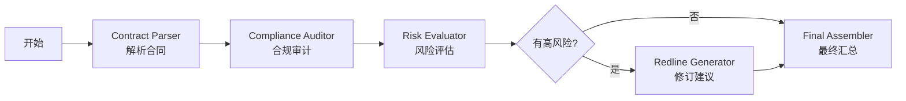

# ⚖️ 法律合同智能分析 Agent

基于 LangGraph 的法律合同智能分析系统，使用 LLM 技术实现合同的自动解析、合规审计、风险评估和修订建议生成。


## 📋 目录

- [功能特性](#功能特性)
- [技术架构](#技术架构)
- [快速开始](#快速开始)
- [安装说明](#安装说明)
- [配置说明](#配置说明)
- [使用方法](#使用方法)
- [项目结构](#项目结构)
- [API 文档](#api-docs)
- [常见问题](#常见问题)
- [开发指南](#开发指南)
- [许可证](#许可证)

## ✨ 功能特性

### 核心功能

- 📄 **智能合同解析**
  - 自动识别合同类型和签约主体
  - 提取关键条款信息
  - 结构化数据存储

- 🔍 **合规性审计**
  - 逐项检查合同条款
  - 识别合规性问题和风险点
  - 生成详细的审计报告

- ⚠️ **风险评估**
  - 智能识别高风险条款
  - 多级风险评估（高/中/低）
  - 影响分析和缓解建议

- ✏️ **修订建议生成**
  - 针对风险条款的修改建议
  - 提供具体的修改策略
  - 标注法律依据

- 📊 **多种交互方式**
  - Web UI 界面（Streamlit）
  - 命令行工具
  - PDF 报告导出

## 🏗️ 技术架构

### 工作流引擎

本项目使用 **LangGraph** 实现状态管理和条件路由：



### 技术栈

- **LLM 框架**: LangChain + LangGraph
- **Web 框架**: Streamlit
- **PDF 生成**: ReportLab
- **语言**: Python 3.9+

## 🚀 快速开始

### 前置要求

- Python 3.9+
- pip 包管理器

### 一键安装

```bash
# 克隆仓库
git clone https://github.com/AliceDai0805/legal_agent.git
cd legal_agent

# 安装依赖
pip install -r requirements.txt

# 配置 API 密钥（见配置说明）
```

### 快速运行

```bash
# 启动 Web UI
streamlit run ui.py

# 或使用命令行工具
python main.py contract_sample.txt
```

## 📦 安装说明

### 1. 克隆仓库

```bash
git clone https://github.com/AliceDai0805/legal_agent.git
cd legal_agent
```

### 2. 创建虚拟环境（推荐）

```bash
python3 -m venv venv
source venv/bin/activate  # macOS/Linux
# 或
venv\Scripts\activate  # Windows
```

### 3. 安装依赖

```bash
pip install -r requirements.txt
```

### 4. 配置 API

在 `legal_agent/.streamlit/secrets.toml` 中配置：

```toml
# OpenAI API 配置
OPENAI_API_KEY = "your_api_key_here"
OPENAI_BASE_URL = "https://open.bigmodel.cn/api/paas/v4/"
MODEL_NAME = "glm-4-flash"
```

支持多种 LLM 提供商：
- OpenAI (GPT-4, GPT-3.5)
- 智谱 AI (GLM-4 系列)
- 其他兼容 OpenAI API 的服务

## ⚙️ 配置说明

### API 配置

项目支持两种配置方式：

#### 方式 1: Streamlit Secrets（推荐用于 Web UI）

配置文件：`legal_agent/.streamlit/secrets.toml`

```toml
OPENAI_API_KEY = "your_api_key"
OPENAI_BASE_URL = "https://api.openai.com/v1"
MODEL_NAME = "gpt-4o"
```

#### 方式 2: 环境变量（用于命令行工具）

配置文件：`legal_agent/.env`

```bash
OPENAI_API_KEY=your_api_key
OPENAI_BASE_URL=https://api.openai.com/v1
MODEL_NAME=gpt-4o
```

### 配置优先级

```
Streamlit 环境：
1. .streamlit/secrets.toml (优先)
2. 系统环境变量 (后备)

命令行环境：
1. 系统环境变量
2. .env 文件
```

### 修改配置

编辑 `.streamlit/secrets.toml` 后，需要重启 Streamlit：

```bash
# 停止当前运行的 Streamlit (Ctrl+C)
# 重新启动
streamlit run legal_agent/ui.py
```

## 📖 使用方法

### Web UI 模式

```bash
cd legal_agent
streamlit run ui.py
```

功能：
- 📤 上传合同文件
- 🔍 查看分析结果
- 📊 可视化展示
- 📄 导出 PDF 报告

### 命令行模式

```bash
python legal_agent/main.py contract_sample.txt
```

输出：
```
✅ 合同解析完成
✅ 合规审计完成
✅ 风险评估完成
✅ 修订建议生成完成
```

结果保存在 `result/contract_analysis_result.json`

## 📁 项目结构

```
legal_agent/
├── ui.py                    # Streamlit Web UI 入口
├── main.py                  # 命令行工具入口
├── graph.py                 # LangGraph 工作流定义
├── state.py                 # 数据状态定义
├── pdf_generator.py          # PDF 报告生成器
├── requirements.txt          # 项目依赖
├── .streamlit/
│   └── secrets.toml        # API 密钥配置（敏感）
├── nodes/                   # 分析节点
│   ├── parser.py            # 合同解析节点
│   ├── auditor.py           # 合规审计节点
│   ├── evaluator.py         # 风险评估节点
│   └── redliner.py           # 修订建议节点
├── utils/                   # 工具函数
│   └── llm_factory.py       # LLM 工厂函数
├── .gitignore               # Git 忽略配置
├── README.md               # 本文件
├── README_UI.md             # UI 使用文档
└── SECRETS_SETUP.md         # Secrets 配置说明
```

## 🔧 API 文档

### 核心函数

#### `create_graph()`
创建并返回 LangGraph 工作流编译对象。

```python
from legal_agent.graph import create_graph

graph = create_graph()
```

#### `get_llm(model_name=None)`
获取配置好的 LLM 实例。

```python
from legal_agent.utils.llm_factory import get_llm

llm = get_llm("gpt-4o")
response = llm.invoke([HumanMessage("Hello")])
```

### 数据模型

#### AgentState

```python
class AgentState(TypedDict):
    raw_text: str                  # 原始合同文本
    metadata: Dict[str, Any]          # 合同元数据
    clauses: List[Dict[str, Any]]      # 提取的合同条款
    audit_results: List              # 合规审计结果
    risks: List[Dict[str, Any]]        # 风险评估结果
    revisions: List[Dict[str, Any]]     # 修订建议
    error_log: List[str]               # 错误日志
```

## ❓ 常见问题

### Q1: 如何更换 LLM 模型？

编辑 `.streamlit/secrets.toml`：

```toml
MODEL_NAME = "gpt-4o"  # 修改为你想要的模型
```

支持的模型：
- `gpt-4o` - OpenAI GPT-4 Omni
- `gpt-4` - OpenAI GPT-4
- `gpt-3.5-turbo` - OpenAI GPT-3.5 Turbo
- `glm-4-flash` - 智谱 GLM-4 Flash
- 其他兼容 OpenAI API 的模型

### Q2: 如何处理大文件？

大文件会被自动截断。如需处理完整文件，修改 `pdf_generator.py` 中的 `_wrap_text` 函数：

```python
def _wrap_text(self, text: str, max_length: int = 500) -> str:
    if len(text) > max_length:
        text = text[:max_length] + "..."
    return text
```

调整 `max_length` 参数来控制文本长度限制。

### Q3: 报告生成失败怎么办？

检查：
1. 确保已安装 reportlab：`pip install reportlab`
2. 检查系统是否有中文字体（macOS 自带 PingFang 字体）
3. 查看错误日志

### Q4: 如何在 Docker 中运行？

创建 `Dockerfile`：

```dockerfile
FROM python:3.9-slim
WORKDIR /app
COPY requirements.txt .
RUN pip install -r requirements.txt
COPY . .
CMD ["streamlit", "run", "ui.py", "--server.port=8501", "--server.address=0.0.0.0"]
EXPOSE 8501
```

构建并运行：

```bash
docker build -t legal-agent .
docker run -p 8501:8501 legal-agent
```

## 🛠️ 开发指南

### 添加新的分析节点

1. 在 `legal_agent/nodes/` 创建新节点文件
2. 继承 `BaseChatModel` 或使用 `get_llm()`
3. 在 `graph.py` 中注册节点

示例：

```python
# 1. 创建节点
# legal_agent/nodes/custom_node.py

# 2. 注册到图（在 graph.py 中）
workflow.add_node("custom_node", custom_node_function)
workflow.add_edge("some_node", "custom_node")
```

### 扩展 PDF 报告

编辑 `legal_agent/pdf_generator.py` 中的方法来自定义报告格式。

## 📄 许可证

本项目采用 MIT 许可证。详见 [LICENSE](LICENSE) 文件。

## 🤝 贡献

欢迎提交 Issue 和 Pull Request！

1. Fork 本仓库
2. 创建特性分支 (`git checkout -b feature/your-feature`)
3. 提交更改 (`git commit -m "Add some feature"`)
4. 推送到分支 (`git push origin feature/your-feature`)
5. 创建 Pull Request

## 📮 联系方式

- **仓库地址**: https://github.com/AliceDai0805/legal_agent
- **Issues**: https://github.com/AliceDai0805/legal_agent/issues

## 🙏 致谢

感谢使用本系统！

---

**⚠️ 免责声明**：本系统仅供学习和研究使用，不构成法律建议。重要法律事务请咨询专业律师。
