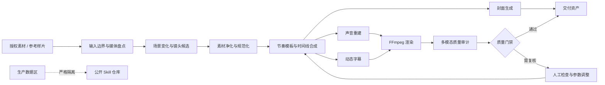

# SceneForge Video Workflow

> 面向**授权短视频素材**的场景感知剪辑、声音重建、动态字幕、封面生成与多模态质量审计 Skill。

<p align="center">
  <strong>不是固定秒数切片器，而是一套可解释、可配置、可审计的视频再创作工程框架。</strong>
</p>


<p align="center">
  产品建立镜头 · 动作与质感证明 · 微距细节展示 · 使用场景镜头
</p>

## 为什么做 SceneForge

短视频自动化不只是把多个片段拼在一起。一个可用的工作流需要同时解决：

- **在哪里切**：依据画面变化、动作完整性和镜头角色生成候选切点，而不是每隔固定秒数机械切片；
- **如何重新组织**：把参考样片抽象成节奏和镜头语法，而不是复制原时间线；
- **如何重建声音**：删除原音轨，重新生成旁白、BGM、混音和响度标准；
- **如何让信息可读**：根据真实语音时长生成 SRT/ASS 字幕，并控制安全区、描边和关键词强调；
- **如何验证结果**：同时检查画面、音频、重复帧、冻结段、完整解码和文件完整性；
- **如何安全开源**：代码、流程、配置与生产数据彻底分离，公开仓库不携带原素材、完整成片、私有报告、剪映草稿或凭据。

SceneForge 将这些步骤组织为一个 **Human-in-the-Loop** 工作流：确定性环节自动化，审美、语义和授权判断保留人工确认。

## 核心能力

| 能力域 | 当前能力 | 成熟度 |
|---|---|---|
| 媒体盘点 | 时长、分辨率、帧率、编码、音视频及字幕轨探测 | 已验证原型 |
| 场景检测 | 像素差、HSV 直方图、平滑、自适应阈值、最小镜头间隔 | 已验证原型 |
| 视觉相似性 | pHash、dHash、多视图规范化、ORB 局部特征 | 已验证原型 |
| 音频相似性 | 自定义频带指纹、时间偏移搜索、Chromaprint | 已验证原型 |
| 重复帧检测 | 黑帧、相邻重复、冻结段、非相邻复现、首尾循环候选 | 已验证原型 |
| 视频合成 | FFmpeg 裁切、缩放、调色、锐化、变速、拼接与 H.264 输出 | 已验证原型 |
| 声音重建 | 分段 TTS、程序化测试音轨、BGM Ducking、响度归一化 | 可插拔适配 |
| 动态字幕 | SRT/ASS、语义分段、时间码、描边、关键词高亮 | 已验证原型 |
| 封面生成 | 关键帧候选、3:4/9:16 构图、渐变和文字层级 | 已验证原型 |
| 时间线编辑器 | OpenCut/剪映时间线导出或导入 | 规划中的适配层 |
| 隐私发布 | framework-only 模式、路径与密钥扫描、媒体白名单 | 已定义并验证 |

> “已验证原型”表示对应链路在本地样例上完成过端到端运行，不代表第三方平台审核、推荐、版权识别或流量结果。

## 系统架构



系统分为四层：

1. **分析层**：媒体探测、场景变化、镜头角色、相似性与质量指标；
2. **编排层**：节奏模板、候选片段、旁白段落、字幕时间线和封面任务；
3. **渲染层**：FFmpeg、OpenCV、NumPy、Pillow，以及可选的 TTS/时间线编辑器适配器；
4. **治理层**：授权声明、来源记录、隐私扫描、完整性哈希和质量门禁。

详细设计见 [技术架构](docs/TECHNICAL_ARCHITECTURE.md)。

## 技术栈

| 类别 | 技术 | 在工作流中的用途 |
|---|---|---|
| 运行环境 | Python 3.10+、PowerShell | 编排、批处理、报告生成和 Windows 环境验证 |
| 媒体引擎 | FFmpeg / FFprobe | 解码、探测、滤镜、音频处理、字幕烧录、转码与完整解码验证 |
| 视频编码 | H.264 / libx264、YUV420P、`+faststart` | 生成兼容性较好的交付视频 |
| 音频编码 | AAC、48 kHz、双声道 | 交付音轨与平台通用兼容 |
| 计算机视觉 | OpenCV | 帧差、HSV 直方图、DCT、ORB、BFMatcher 和图像预处理 |
| 数值计算 | NumPy | FFT、频带能量、波形合成、包络与统计阈值 |
| 图像生成 | Pillow | 封面裁切、渐变、排版、描边和 JPEG 输出 |
| 音频指纹 | Chromaprint | 音频内容指纹的补充比较与审计记录 |
| 字幕 | SRT、ASS | 普通字幕交换、动态样式和最终烧录 |
| 数据与报告 | JSON、CSV、Markdown | 机器可读结果、逐项指标与人类可读报告 |
| 元数据索引 | SQLite（原型） | 素材来源、镜头标签和版本记录 |
| 可选时间线 | OpenCut、剪映适配器、pyJianYingDraft | 将结构化时间线映射到可视化编辑器；不随公开 Skill 打包 |
| 可选语音 | TTS 适配器 | 分段旁白生成；音色标识、API 与产物不进入公开仓库 |

## 算法概览

### 1. 场景变化检测

以约 10 FPS 对视频降采样，将帧缩放至 90×160，并综合灰度像素差与 HSV 二维直方图距离：

```text
变化分数 = 像素差 × 0.70 + Bhattacharyya 直方图距离 × 0.30
```

对分数执行 3 帧平滑，再使用自适应阈值：

```text
阈值 = max(P72, 均值 + 0.35 × 标准差)
```

候选点之间默认保持约 0.65 秒最小间隔。输出是**候选切点**，仍需结合动作完整性、镜头角色和叙事目标复核。

### 2. 感知哈希与多视图比较

- **pHash**：32×32 灰度图 → DCT → 左上 8×8 低频系数 → 中位数二值化 → 64 位哈希；
- **dHash**：9×8 灰度图 → 水平相邻像素比较 → 64 位梯度哈希；
- **综合相似度**：`0.72 × pHash + 0.28 × dHash`；
- **多视图规范化**：原画、中心裁切、9:16/3:4 前景视图、去底部字幕高发区视图分别计算，降低边框、裁切和字幕覆盖的干扰。

### 3. ORB 局部特征

使用最多 500 个 ORB 特征点、Hamming 距离、KNN `k=2` 和 Lowe Ratio Test：

```text
first.distance < 0.75 × second.distance
```

它用于补强缩放、裁切、局部遮挡和重编码后的来源匹配，不单独作为版权或平台判定结论。

### 4. 音频指纹

自定义频谱指纹链路将音频解码为 11025 Hz 单声道 PCM，采用 2048 点 FFT、1024 点 Hop 和 Hann 窗，在 80 Hz～5 kHz 之间划分 16 个几何频带，计算频带能量与时间差分，形成 31 位局部指纹，并通过滑窗搜索估计时间偏移。

同时可调用 Chromaprint 作为第二条证据链。编码格式、文件大小或 MD5 不被当作音频内容已经改变的证据。

### 5. 重复帧与媒体完整性

审计项目包括：黑帧、像素级完全重复、dHash 相邻近重复、连续冻结段、非相邻完整复现、首尾循环候选、全片实际解码帧数、音视频时长差和轨道参数。

- **SHA-256**：推荐用于交付文件完整性与版本记录；
- **MD5**：仅保留给旧系统兼容，不用于内容相似性判断。

更完整的算法、参数和局限性见 [算法说明](docs/ALGORITHMS.md)。

## 完整工作流

```text
授权确认
  → 输入隔离
  → FFprobe 媒体盘点
  → 参考样片风格建模
  → 场景变化候选切点
  → 原音轨/字幕轨处理
  → 片段标签与时间线合成
  → 新旁白/BGM/字幕/封面
  → FFmpeg 标准化渲染
  → pHash/dHash/ORB/音频指纹/重复帧审计
  → 人工复核
  → 交付或进入 framework-only 公开发布流程
```

工作流不通过随机噪声、不可见扰动或无意义滤镜“制造差异”，而是通过重新叙事、声音重建、构图适配和质量审计形成可解释的再创作过程。

详见 [端到端工作流](docs/WORKFLOW.md)。

## 快速开始

### 作为 Codex Skill 使用

将本目录复制到支持 Skills 的目录，并保持结构完整：

```text
sceneforge-video-workflow/
├─ SKILL.md
├─ agents/
├─ assets/
├─ docs/
└─ references/
```

示例调用：

```text
使用 $sceneforge-video-workflow，为一批已获得授权的竖屏素材设计场景感知剪辑、声音重建、字幕封面与质量审计流程。
```

```text
使用 $sceneforge-video-workflow，只生成可公开到 GitHub 的框架、示例配置和空白报告模板，不复制任何生产素材或真实报告。
```

### 配置入口

复制 [`assets/config.example.yaml`](assets/config.example.yaml)，仅填写相对路径或环境变量：

```yaml
mode: framework-only
scene_detection:
  sample_fps: 10
  minimum_gap_seconds: 0.65
visual_similarity:
  phash_weight: 0.72
  dhash_weight: 0.28
release:
  allow_real_media_in_repository: false
```

> 仓库当前提供的是 Skill、方法论和安全配置模板，不提供一键运行的完整生产脚本。这样可以避免把与特定素材、私有服务或编辑器版本强耦合的实现误包装成通用工具。

## 输出契约

生产环境可按需生成：

```text
outputs/
├─ final_video.mp4
├─ subtitles.srt
├─ subtitles.ass
├─ cover_3x4.jpg
├─ cover_9x16.jpg
├─ timeline.json
└─ audit/
   ├─ report.json
   ├─ frame_metrics.csv
   └─ report.md
```

公开 Skill 仓库默认只允许：

- `SKILL.md` 与通用文档；
- 示例配置和空白报告模板；
- 不含凭据的适配器接口说明；
- 合成数据、开放许可素材，或经权利人与隐私检查明确批准的少量演示截图。

## 质量门禁

交付前至少检查：

- 视频能否从头到尾完整解码；
- 是否存在异常黑帧、长冻结、非预期重复或黑屏补时长；
- 音视频时长差是否在配置阈值内；
- 原音轨、字幕轨和数据轨是否按要求移除；
- 烧录字幕是否位于安全区，时间线是否单调且无明显重叠；
- 输出分辨率、帧率、SAR、像素格式、编码和响度是否符合交付规范；
- 审计报告是否记录算法版本、参数、阈值和限制；
- 开源目录是否通过路径、凭据、隐私和媒体白名单扫描。

## 演示截图说明

本仓库中的 5 张 JPG 来自一次**已获授权的成片演示**，仅用于说明镜头组织与字幕效果：

| 截图 | 说明 |
|---|---|
| [`demo-product-reveal.jpg`](docs/images/demo-product-reveal.jpg) | 产品建立镜头，快速交代主体 |
| [`demo-texture-action.jpg`](docs/images/demo-texture-action.jpg) | 动作与质感证明，强调画面变化 |
| [`demo-macro-detail.jpg`](docs/images/demo-macro-detail.jpg) | 微距细节，承担视觉记忆点 |
| [`demo-use-case.jpg`](docs/images/demo-use-case.jpg) | 使用场景，补充具体体验 |
| [`demo-showcase.jpg`](docs/images/demo-showcase.jpg) | 四类镜头的公开展示拼图 |

截图已重新编码并移除可识别的文件元数据；仓库不包含其原始素材、完整视频、音频、剪映草稿、来源映射或真实审计报告。

## 隐私、版权与合规边界

SceneForge 面向已获得合法授权的素材处理。它不应被描述或用于：

- 绕过平台审核、内容治理或版权识别；
- 通过随机扰动、不可见水印或哈希碰撞逃避检测；
- 将 MD5 改变包装成内容原创或低相似度证明；
- 保证账号不限流、内容过审或获得推荐；
- 未经授权复制、重制或发布第三方素材。

pHash、dHash、ORB、Chromaprint 和自定义频谱指纹都是**本地工程指标**，不等于任何平台的内部模型或最终判断。

详细发布规则见 [隐私与合规](docs/PRIVACY_AND_COMPLIANCE.md)。

## 文档导航

- [技术架构](docs/TECHNICAL_ARCHITECTURE.md)：模块分层、数据流、适配器与工程设计；
- [算法说明](docs/ALGORITHMS.md)：场景检测、感知哈希、ORB、音频指纹和重复帧检测；
- [端到端工作流](docs/WORKFLOW.md)：从输入边界到交付门禁的执行顺序；
- [隐私与合规](docs/PRIVACY_AND_COMPLIANCE.md)：公开发布白名单、脱敏与风险边界；
- [流程架构参考](references/pipeline.md)：精简的数据契约和目录建议；
- [质量审计方法](references/quality-audit.md)：审计指标速查；
- [空白审计模板](assets/audit-report-template.md)：不含生产数据的报告骨架。

## Roadmap

- [ ] 提供完全基于合成素材的可运行演示；
- [ ] 抽象 FFmpeg FilterGraph 构建器；
- [ ] 增加可配置的镜头角色分类器；
- [ ] 增加时间线约束求解与自动回退；
- [ ] 提供 OpenCut 时间线适配器；
- [ ] 提供剪映草稿适配器的独立接口规范；
- [ ] 增加字幕 OCR 检查与安全区可视化；
- [ ] 增加可重复的基准测试与合成测试集；
- [ ] 增加软件物料清单、许可证和 CI 隐私扫描。

## 设计参考

本项目的文档组织和模块化表达参考了以下优秀开源项目，但不声称复制其代码或已经完成直接集成：

- [OpenCut](https://github.com/OpenCut-app/OpenCut)：开放式视频编辑器与时间线架构参考；
- [PySceneDetect](https://github.com/Breakthrough/PySceneDetect)：场景检测工具的模块化表达参考；
- [Auto-Editor](https://github.com/WyattBlue/auto-editor)：媒体自动化与命令行工作流参考；
- [Chromaprint](https://github.com/acoustid/chromaprint)：音频内容指纹技术参考；
- [FFmpeg](https://ffmpeg.org/)：媒体解码、滤镜、编码与探测基础设施；
- [OpenCV](https://opencv.org/)、[NumPy](https://numpy.org/)、[Pillow](https://python-pillow.org/)：视觉、数值计算与封面生成基础组件。

## 开源发布提醒

正式创建 GitHub 仓库前，请补充与你的发布目标相匹配的 `LICENSE`、贡献指南和安全策略。未经明确选择，本项目不替你假定开源许可证。